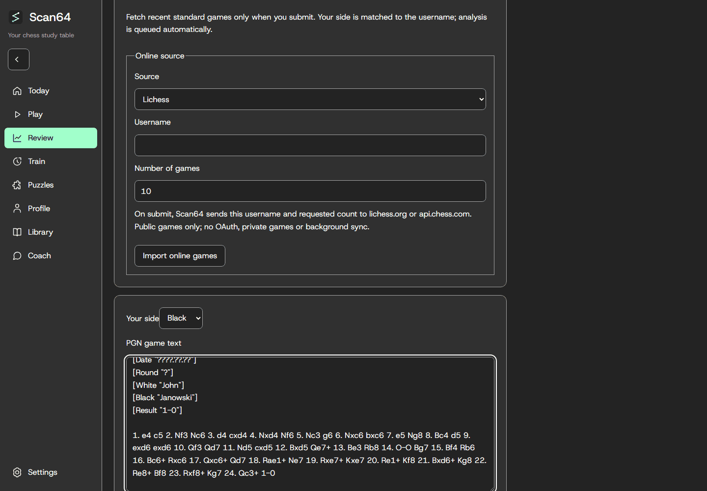
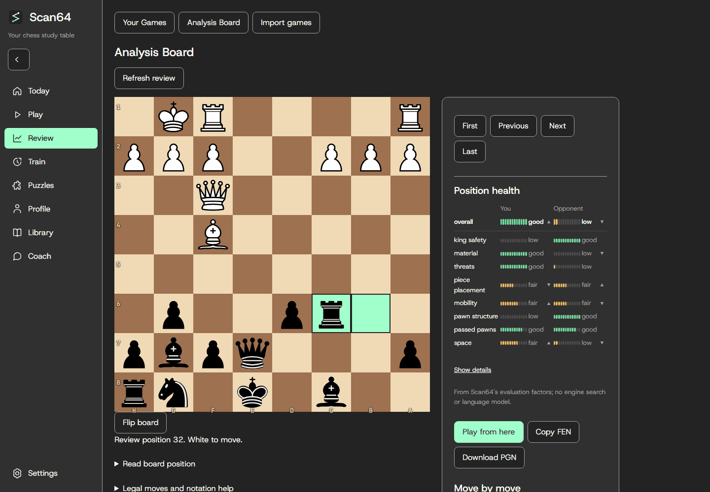
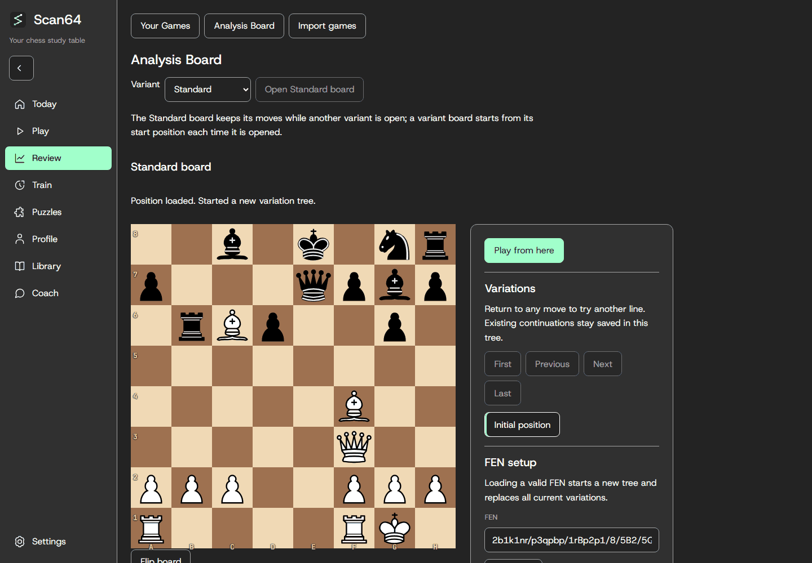

  

  
  
  

**A free, open-source chess coach that runs on your own computer.** Play, import your online games, review the moments that mattered, and practise engine-checked lessons and puzzles from the Lichess database.

**[Download the desktop app](https://github.com/Mathews-Tom/Scan64/releases/latest)** for macOS (Apple silicon), Windows or Linux. Read [Get started](https://mathews-tom.github.io/Scan64/docs/getting-started.html) first: the installers are not operating-system signed, and it shows how to check yours.

## See it in action

Import a game; the server analyses it.

Find the turning point: the move on the board and the win-probability graph, the key moment that explains it, and a retry from the position before it.

Load the position on the Analysis Board, see the engine lines and select a claim of their explanation to highlight the moves it cites.

The captures come from the current web client, driven by headless Chromium against a real server run from source (`scan64-cli serve` with Stockfish; the desktop app analyses with Caissa) and an empty database; the game is John vs Janowski, a historical game. `apps/scan64-web/scripts/capture-readme.mjs` and `scripts/readme-media/make_gifs.py` rebuild them.

## Learn more

- [Documentation](https://mathews-tom.github.io/Scan64/docs/): what Scan64 does and does not claim, installation, the user guide, engines and design.
- [Scan64 website](https://mathews-tom.github.io/Scan64/).
- [Contributing](CONTRIBUTING.md), [security policy](SECURITY.md) and [changelog](CHANGELOG.md).

Scan64 is licensed under the [GNU General Public License v3.0](LICENSE). It builds on [Stockfish](https://stockfishchess.org/), [python-chess](https://github.com/niklasf/python-chess) and [Chessground](https://github.com/lichess-org/chessground), and imports the [Lichess puzzle database](https://database.lichess.org/#puzzles) (CC0); see [THIRD_PARTY_NOTICES.md](THIRD_PARTY_NOTICES.md).
