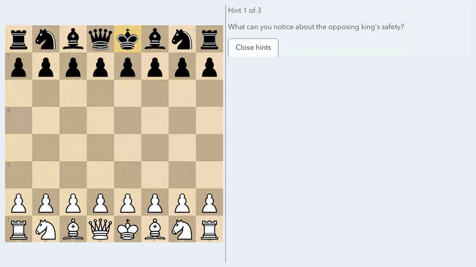
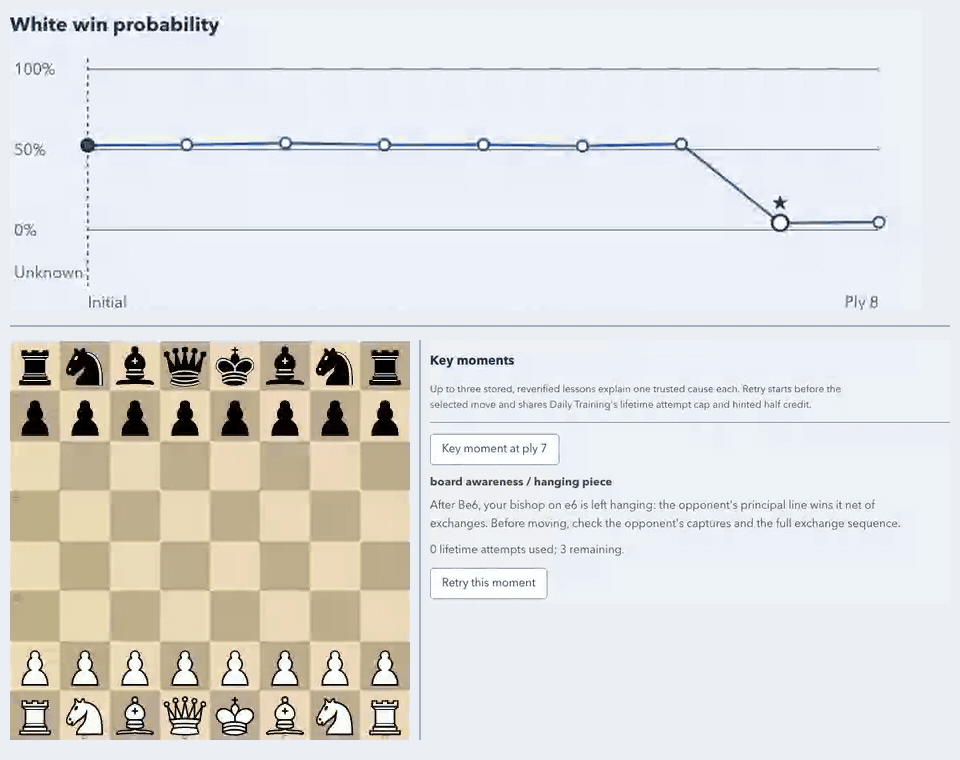
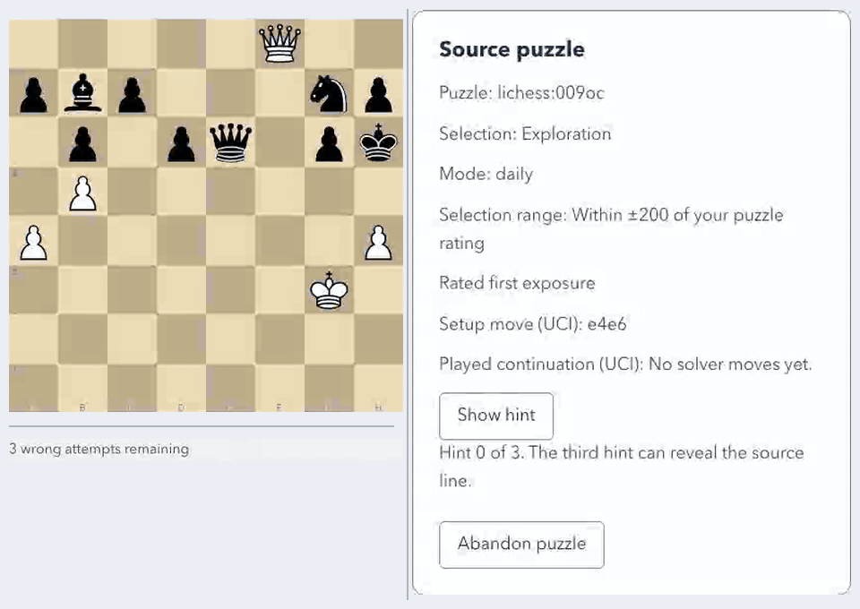
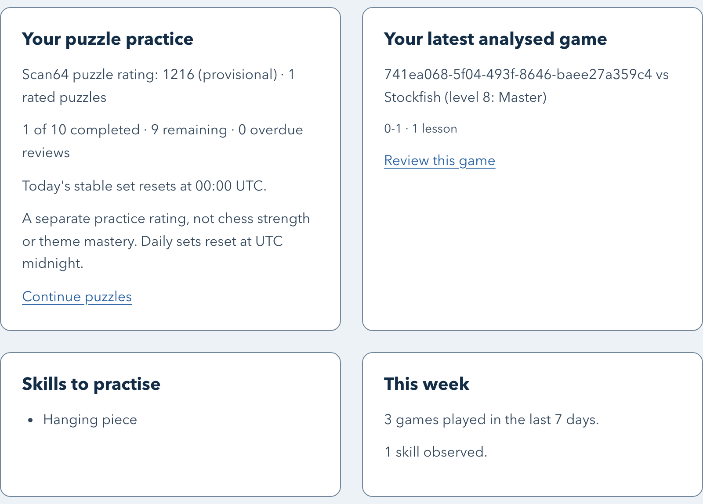
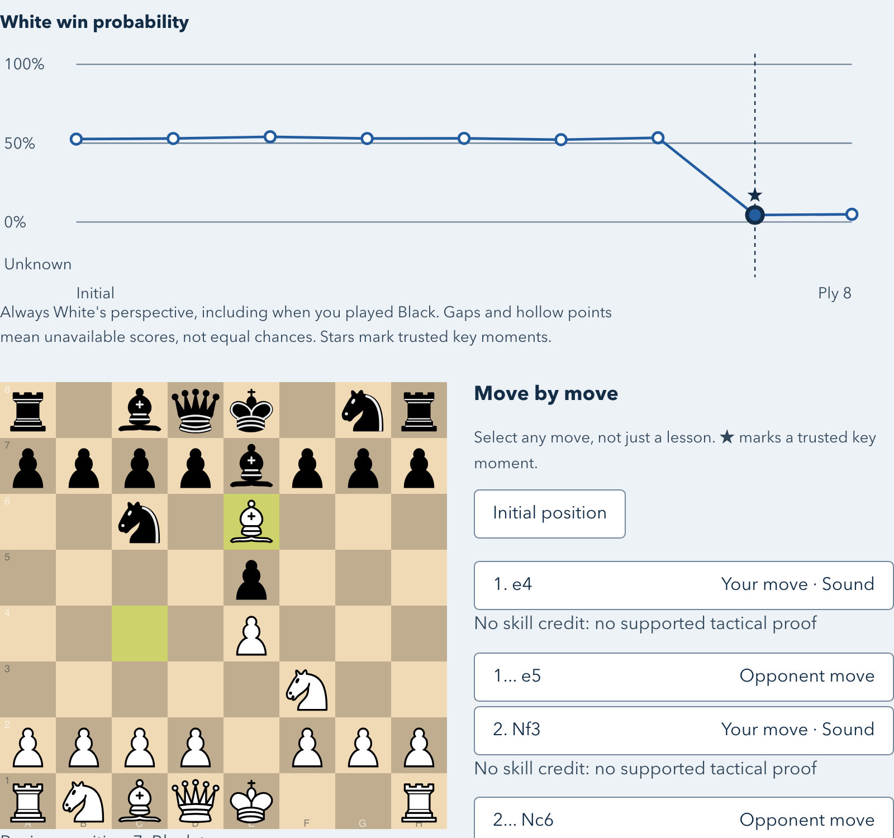
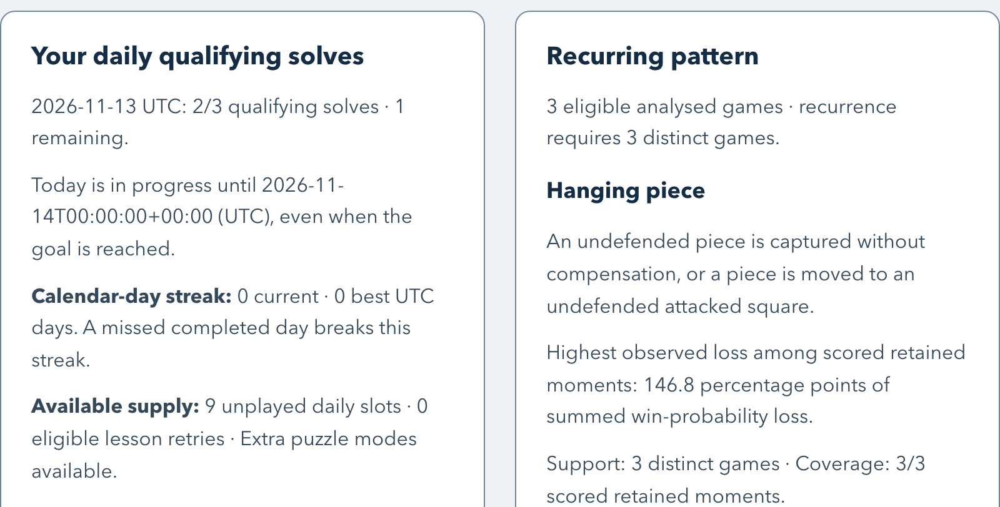
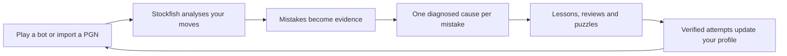

<p align="center">
  
</p>

<p align="center">
  <a href="https://github.com/Mathews-Tom/Scan64/releases/latest"></a>
  <a href="https://github.com/Mathews-Tom/Scan64/actions/workflows/ci.yml"></a>
  <a href="LICENSE"></a>
  
  
</p>

<p align="center">
  <b>A free, open-source chess coach that runs on your own computer.</b><br>
  Play a bot at your level, ask for a hint when you're stuck, replay the moments that decided the game, and practise puzzles picked from your own mistakes.
</p>

<p align="center">
  <a href="#get-started">Get started</a> ·
  <a href="#see-it-in-action">See it in action</a> ·
  <a href="docs/user-guide.md">User guide</a> ·
  <a href="CONTRIBUTING.md">Contribute</a>
</p>

---

## Why Scan64?

Most chess tools can tell you that a move was bad. Scan64 tries to help you see *why*, and then gives you something to practise. It is built for improving club players, roughly 600 to 1600, who keep losing to the same kinds of mistakes, but anyone who enjoys the game is welcome.

- **Your games are the curriculum.** Lessons, reviews and patterns come from the games you play or import, checked by Stockfish.
- **Hints that teach, not tell.** Hints come in three steps: a nudge, then the idea, then the move with arrows and a reason. You decide how much help you need.
- **Honest about what it knows.** Scan64 shows you the evidence behind every pattern and goal. It does not claim to raise your rating.
- **Private by default.** Everything runs locally. Your games and progress stay in a database on your machine, and you can export them or delete your player data whenever you like.

## See it in action

### Play a bot and ask for a hint

Pick one of eight bot levels and a colour, take moves back while you learn, and step through the hint ladder when you're stuck.

<p align="center"></p>

### Review the moments that decided the game

After a game, Scan64 analyses your moves with Stockfish and shows an accuracy figure, an evaluation graph and up to three key moments, each of which you can retry on the board.

<p align="center"></p>

### Practise puzzles

Solve multi-move puzzles from the free Lichess puzzle database. Scan64 keeps a separate puzzle rating, builds a daily set and lets you practise by theme or revisit your misses.

<p align="center"></p>

<table>
  <tr>
    <td width="33%"></td>
    <td width="33%"></td>
    <td width="33%"></td>
  </tr>
  <tr>
    <td align="center"><b>Today</b>: what to do next</td>
    <td align="center"><b>Review</b>: where the game turned</td>
    <td align="center"><b>Profile</b>: your recurring pattern</td>
  </tr>
</table>

## What you can do

| Play | Learn | Track |
| --- | --- | --- |
| Eight bot levels, either colour, take-backs and resignation | Three-step hints with tactical reasons and positional principles | Today dashboard with daily goals and a calendar streak |
| Import your own PGN games | Per-move game review with key moments and retries | Your costliest recurring pattern, with the positions behind it |
| Keyboard move entry and narrow-screen play | Lessons from your mistakes that accept the sound alternatives the engine verifies | Separate puzzle rating and bot-level trends |
| Optional human-like opponents with [Maia](docs/maia.md) | Daily puzzle sets, theme practice, solve streaks | Player-scoped [export, import and deletion](docs/user-guide.md#data-and-privacy) |

## How it works



Every lesson answer is checked by the engine or a tablebase before it can change your profile. Patterns only count evidence from your own moves, and the coverage behind each figure is always shown. See the [system overview](docs/system-overview.md) for details.

## Get started

### macOS app (Apple silicon)

1. Download `Scan64-<version>-macos-arm64.zip` from the [latest release](https://github.com/Mathews-Tom/Scan64/releases/latest) and check it against the published `.sha256` file.
2. Unzip it and drag **Scan64.app** to Applications. Python, Stockfish and everything else it needs are included.
3. The app is **unsigned and not notarized** (ad-hoc signature only). If macOS blocks the first launch, open **System Settings → Privacy & Security**, choose **Open Anyway**, then **Open**. Only do this for a download whose origin and SHA-256 you have checked, and do not disable Gatekeeper globally.

Scan64 opens your browser and a small status window. **Open Scan64** reopens the browser. **Quit Scan64**, closing the window, or **⌘Q** stops the server and engines. Opening the app again while it runs just opens the existing server.

The app uses the first free loopback port from 8001 and stores its data under `~/Library/Application Support/Scan64`, which survives app updates. Your player identity is a token kept in the browser's local storage for that exact address, so keep that storage and, if another program takes port 8001, free it and relaunch so Scan64 returns to the same port. An exported archive backs up your data but cannot replace that token. You can also build the app yourself with `scripts/build-macos-app.sh`; see the [user guide](docs/user-guide.md) and [third-party notices](THIRD_PARTY_NOTICES.md).

### Docker

No local Python, Node or Stockfish needed:

```sh
docker build -t scan64 .
docker run --name scan64 -p 127.0.0.1:8001:8001 -v scan64-data:/data scan64
```

Open **http://127.0.0.1:8001**. The image supports Linux amd64 and arm64, includes checksum-verified Stockfish 18, runs as a non-root user and keeps its database in the `scan64-data` volume. Stop with Ctrl-C and resume with `docker start -a scan64`; your games survive as long as you reuse the volume.

### From source

You need [uv](https://docs.astral.sh/uv/), Python 3.12+, Node.js 24+, [pnpm](https://pnpm.io/installation) 10.33.3, and Stockfish 18+ available as `stockfish` on your `PATH`.

```sh
git clone https://github.com/Mathews-Tom/Scan64.git
cd Scan64
uv sync --locked
pnpm --dir apps/scan64-web install --frozen-lockfile
pnpm --dir apps/scan64-web build
uv run scan64-cli serve
```

This serves the app and API at **http://127.0.0.1:8001** and opens your browser. Use `--no-browser` to skip that, or `--port 8061` for another port. Scan64 binds to loopback only; it is not a hardened LAN or hosted deployment. To keep the database somewhere specific:

```sh
SCAN64_DATABASE_URL="sqlite:////absolute/path/to/scan64.db" uv run scan64-cli serve
```

### Your first session

Enter a display name and choose **Start learning**. Tell Scan64 roughly how strong you are and it suggests a bot level. From **Today** you can Play, Train or Review; **Library** holds the study and import screens.

Puzzles need a one-time import of the free [Lichess puzzle database](https://database.lichess.org/#puzzles) (CC0). Nothing is downloaded automatically:

```sh
uv run scan64-cli puzzles import --download --json
```

The download is about 310 MB. See [Import a puzzle catalog](docs/user-guide.md#import-a-puzzle-catalog) for local files, Docker and filters. The macOS app has no built-in importer yet; the guide explains how to import into its database from a source checkout.

## What Scan64 does not claim

- It has not been shown to improve over-the-board results or ratings. Bot levels have no Elo figure.
- Lesson hints are reported by the app rather than proven by the server, and the user guide says so.
- Accessibility targets WCAG 2.2 AA on every route, but the hands-on Safari/VoiceOver pass is still pending. See [keyboard use and accessibility](docs/user-guide.md#keyboard-touch-and-screen-readers).
- There is no hosted service, published container image, PyPI package or signed desktop app.

## Documentation

| Use Scan64 | Understand it | Build on it |
| --- | --- | --- |
| [User guide](docs/user-guide.md) | [System overview](docs/system-overview.md) | [Contributing](CONTRIBUTING.md) |
| [Maia opponents](docs/maia.md) | [System design](docs/system-design.md) | [Web client guide](apps/scan64-web/README.md) |
| [Opening families](docs/content/opening-families.md) | [LessonSpec package](packages/chess-lesson-spec/README.md) | [Changelog](CHANGELOG.md) |
| [Live API reference](http://127.0.0.1:8001/docs) (while running) | [Project brief](docs/pitch.md) | [Security policy](SECURITY.md) |

### Development

`scripts/run.sh` starts the development setup: the API on `http://127.0.0.1:8001` and the hot-reloading Vite client on `http://127.0.0.1:5173`. The API does not reload, so restart the script after Python changes. `scripts/check.sh` runs the full local gate (Ruff, mypy, pytest, the web build and tests, and Playwright); it needs `stockfish` on `PATH` and port 5173 free.

### Optional extras

- **Maia weights.** Scan64 never bundles, downloads or hosts Maia weights. If you have the right to use a checkpoint, follow the [Maia guide](docs/maia.md).
- **LLM wording.** Explanations are deterministic templates by default. An operator can configure a provider through `SCAN64_LLM_CONFIG`; generated text is validated against the diagnosis evidence before use.

## Contributing

Bug reports, ideas and pull requests are welcome. Read [CONTRIBUTING.md](CONTRIBUTING.md) to set up and run the checks. Report security issues privately as described in [SECURITY.md](SECURITY.md).

## License and credits

Scan64 is licensed under the [GNU General Public License v3.0](LICENSE).

It builds on [Stockfish](https://stockfishchess.org/), [python-chess](https://github.com/niklasf/python-chess) and [Chessground](https://github.com/lichess-org/chessground) (all GPL-3.0-or-later), and imports the [Lichess puzzle database](https://database.lichess.org/#puzzles) (CC0). See [THIRD_PARTY_NOTICES.md](THIRD_PARTY_NOTICES.md) for the full list.
