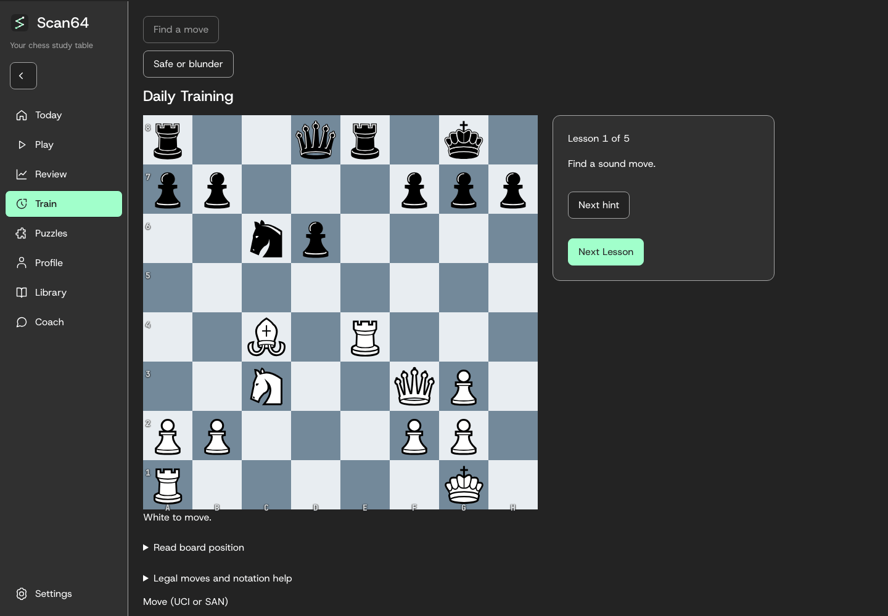
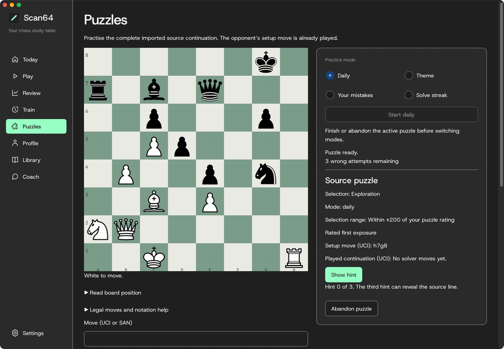
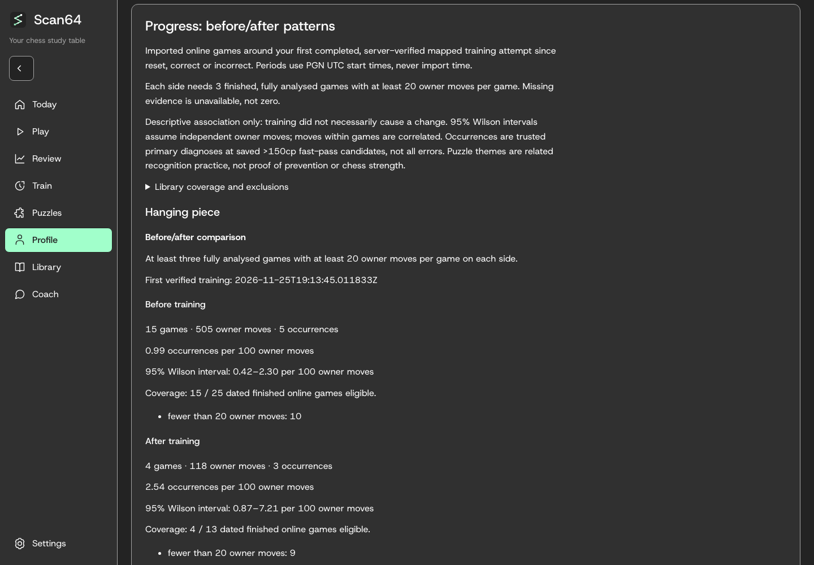

<p align="center">
  
</p>

<p align="center">
  <a href="https://github.com/Mathews-Tom/Scan64/releases/latest"></a>
  <a href="https://github.com/Mathews-Tom/Scan64/actions/workflows/ci.yml"></a>
  <a href="LICENSE"></a>
  
  
</p>

<p align="center">
  <b>A free, open-source chess coach that runs on your own computer.</b><br>
  Play, import your online games, review the moments that mattered, and practise engine-checked lessons and solve puzzles from the Lichess database.
</p>

<p align="center">
  <a href="#get-started">Get started</a> ·
  <a href="#see-it-in-action">See it in action</a> ·
  <a href="docs/user-guide.md">User guide</a> ·
  <a href="CONTRIBUTING.md">Contribute</a>
</p>

---

## Why Scan64?

Most chess tools can tell you that a move was bad. Scan64 tries to help you see *why*, and then gives you something to practise. It is built for improving club players, roughly 600 to 1600, who keep losing to the same kinds of mistakes, but anyone who enjoys the game is welcome.

- **Your games are the curriculum.** Import by Lichess or Chess.com username, paste a PGN, or play here. Stockfish turns supported mistakes into lessons and evidence-linked patterns.
- **Help at the right depth.** Three-step hints go from a nudge to the idea to sound moves. Candidates and an optional blunder guard let you examine choices before committing.
- **Evidence, not promises.** Profile shows game insights, recurring patterns and before/after recurrence with sample sizes. A change is not proof that training caused it, or that your rating improved.
- **Local-first.** Games and progress stay on your computer. Online imports, **Download puzzles** from Lichess, desktop updates and optional local model wording have explicit network boundaries; no online Scan64 account is needed. See [Stable from 1.0](#stable-from-10) for the compatibility boundary.

## See it in action

These are **headless Chromium captures of the current React client**, at 1440 × 1000 in dark mode. They use disposable demo players, public Lichess games and genuine CC0 puzzles—not the maintainer's data or native desktop windows. Insights and Progress share one demo state; the other scenes show a separate session. The desktop app runs the same client.

### Play a bot and ask for a hint

Pick one of eight relative bot levels, a colour and an optional clock. Untimed games allow takebacks; hints reveal a nudge, an idea, then sound moves with arrows and reasons.

<p align="center"></p>

### Turn a reviewed mistake into practice

Replay every move with Stockfish accuracy and coverage, an evaluation graph, and up to three trusted key moments to retry. Daily Training brings your eligible lessons back on a review schedule; this recording follows a real game-derived lesson through hints to a server-verified answer. The Analysis Board also lets you explore up to three engine lines and save variations as PGN.

<p align="center"></p>

### Practise puzzles

Solve multi-move puzzles from the free Lichess puzzle database. Scan64 keeps a separate puzzle rating, builds a daily set and lets you practise by theme or revisit your misses.

<p align="center"></p>

<table>
  <tr>
    <td width="50%"><a href="assets/screenshot-today.png"></a></td>
    <td width="50%"><a href="assets/screenshot-review.png"></a></td>
  </tr>
  <tr>
    <td align="center"><b>Today</b>: choose your next session</td>
    <td align="center"><b>Review</b>: inspect a turning point</td>
  </tr>
  <tr>
    <td><a href="assets/screenshot-profile.png"></a></td>
    <td><a href="assets/screenshot-patterns.png"></a></td>
  </tr>
  <tr>
    <td align="center"><b>Insights</b>: 895 scored owner moves</td>
    <td align="center"><b>Progress</b>: 1.13 → 1.87 per 100 moves—not a causal claim</td>
  </tr>
</table>

## What you can do

| Play and review | Practise | Understand your progress |
| --- | --- | --- |
| Eight bot levels; untimed or 1+0, 3+2, 5+0 and 10+5 | Engine-checked lessons; FSRS-scheduled lesson and eligible puzzle reviews | Game insights by phase, colour and opening; clock-pressure coverage when available |
| Three-step hints, Candidates and opt-in blunder guard | **Safe or blunder**: choose a sound move over your played mistake | Recurring patterns with source positions, game counts and scored coverage |
| **Review → Import games**: Lichess/Chess.com username or PGN | **Convert the win**: separate sparring from eligible review positions | Before/after pattern recurrence with game/move counts, intervals and insufficient-data states—not a causal claim |
| Per-move review, key moments and an Analysis Board with engine lines | Daily puzzles, theme runs, missed-puzzle retries and a separate puzzle rating | Daily goals, calendar streaks, named skills and bot results by level and time control, excluding assisted games |
| Premoves, annotations, keyboard moves and board appearance choices | Import a repertoire PGN, practise due decisions and compare imported-game deviations | Download a local coach packet with a pattern summary and annotated PGN evidence |

**Library → Community lesson packs** installs local JSON packs and re-verifies their solver moves with your engine. Pack play **never changes progress or review schedules**; keep the original files because player exports exclude packs. Optional [Maia opponents](docs/maia.md) require operator-provided weights.

## How it works

```text
Play or import → Stockfish analysis → supported diagnosis → lesson → verified answer
       ↑                                                                    ↓
       └──────────── Profile evidence and scheduled practice ───────────────┘
```

Lesson answers are checked on the server before they update skills and matching review schedules; hints remain app-reported. Patterns use your own moves and show their evidence coverage. Related puzzle themes are practice, not a new diagnosis. [Optional local Ollama wording](docs/user-guide.md#optional-local-explanation-wording) is off by default: built-in explanations need no model, and generated wording must pass evidence checks. See the [system overview](docs/system-overview.md).

## Get started

### Install the desktop app

The unified desktop app opens Scan64 in one window, without a browser tab. It bundles Python and Stockfish; no developer tools or separate engine are needed.

**Download the installer for your platform from the [latest published Scan64 release](https://github.com/Mathews-Tom/Scan64/releases/latest).** [Desktop CI](https://github.com/Mathews-Tom/Scan64/actions/workflows/desktop.yml) artifacts are test builds, not release installers.

**Upgrading from 0.6.1 or earlier:** the old macOS app cannot update itself. Delete it and install the current desktop release by hand. Its data is not migrated.

| Platform | Release asset | Install and open |
| --- | --- | --- |
| **macOS Apple silicon (arm64)** | `.dmg` | Open the disk image, drag **Scan64** into **Applications**, eject the image and launch Scan64 from Applications. |
| **Windows x64** | `-setup.exe` | Run the installer, then launch Scan64 from the Start menu. Installation is for your current user, without administrator rights. |
| **Linux x64 — AppImage** | `.AppImage` | Make the downloaded AppImage executable, then run it from your download folder. Requires FUSE support; otherwise use the Debian package. |
| **Linux x64 — Debian/Ubuntu** | `.deb` | [Install the downloaded package with `apt`](docs/user-guide.md#install-on-your-os), then launch Scan64 from the application menu. |

See [Open an unsigned installer safely](#open-an-unsigned-installer-safely) before the first launch on macOS or Windows.

The desktop app includes signed in-app updates: **Settings → Updates** checks GitHub Releases, downloads in the background by default, and waits for **Restart to update**. It never restarts automatically. Linux `.deb` installs instead link to the release download. See the [updates guide](docs/user-guide.md#updates).

### Open an unsigned installer safely

Scan64 is a free project with one developer, and it does not pay for Apple Developer ID or Windows code-signing certificates. The macOS app is ad-hoc signed and not notarized. The Windows installer has no Authenticode signature. Your operating system therefore cannot confirm who built the download and warns you on first launch. These warnings do not mean the app is harmful, but they also do not tell you it is safe. The steps below confirm that your file is exactly the one published on the Scan64 release, not a corrupted or swapped copy; whether to trust that release is still your decision.

**1. Download only from the [Scan64 releases page](https://github.com/Mathews-Tom/Scan64/releases/latest).** Other mirrors, Desktop CI artifacts and files sent to you by someone else are not release installers.

**2. Check the file's SHA-256 against the release.** GitHub lists a `sha256:` digest for every release file. With the [GitHub CLI](https://cli.github.com/), print the latest release's digests with `gh release view --repo Mathews-Tom/Scan64 --json assets --jq '.assets[] | [.digest, .name] | @tsv'`. Hash your download with the command below. Then compare its output with the hex after `sha256:` for the same file name. Every character must match; letter case does not matter.

| System | Command |
| --- | --- |
| macOS | `shasum -a 256 ~/Downloads/Scan64_*_aarch64.dmg` |
| Windows (PowerShell) | `Get-FileHash $HOME\Downloads\Scan64_*_x64-setup.exe -Algorithm SHA256 \| Format-List Path,Hash` |
| Linux AppImage | `sha256sum ~/Downloads/Scan64_*_amd64.AppImage` |
| Linux Debian/Ubuntu | `sha256sum ~/Downloads/Scan64_*_amd64.deb` |

If the values differ, delete the file and download it again. Do not open a file whose digest does not match.

**3. macOS: allow Scan64 once.**

1. Drag Scan64 to **Applications** and open it. macOS refuses because it cannot verify the developer. Choose **Done**, not **Move to Trash**.
2. Open **System Settings → Privacy & Security**. Under **Security**, select **Open Anyway** next to the Scan64 message. The button appears for about an hour after the blocked launch; open Scan64 again if it is missing.
3. Confirm **Open Anyway** and enter your login password. macOS remembers this exception for Scan64.

Since macOS 15, Control-click → **Open** no longer bypasses this check; use **Open Anyway**. If the **Open Anyway** button never appears, you can instead remove the download flag from this one app in Terminal: `xattr -dr com.apple.quarantine /Applications/Scan64.app`. On a Mac managed by your work or school, ask its administrator rather than working around their settings. Never turn Gatekeeper off for the whole Mac with `spctl --master-disable` or similar. **If macOS says Scan64 is damaged or will damage your computer, stop.** That is not the unsigned-developer warning. Delete the file and download it again, then check the digest.

**4. Windows: get past SmartScreen.**

- If **Windows protected your PC** appears, select **More info**, check that the file name is the one you verified, then select **Run anyway**.
- Alternatively, before running the installer, right-click it, choose **Properties**, tick **Unblock** and select **OK**. This removes the downloaded-from-the-internet mark from that one file.
- **Smart App Control** blocks unsigned apps that it has no reputation data for, and it offers no per-app exception. If it blocks the installer, the only way to run Scan64 is to turn Smart App Control off in **Windows Security → App & browser control → Smart App Control settings**. That removes its protection for every app, so decide whether the trade-off is acceptable for your PC before you change it.

**5. Linux needs no bypass.** AppImages and `.deb` packages carry no platform signature to check; verify the digest as in step 2.

**After installation, updates are verified for you.** On macOS, Windows and the AppImage, **Settings → Updates** installs an update only if its signature matches Scan64's update key (key id `A1BF33DC0D262D9E`, listed in [SECURITY.md](SECURITY.md)). This is separate from operating-system code signing. The `.deb` package does not update itself. Whenever you install a version by downloading it yourself, including every `.deb` update, repeat steps 1, 2 and the step for your system.

### Build the macOS app (Apple silicon)

You can also build the unified desktop app locally.
It opens one window with the whole client, not a browser tab or a status window.
You need Xcode Command Line Tools, Rust, uv with managed Python 3.12+, Node.js 24+ and pnpm 10.33.3:

```sh
uv sync --locked --group build --python-preference only-managed
pnpm install --frozen-lockfile
cargo install cargo-about --version 0.8.2 --locked
pnpm --dir apps/scan64-web build
uv run --no-sync python scripts/build-server.py
SCAN64_UPDATER_DRY_RUN=1 pnpm --dir apps/scan64-desktop tauri build --config src-tauri/tauri.bundle.conf.json --bundles app
open apps/scan64-desktop/src-tauri/target/release/bundle/macos/Scan64.app
```

The build bundles Python, Stockfish 18, both networks and their licences/source; runtime needs no developer tools or system Stockfish. It is **unsigned and not notarized** (ad-hoc signing only). If macOS blocks a trusted build, use **System Settings → Privacy & Security → Open Anyway**; never disable Gatekeeper globally.

This is an explicit development dry run: it skips the production public-key guard and cannot consume production updates. The published installers use the production updater key; never use the test-only updater overlay for a release.

Quit with **⌘Q**, the application menu or by closing the window; another launch focuses the existing window. Data and logs live in `~/Library/Application Support/org.scan64.desktop`. The fixed shell origin keeps your player signed in even when the loopback server port changes; retain the app's local storage as well as its database. Older desktop data is not migrated.

Use **Download puzzles** or **Choose a file…** in Puzzles or **Settings → Puzzle library**. Manage app updates in **Settings → Updates**. Browser and container installation below is unchanged. See the [user guide](docs/user-guide.md) and [third-party notices](THIRD_PARTY_NOTICES.md).

### Docker

No local Python, Node or Stockfish needed:

```sh
docker build -t scan64 .
docker run --name scan64 -p 127.0.0.1:8001:8001 -v scan64-data:/data scan64
```

Open `http://127.0.0.1:8001`. The image supports Linux amd64 and arm64, includes checksum-verified Stockfish 18, runs as a non-root user and keeps its database in the `scan64-data` volume. Stop with Ctrl-C and resume with `docker start -a scan64`; your games survive as long as you reuse the volume.

### From source

You need [uv](https://docs.astral.sh/uv/), Python 3.12+, Node.js 24+, [pnpm](https://pnpm.io/installation) 10.33.3, and Stockfish 18+ available as `stockfish` on your `PATH`.

```sh
git clone https://github.com/Mathews-Tom/Scan64.git
cd Scan64
uv sync --locked
pnpm --dir apps/scan64-web install --frozen-lockfile
pnpm --dir apps/scan64-web build
uv run scan64-cli serve
```

This serves the app and API at `http://127.0.0.1:8001` and opens your browser. Use `--no-browser` to skip that, or `--port 8061` for another port. Scan64 binds to loopback only; it is not a hardened LAN or hosted deployment. To keep the database somewhere specific:

```sh
SCAN64_DATABASE_URL="sqlite:////absolute/path/to/scan64.db" uv run scan64-cli serve
```

### Your first session

1. Enter a display name and choose **Start learning**. Declare a starting level for an overridable bot suggestion—not an Elo estimate.
2. From **Today**, play a bot or use **Review → Import games** for a Lichess/Chess.com username or PGN. Let analysis finish, then inspect a key moment and retry it.
3. Open **Train** for a lesson or **Safe or blunder**, or start **Convert the win** from an eligible review. Profile shows game insights and patterns; sparse before/after samples say **Not enough games**.
4. Explore **Library** for repertoires and community packs. Use **Settings → Send feedback** to preview a GitHub issue draft; Scan64 sends nothing itself.

Puzzles need a one-time import of the free [Lichess puzzle database](https://database.lichess.org/#puzzles) (CC0). Nothing is downloaded automatically:

```sh
uv run scan64-cli puzzles import --download --json
```

The download is about 310 MB. See [Import a puzzle catalog](docs/user-guide.md#import-a-puzzle-catalog) for local files, Docker and filters. In the desktop app, choose **Download puzzles** or **Choose a file…** in Puzzles or **Settings → Puzzle library**.

## Stable from 1.0

Scan64 uses semantic versioning. From 1.0, these are compatibility commitments; breaking one requires a major version:

- **Saved data:** upgrading a database from v0.9.0 or later preserves player progress. Tests upgrade a populated database produced by the v0.9.0 release to the current schema. A separate test migrates a copy built at the v0.8.0 schema revision through later upgrades. The desktop app automatically copies the database before a version upgrade migrates it; source and Docker users keep their own copy.
- **Player export archives:** archives exported by v0.9.0 and by the current release import into the current release. Tests restore a real v0.9.0 export and current archive forms, including games, completed analysis, lesson and puzzle progress, skill state and review schedules. From 1.0, an archive exported by a 1.x release stays importable in later 1.x releases.
- **In-app updates:** updates are verified with the committed Tauri updater public key. This is separate from operating-system installer signing.

The internal HTTP API, CLI flags and UI layout are not stable interfaces. Untested older data is not covered; in particular, data from the older browser-based app (0.6.1 and earlier) is not migrated. These tests are not acceptance of a published 1.0 installer.

## What Scan64 does not claim

- It has not been shown to improve over-the-board results or ratings. Bot levels have no Elo figure.
- Lesson hints are reported by the app rather than proven by the server, and the user guide says so.
- Accessibility targets WCAG 2.2 AA on every route, but the hands-on Safari/VoiceOver pass is still pending. See [keyboard use and accessibility](docs/user-guide.md#keyboard-touch-and-screen-readers).
- There is no hosted service, published container image or PyPI package. Desktop installers and Linux packages are not operating-system signed; macOS builds are unsigned and not notarized (ad-hoc signing only). Updater bundles carry separate `.sig` files verified by the app; `.deb` packages do not update themselves.

## Documentation

| Use Scan64 | Understand it | Build on it |
| --- | --- | --- |
| [User guide](docs/user-guide.md) | [System overview](docs/system-overview.md) | [Contributing](CONTRIBUTING.md) |
| [Maia opponents](docs/maia.md) | [System design](docs/system-design.md) | [Web client guide](apps/scan64-web/README.md) |
| [Opening families](docs/content/opening-families.md) | [LessonSpec package](packages/chess-lesson-spec/README.md) | [Changelog](CHANGELOG.md) |
| Local API reference: `http://127.0.0.1:8001/docs` (while running) | [Project brief](docs/pitch.md) | [Security policy](SECURITY.md) |

### Development

`scripts/run.sh` starts the development setup: the API on `http://127.0.0.1:8001` and the hot-reloading Vite client on `http://127.0.0.1:5173`. The API does not reload, so restart the script after Python changes. `scripts/check.sh` runs the full local gate (Ruff, mypy, pytest, the web build and tests, and Playwright); it needs `stockfish` on `PATH` and port 5173 free.

### Optional extras

- **Maia weights.** Scan64 never bundles, downloads or hosts Maia weights. If you have the right to use a checkpoint, follow the [Maia guide](docs/maia.md).
- **Local wording.** Opt into an installed Ollama model in **Settings → Local explanation wording**. It can reword new explanations, not change engine verdicts; unavailable or rejected wording falls back to built-in templates. See the [privacy boundary](docs/user-guide.md#optional-local-explanation-wording).

## Contributing

Bug reports, ideas and pull requests are welcome. Read [CONTRIBUTING.md](CONTRIBUTING.md) to set up and run the checks. Report security issues privately as described in [SECURITY.md](SECURITY.md).

## License and credits

Scan64 is licensed under the [GNU General Public License v3.0](LICENSE).

It builds on [Stockfish](https://stockfishchess.org/), [python-chess](https://github.com/niklasf/python-chess) and [Chessground](https://github.com/lichess-org/chessground) (all GPL-3.0-or-later), and imports the [Lichess puzzle database](https://database.lichess.org/#puzzles) (CC0). See [THIRD_PARTY_NOTICES.md](THIRD_PARTY_NOTICES.md) for the full list.

The Scan64 [mark](assets/logo.svg) and [social preview](assets/social-preview.png) are available in `assets/`.
