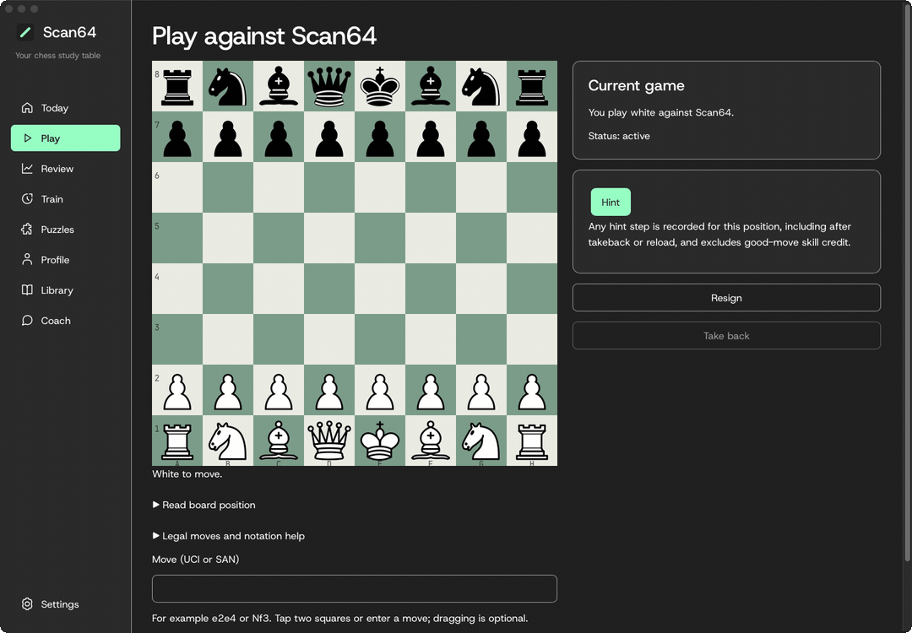
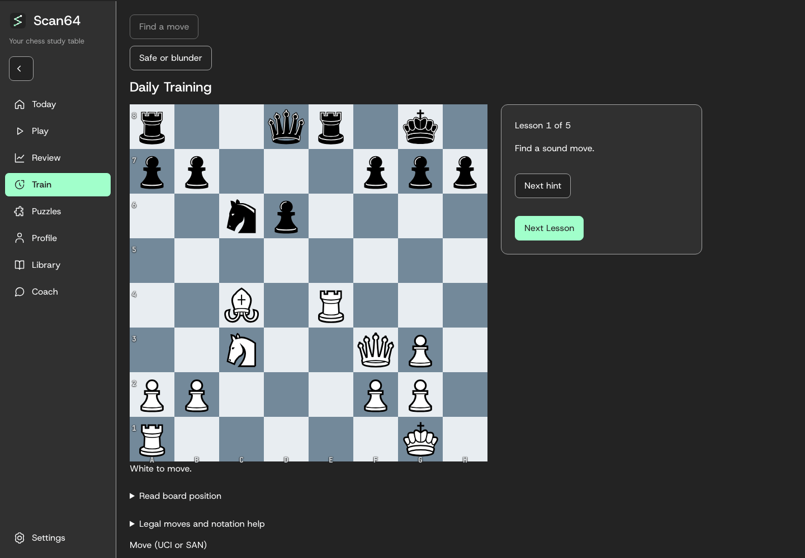
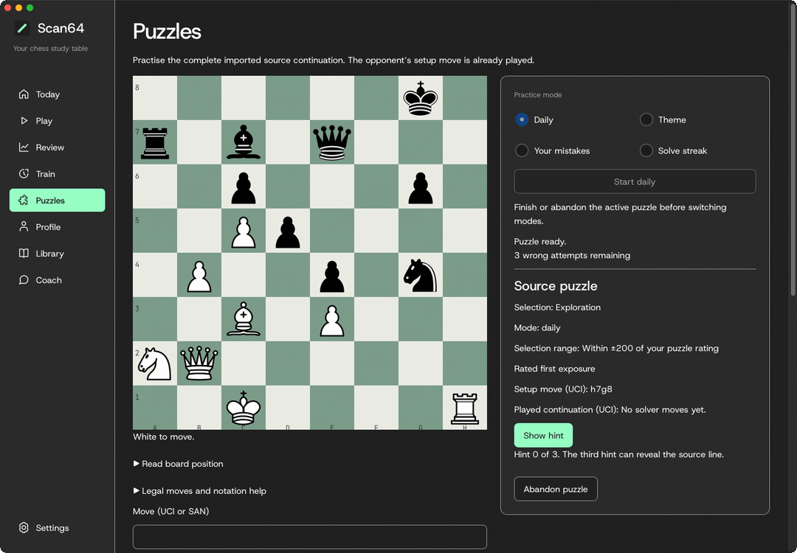
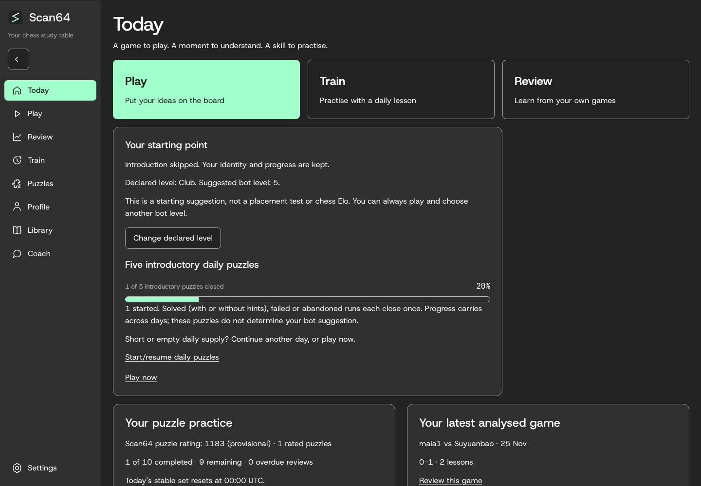
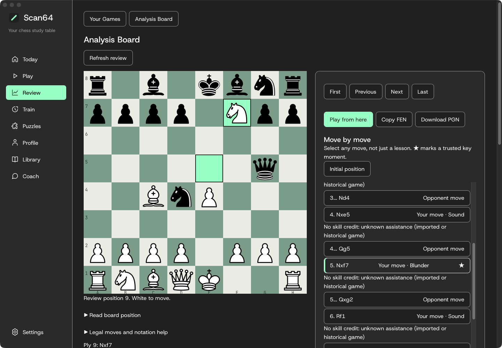
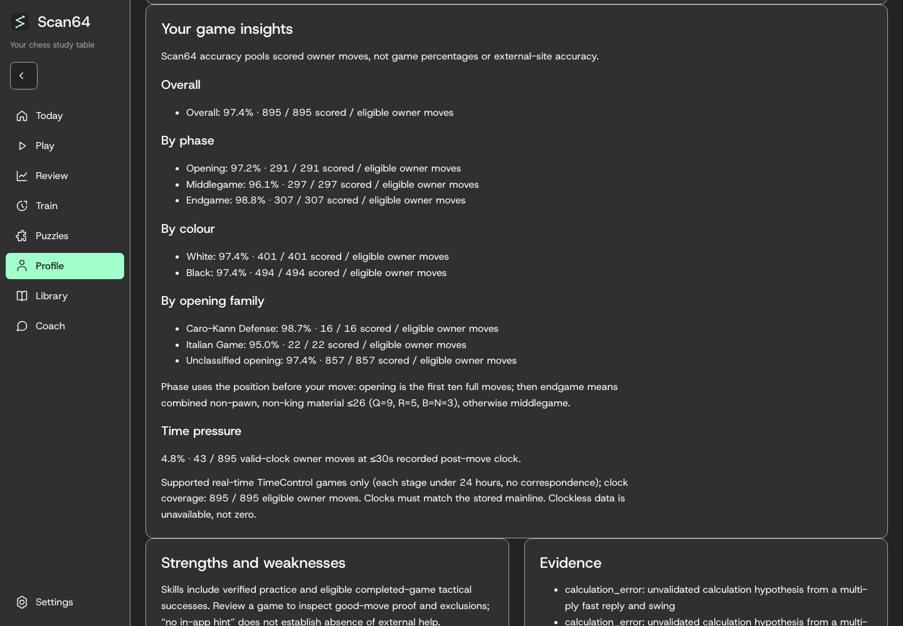
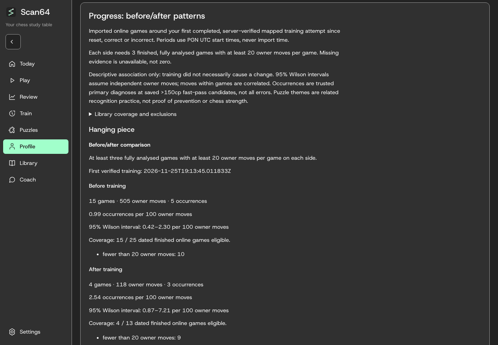

# About Scan64

## Why Scan64?

Most chess tools can tell you that a move was bad. Scan64 tries to help you see *why*, and then gives you something to practise. It is built for improving club players, roughly 600 to 1600, who keep losing to the same kinds of mistakes, but anyone who enjoys the game is welcome.

- **Your games are the curriculum.** Import by Lichess or Chess.com username, paste a PGN, or play here. Stockfish turns supported mistakes into lessons and evidence-linked patterns.
- **Help at the right depth.** Three-step hints go from a nudge to the idea to sound moves. Candidates and an optional blunder guard let you examine choices before committing.
- **Evidence, not promises.** Profile shows game insights, recurring patterns and before/after recurrence with sample sizes. A change is not proof that training caused it, or that your rating improved.
- **Local-first.** Games and progress stay on your computer. Online imports, **Download puzzles** from Lichess, desktop updates and optional local model wording have explicit network boundaries; no online Scan64 account is needed. See [Stable from 1.0](#stable-from-10) for the compatibility boundary.

## See it in action

These are **headless Chromium captures of the current React client**, at 1440 × 1000 in dark mode with the default board appearance. They use a disposable demo player, public Lichess games and genuine CC0 puzzles—not the maintainer's data or native desktop windows. Insights and Progress share one completed analysis state; the other scenes follow the same demo player's play, review and practice. The desktop app runs the same client.

### Play a bot and ask for a hint

Pick one of eight relative bot levels, a colour and an optional clock. Untimed games allow takebacks; hints reveal a nudge, an idea, then sound moves with arrows and reasons.

<p align="center"></p>

### Turn a reviewed mistake into practice

Replay every move with Scan64 accuracy and coverage, an evaluation graph, and up to three trusted key moments to retry. Daily Training brings your eligible lessons back on a review schedule; this recording follows a real game-derived lesson through hints to a server-verified answer. The Analysis Board also lets you explore up to three engine lines and save variations as PGN.

<p align="center"></p>

### Practise puzzles

Solve multi-move puzzles from the free Lichess puzzle database. Scan64 keeps a separate puzzle rating, builds a daily set and lets you practise by theme or revisit your misses.

<p align="center"></p>

<table>
  <tr>
    <td width="50%"><a href="../assets/screenshot-today.png"></a></td>
    <td width="50%"><a href="../assets/screenshot-review.png"></a></td>
  </tr>
  <tr>
    <td align="center"><b>Today</b>: choose your next session</td>
    <td align="center"><b>Review</b>: inspect a turning point</td>
  </tr>
  <tr>
    <td><a href="../assets/screenshot-profile.png"></a></td>
    <td><a href="../assets/screenshot-patterns.png"></a></td>
  </tr>
  <tr>
    <td align="center"><b>Insights</b>: 834 scored owner moves</td>
    <td align="center"><b>Progress</b>: 0.99 → 2.54 per 100 moves—not a causal claim</td>
  </tr>
</table>

## What you can do

| Play and review | Practise | Understand your progress |
| --- | --- | --- |
| Eight bot levels; untimed or 1+0, 3+2, 5+0 and 10+5 | Engine-checked lessons; FSRS-scheduled lesson and eligible puzzle reviews | Game insights by phase, colour and opening; clock-pressure coverage when available |
| Three-step hints, Candidates and opt-in blunder guard | **Safe or blunder**: choose a sound move over your played mistake | Recurring patterns with source positions, game counts and scored coverage |
| **Review → Import games**: Lichess/Chess.com username or PGN | **Convert the win**: separate sparring from eligible review positions | Before/after pattern recurrence with game/move counts, intervals and insufficient-data states—not a causal claim |
| Per-move review, key moments and an Analysis Board with engine lines | Daily puzzles, theme runs, missed-puzzle retries and a separate puzzle rating | Daily goals, calendar streaks, named skills and bot results by level and time control, excluding assisted games |
| Premoves, annotations, keyboard moves and board appearance choices | Import a repertoire PGN, practise due decisions and compare imported-game deviations | Download a local coach packet with a pattern summary and annotated PGN evidence |

**Library → Community lesson packs** installs local JSON packs and re-verifies their solver moves with your engine. Pack play **never changes progress or review schedules**; keep the original files because player exports exclude packs. Optional [Maia opponents](maia.md) require operator-provided weights.

## How it works

```text
Play or import → Stockfish analysis → supported diagnosis → lesson → verified answer
       ↑                                                                    ↓
       └──────────── Profile evidence and scheduled practice ───────────────┘
```

Lesson answers are checked on the server before they update skills and matching review schedules; hints remain app-reported. Patterns use your own moves and show their evidence coverage. Related puzzle themes are practice, not a new diagnosis. [Optional local Ollama wording](user-guide.md#optional-local-explanation-wording) is off by default: built-in explanations need no model, and generated wording must pass evidence checks. See the [system overview](system-overview.md).

## Stable from 1.0

Scan64 uses semantic versioning. From 1.0, these are compatibility commitments; breaking one requires a major version:

- **Saved data:** upgrading a database from v0.9.0 or later preserves player progress. Tests upgrade a populated database produced by the v0.9.0 release to the current schema. A separate test migrates a copy built at the v0.8.0 schema revision through later upgrades. The desktop app automatically copies the database before a version upgrade migrates it; source and Docker users keep their own copy.
- **Player export archives:** archives exported by v0.9.0 and by the current release import into the current release. Tests restore a real v0.9.0 export and current archive forms, including games, completed analysis, lesson and puzzle progress, skill state and review schedules. From 1.0, an archive exported by a 1.x release stays importable in later 1.x releases.
- **In-app updates:** updates are verified with the committed Tauri updater public key. This is separate from operating-system installer signing.

The internal HTTP API, CLI flags and UI layout are not stable interfaces. Untested older data is not covered; in particular, data from the older browser-based app (0.6.1 and earlier) is not migrated. These tests are not acceptance of a published 1.0 installer.

## What Scan64 does not claim

- It has not been shown to improve over-the-board results or ratings. Bot levels have no Elo figure.
- Lesson hints are reported by the app rather than proven by the server, and the user guide says so.
- Accessibility targets WCAG 2.2 AA on every route, but the hands-on Safari/VoiceOver pass is still pending. See [keyboard use and accessibility](user-guide.md#keyboard-touch-and-screen-readers).
- There is no hosted service, published container image or PyPI package. Desktop installers and Linux packages are not operating-system signed; macOS builds are unsigned and not notarized (ad-hoc signing only). Updater bundles carry separate `.sig` files verified by the app; `.deb` packages do not update themselves.

## Contributing

Bug reports, ideas and pull requests are welcome. The [roadmap](roadmap.md) lists features open for contributors, with items ready to start marked **Ready**. Read [CONTRIBUTING.md](../CONTRIBUTING.md) to set up and run the checks. Report security issues privately as described in [SECURITY.md](../SECURITY.md).

## License and credits

Scan64 is licensed under the [GNU General Public License v3.0](../LICENSE).

It builds on [Stockfish](https://stockfishchess.org/), [python-chess](https://github.com/niklasf/python-chess) and [Chessground](https://github.com/lichess-org/chessground) (all GPL-3.0-or-later), and imports the [Lichess puzzle database](https://database.lichess.org/#puzzles) (CC0). See [THIRD_PARTY_NOTICES.md](../THIRD_PARTY_NOTICES.md) for the full list.

The Scan64 [mark](../assets/logo.svg) and [social preview](../assets/social-preview.png) are available in `assets/`.
