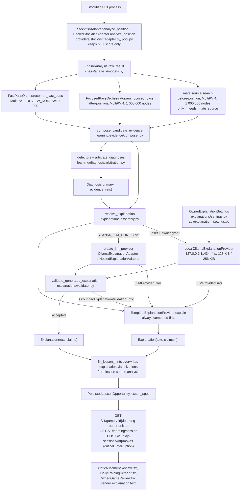

# Narrator pipeline: how engine variations reach the explanation LLM

Status: describes the code at commit `8f0071168be9d4a31f4573246660c76977a3b94d` (branch `epic/371`). It describes current behaviour only. Issue #361.

The narrator is an optional LLM that words a lesson explanation. The engine and the deterministic detectors decide every chess fact. The LLM receives evidence the server has already composed. Its output is shown only if `validate_generated_explanation` accepts it. Otherwise the deterministic template is shown.

Paths are relative to the repository root. `file:line` references are line numbers at the commit above.

## 1. Flow overview

## 2. Engine analysis (`src/scan64/providers/stockfish/`)

Both adapters run `chess.engine` `analyse(board, limit, multipv=multipv)` and reduce each info dict to two fields:

| Source | Kept | Form |
|---|---|---|
| `StockfishAdapter.analyze_position` (`adapter.py:76-124`) | `pv` | list of UCI strings, full length as Stockfish reports it |
| same | `score` | `score_cp` or `score_mate`, relative to the side to move (`info["score"].pov(board.turn)`) |
| `PooledStockfishAdapter.analyze_position` (`pool.py:127-178`) | same two fields | same |

Dropped by both adapters (not copied into `raw_result`): `depth`, `seldepth`, `nodes`, `nps`, `time`, `hashfull`, `tbhits`, the `multipv` index, `lowerbound`/`upperbound` flags, `currmove`, `refutation`, `string`. WDL is not produced: neither adapter sets `UCI_ShowWDL`.

`EngineAnalysis.config` (`chess/analysis/models.py:21-29`) records the engine identity and the *requested* limits (`nodes`, `depth`, `time_ms`, `multipv`), not the depth reached. The adapter does not cut PV length. Every later cut happens downstream.

`PoolBoundAdapter` (`pool.py:235-260`) and `BatchAnalysisAdapter` (`chess/analysis/reuse.py:34`) produce the same `raw_result` shape. `BatchAnalysisAdapter` reuses saved rows keyed by FEN and config.

## 3. Analysis jobs and the focused pass (`src/scan64/chess/analysis/`)

`resolve_explanation` has three callers. Each one feeds `compose_candidate_evidence` different engine budgets:

| Caller | Fast pass (`fast_analysis`, `reply_analysis`) | `focused_analysis` | Mate source | LLM provider | Time budget around the LLM |
|---|---|---|---|---|---|
| `run_analysis_for_game` (`jobs.py:91`) | `FastPassConfig(nodes=REVIEW_NODES)`; `REVIEW_NODES = 10_000` (`review.py:12`), MultiPV 1 | `FocusedPassConfig(nodes=1_000_000, multipv=4)` on the **after** position (`jobs.py:150-158`) | 1 000 000 nodes, MultiPV 4, before position (`jobs.py:195-198`) | operator config, else `read_local_explanation_provider` (`jobs.py:332-337`) | Local Ollama 4 s; hosted: httpx default 5 s per request (the `httpx.AsyncClient()` that `resolve_explanation` opens at `assembly.py:162`) |
| `analyse_command` (`cli/analyse.py:26`) | `FastPassConfig(nodes=10000)` (`analyse.py:48`), MultiPV 1 | `analyze_position(candidate.fen, nodes=1_000_000, multipv=4)` (`analyse.py:84`) | same as above (`analyse.py:86-90`) | operator config only; no `local_provider` (`analyse.py:153`) | as above |
| `prepare_coach_interruption` (`coach_interruption.py:146`), called from `play_session_service.py:449,686` | `analyze_interactive(nodes=COACH_DIAGNOSTIC_NODES)`, 10 000 nodes, MultiPV 1 (`coach_interruption.py:205-210`) | **`after_analysis` reused**: 10 000 nodes, MultiPV 1 (`coach_interruption.py:250`) | as above (`coach_interruption.py:237-241`) | operator config, else local grant (`_resolve_coach_explanation`, `coach_interruption.py:130-143`) | `COACH_EXPLANATION_TIMEOUT_SECONDS = 0.25` for consent read plus generation; on `TimeoutError`, template |

`FastPassOrchestrator.run_fast_pass` (`orchestration.py:144`) flags a candidate when the mover's swing exceeds `swing_threshold_cp` (150). `FocusedPassOrchestrator.run_focused_pass` (`orchestration.py:224`) searches `candidate.fen`, the position **after** the mistake, with the opponent to move.

The lesson source search `analyze_lesson_source` (`learning/exercises/sound_moves.py:57`) runs 1 000 000 nodes at MultiPV 2, 4, then 8 on the before-position. It builds the accepted-move set and the hints (`fill_lesson_hints`). It is **not** passed to `resolve_explanation`, so it never reaches the LLM.

## 4. Evidence composition (`src/scan64/learning/evidence/composer.py`)

`compose_candidate_evidence` (`composer.py:331-607`) builds a `provenance` dict (`composer.py:355-373`). Every evidence item it emits copies that dict into its payload. Engine-derived provenance fields:

| Payload field | Content | Origin position |
|---|---|---|
| `fast_line` | full `pv` of `fast_analysis.raw_result[0]` (`_pv_line`, `composer.py:56`) | before |
| `proving_line` | full `pv` of `reply_analysis.raw_result[0]` | after |
| `source_score_mate` | `score_mate` of `fast_analysis.raw_result[0]` | before |
| `focused_multipv` | the whole `focused_analysis.raw_result` list: every MultiPV entry with full `pv` and `score_cp`/`score_mate` | after |
| `focused_line` | full `pv` of `focused_analysis.raw_result[0]` only | after |
| `swing_cp`, `analysis_depth`, `before_fen`, `after_fen`, `played_move` (SAN) | scalars | — |
| `fast_analysis_id`, `reply_analysis_id`, `focused_analysis_id`, `diagnosis_rule_version`, `diagnosis_capabilities` | identifiers | — |

Not in provenance: the fast-pass `score_cp` of the before or after position. Only `source_score_mate` is included. Scores reach the payload only through `focused_multipv` (after-position) and the allowed-mate fields.

Per-kind additions (all at `composer.py`):

| Evidence | Extra engine fields |
|---|---|
| allowed mate (`composer.py:399-425`) | `mate_source_config` (engine identity and limits), `mate_source_multipv` (four before-position lines with scores), `before_score_mate`, `before_score_cp`, `after_score_mate`, `mate_in`, `mating_line` (= `proving_line`) |
| hanging piece (`composer.py:426-436`) | `hanging_square`, `hanging_piece`, `material_gain`, `exchange_gain` |
| missed check / capture (`composer.py:443-486`) | single move `best_move` = `fast_line[0]` |
| knight fork / pin / overload (`composer.py:487-504`) | `best_move`; pin adds `pinning_move` (= `best_move`) |
| missed direct threat (`composer.py:512-539`) | single move `threat_move` = `proving_line[0]` |
| king safety (`composer.py:540-553`) | single move `incoming_threat` = `proving_line[0]` |
| calculation hypothesis (`composer.py:556-571`) | `sequence_plies` = `len(proving_line)` |
| motifs (`composer.py:588-606`, `motifs.py:66`) | motif squares and pieces; back rank adds `mating_line` |

Only codes in `TRUSTED_CODES` (`learning/diagnosis/trust.py:12-21`) reach an explanation: hanging piece, missed check, missed capture, missed direct threat, allowed mate, knight fork. `arbitrate_diagnoses` (`arbitration.py:79`) always returns an empty secondary tuple.

## 5. Explanation assembly and the prompt (`src/scan64/explanations/assembly.py`)

`resolve_explanation` (`assembly.py:115-168`):

1. Computes `TemplateExplanationProvider().explain(diagnosis, evidence)` first (`assembly.py:135`).
2. If `SCAN64_LLM_CONFIG` is unset: uses `local_provider` if given, else returns the template (`assembly.py:139-148`).
3. If it is set: `LLMProviderConfig.from_toml`. With `provider = "template"`, it returns the template. Otherwise `create_llm_provider` builds an adapter (`assembly.py:150-168`). Operator config overrides the owner grant.
4. `_attempt_grounded_generation` (`assembly.py:99-112`) builds the grounding context and the request, calls `provider.generate`, and validates the result.

`_grounding_context` (`assembly.py:62-71`) keeps only the evidence items whose `evidence_id` is in `diagnosis.evidence_refs`. It uses `fen` = the caller's FEN. All three callers pass the **before** position (`jobs.py:336`, `analyse.py:153`, `coach_interruption.py:184`). It sets `requested_hint_level = 3` (`_FULL_DISCLOSURE_HINT_LEVEL`).

`_explanation_request` (`assembly.py:74-96`) produces two messages:

- `system`: fixed instructions. Cite an `evidence_id`, name only squares, pieces and moves in the payload, cite only verified lines, invent nothing.
- `user`: `"Verified evidence:\n"` plus one line per referenced evidence item:
  `- evidence_id='…' kind='…' claim='…' payload={…}`

Serialisation: f-string `!r`, the Python `repr` of `str` and `dict`. This is not JSON: single quotes, `None`, `True`/`False`. Moves are UCI strings. There is no SAN and no stated schema. The payload is sent whole, including `focused_multipv`, `mate_source_multipv` and `mate_source_config`.

Not in the prompt: the diagnosis code (`diagnosis.primary`) and confidence, the `fen` argument (the payload's `before_fen`/`after_fen` are present), `position_id`, `engine_analysis_id` and `producer` of each evidence item, unreferenced evidence items, the lesson's accepted moves, and the lesson source analysis (MultiPV 2/4/8).

### Where variations are cut

| Stage | Cut | Reference |
|---|---|---|
| Adapter | all info fields except `pv` and score | `adapter.py:103-114`, `pool.py:158-168` |
| Fast pass | MultiPV 1, 10 000 nodes | `jobs.py:135-141`, `analyse.py:48`, `coach_interruption.py:205-210` |
| Focused pass | MultiPV 4 (jobs, CLI). Coach: MultiPV 1, 10 000 nodes, the fast reply reused | `jobs.py:152-155`, `analyse.py:84`, `coach_interruption.py:250` |
| Prompt | all `focused_multipv` lines included at full length; lesson source analysis excluded | `composer.py:368`, `assembly.py:75-79` |
| Verified lines | only `focused_line` (MultiPV line 1) plus the single-move fields `best_move`, `threat_move`, `pinning_move`, `incoming_threat` | `_verified_lines_for`, `assembly.py:40-59` |
| Validator replay origin | every verified line is replayed from the **before** FEN | `_validate_line`, `validator.py:110-137` |
| Local Ollama request | serialised request body > 128 KiB raises `LLMProviderError` | `_MAX_REQUEST_BYTES`, `local_ollama.py:17,43` |
| Local Ollama response | body > 256 KiB raises `LLMProviderError` | `_MAX_RESPONSE_BYTES`, `local_ollama.py:18,56-74` |
| Local Ollama time | 4 s for model listing plus chat, one `asyncio.timeout` | `_OPERATION_SECONDS`, `local_ollama.py:16,140` |
| Coach | 0.25 s for consent read plus generation | `coach_interruption.py:39,139` |
| Ollama context | the request sets no `options` (no `num_ctx`), so the server's default context length applies | `OllamaExplanationAdapter.generate`, `adapters.py:87-107` |

Consequence of the replay origin, checked with a direct call to `validate_generated_explanation`: `focused_line`, `threat_move` and `incoming_threat` start from the after-position, where the opponent is to move. Each begins with an opponent move. From the before FEN that move is illegal (`"Explanation claim contains illegal move"`). Only `best_move` and `pinning_move` (both `fast_line[0]`) can pass a non-empty `line`. Per trusted code:

| Code | Verified lines that pass the replay |
|---|---|
| `threat_processing.missed_check`, `threat_processing.missed_capture`, `tactics.fork.knight` | the single move `best_move` |
| `board_awareness.hanging_piece`, `threat_processing.missed_direct_threat`, `threat_processing.allowed_mate` | none; only claims with an empty `line` pass |

`mating_line`, `proving_line`, `fast_line` beyond its first move, and `focused_multipv` lines 2 to 4 are never verified lines. The LLM sees them in the payload but cannot cite them.

## 6. Providers (`src/scan64/providers/llm/`)

| Provider | Transport | Output contract | Reference |
|---|---|---|---|
| `OllamaExplanationAdapter` | `POST {base_url}/api/chat`, `stream: false`, `format` = `GeneratedExplanation` JSON schema | `message.content` parsed by `GeneratedExplanation.model_validate_json` | `adapters.py:79-107` |
| `HostedExplanationAdapter` | `POST {base_url}/v1/chat/completions`, bearer key from `llm.api_key_environment`, one forced strict function `submit_grounded_explanation` | `tool_calls[0].function.arguments` parsed the same way; `_strict_schema` marks every property required and removes defaults | `adapters.py:110-172` |
| `LocalOllamaExplanationProvider` | fixed `LOCAL_OLLAMA_BASE_URL = "http://127.0.0.1:11434"`; `_BoundedTransport` (no proxy env, no retries, no redirects, identity encoding only) | lists `/api/tags`, requires the granted model to be installed and not a `*cloud` name or remote entry (`_permitted_name`, `_models`), rechecks consent in a request hook (`_authorize_dispatch`), then delegates to `OllamaExplanationAdapter` | `local_ollama.py:24-150` |

`GeneratedExplanation` (`contracts.py:18-23`) is `claims: tuple[ExplanationClaim, ...]` with at least one claim. `ExplanationClaim` (`packages/chess-lesson-spec/src/chess_lesson_spec/claims.py:8-17`) has `text`, `evidence_ref`, `line` (UCI tuple, default empty), `certainty` (default `observed`) and `disclosure_level` (≥ 1).

`LLMProviderConfig.from_toml` and `create_llm_provider` (`config.py:31-109`) accept `template`, `ollama` (HTTPS, or loopback HTTP) and `openai` (HTTPS only, `_validated_base_url`).

## 7. Owner grant (local Ollama)

- Table `OwnerExplanationSettings(player_id, model, revision)` (`explanations/settings.py:23-26`).
- API router `/v1/players/{player_id}/explanation-settings` (`api/explanation_settings.py:18`):
  - `GET` returns `mode` `disabled` | `local` | `operator` (`get_explanation_settings`).
  - `POST /probe` calls `detect_local_ollama` and lists local model names. It sends no evidence (`probe_explanation_settings`).
  - `PUT` takes `{model, consent}`. `consent` must equal `model is not None`. The model must be in the current local listing (503 if Ollama is unreachable, 422 if the model is not installed). The handler re-authorises under `lock_puzzle_player`, then inserts, updates (new `revision`) or deletes the row (`set_explanation_settings`).
  - Both write endpoints return 409 while `SCAN64_LLM_CONFIG` is set (`_require_settings_control`).
- Job fence: `_execute_analysis_job_async` selects `local_explanation_owner_generation` (deletion-audit count) in the same query as the game (`jobs.py:550`). `read_local_explanation_provider` (`settings.py:81-98`) returns a provider only if the committed grant's generation matches. Its `still_authorized` closure requires the same `(model, revision)` at chat dispatch.
- Client: `LocalExplanationSettings.tsx` in `SettingsScreen.tsx:91`, API calls in `apps/scan64-web/src/api/explanationSettings.ts`.

## 8. Validator (`src/scan64/explanations/validator.py`)

`validate_generated_explanation` (`validator.py:33-55`) raises `GroundedExplanationValidationError` on the first failure:

1. `requested_hint_level < 1`.
2. The context FEN does not parse.
3. Duplicate evidence IDs in the context (`_evidence_ids`).
4. Per claim (`_validate_claim`, `validator.py:83-107`):
   - `evidence_ref` is blank or not among the referenced evidence IDs;
   - `certainty` ranks above `maximum_certainty`. The default is `observed` and `resolve_explanation` does not override it, so `likely` and `certain` are always rejected;
   - `disclosure_level` > `requested_hint_level` (3);
   - `line` non-empty and (`_validate_line`): any move is malformed UCI, or illegal when replayed from the context FEN, or the line is not a prefix (`_is_prefix`) of a verified line for that `evidence_ref`.

On success it returns `Explanation(text=" ".join(claim.text …), claims=…)`.

Not checked: the claim `text`. Pieces, squares, moves, evaluations and material named in prose are not compared with the evidence or the board. The system prompt asks for this, but nothing enforces it. Issue #366 tracks this check.

`attach_validated_explanation` (`validator.py:58-71`) is a second entry point with an added FEN-match check. None of the three callers uses it.

## 9. Template fallback

`TemplateExplanationProvider.explain` (`templates/provider.py:236-257`) renders one template per code from the first evidence item in `diagnosis.evidence_refs` (`_matched_payload`). It returns `Explanation(text, visualizations=[])` with `claims` empty. Allowed mate prints the full mating line in SAN (`_allowed_mate_text`). The other trusted codes print `played_move` and one move or square.

Paths that return the template instead of LLM output:

| # | Condition | Reference |
|---|---|---|
| 1 | `SCAN64_LLM_CONFIG` unset and no `local_provider` (no grant, generation mismatch, operator mode, or CLI) | `assembly.py:139-148`, `settings.py:72-73,85-90` |
| 2 | `[llm] provider = "template"` | `assembly.py:151-152` |
| 3 | `create_llm_provider` returns `None` (template config only) | `assembly.py:156-157,164-165` |
| 4 | `LLMProviderError` from `generate`: HTTP error or non-2xx, invalid JSON, wrong shape, schema mismatch, no choices or tool call, wrong function name; local: model not installed or not permitted, consent changed before dispatch, request > 128 KiB, response > 256 KiB, encoded or ambiguous framing, length mismatch, 4 s timeout | `assembly.py:111-112`, `adapters.py`, `local_ollama.py` |
| 5 | `GroundedExplanationValidationError` (section 8) | `assembly.py:111-112` |
| 6 | Coach path: 0.25 s timeout. The template is computed again | `coach_interruption.py:142-143` |
| 7 | Consent read raises `SQLAlchemyError`: provider `None`, then path 1 | `settings.py:75-78` |

Failures that do **not** fall back. These propagate to the caller: `ExplanationTemplateError` (raised before any LLM call, because the template is computed first) and `LLMConfigurationError` (bad config file, missing API key env var, non-HTTPS URL).

Fallbacks are not logged today. `assembly.py`, `validator.py` and `providers/llm/` contain no logger. The fallback branches return the template silently. The only log line on this path is `logger.warning("Local explanation consent unavailable")` (`settings.py:77`), for path 7. The stored `Explanation` has no field naming its source. The only implicit marker is that template output has an empty `claims` list.

## 10. After resolution: storage, API, client

- `fill_lesson_hints` (`learning/exercises/hints.py:54-62`) runs after `resolve_explanation` in all three callers. It replaces `explanation.visualizations` with level-3 hint drawings plus one `AnimateLineCommand` per lesson-source candidate line. Engine lines shown on the board therefore come from the lesson source analysis, not from the LLM.
- `verify_lesson` checks the lesson, including visualizations (`verification/verifier.py:99-100`). It does not check explanation text.
- The lesson is stored in `PersistedLessonOpportunity.lesson_spec` and served through `GET /v1/games/{game_id}/learning-opportunities` (`api/games.py:266`), `GET /v1/learning/session` (`api/learning.py:331`), game review (`api/game_review.py:47`) and `critical_interruption` on play moves (`api/play.py:130-139,539-546`).
- The client renders `explanation.text` only: `CriticalMomentReview.tsx:171-174`, `DailyTrainingScreen.tsx:184`, `OwnedGameReview.tsx:301`. `claims` and `claims[].line` are not rendered. `CriticalMomentReview` also appears in `PlayScreen.tsx:1522`, `PgnImportScreen.tsx:157` and `PuzzlesScreen.tsx:342`.

## 11. Gaps

| Gap | Evidence in code | Issue |
|---|---|---|
| Adapter drops depth, seldepth, nodes, time, WDL, bound flags and the MultiPV index | `adapter.py:103-114`, `pool.py:158-168` | #360 |
| Claim text is not grounded | `validator.py:83-107` checks reference, certainty, disclosure and line only | #366 |
| Prompt is a Python-`repr` dump of raw UCI payloads with no SAN, per-move facts or schema | `assembly.py:75-79` | #367 |
| Narration exists only for diagnosed mistakes (lessons, coach), not for arbitrary positions | the only callers are `jobs.py`, `analyse.py`, `coach_interruption.py` | #368 |
| No evaluation of which open model words chess lines with the fewest false statements | — | #369 |
| Verified lines from the after-position are replayed from the before FEN and always fail; MultiPV lines 2 to 4, `fast_line` beyond move 1, `proving_line` and `mating_line` cannot be cited | `assembly.py:40-71`, `validator.py:110-137` | #360, #367 |
| Coach focused evidence is a 10 000-node MultiPV 1 search | `coach_interruption.py:250` | #360 |
| The lesson source analysis (1 000 000 nodes, MultiPV up to 8) never reaches the prompt | `jobs.py:306`, `assembly.py:115` | #367 |
| Fallbacks are unlogged, and the explanation records no source | section 9 | #366 |
| The `calculation.stopped_too_early` template prints `focused_line` (after-position line 1) with `sequence_plies = len(proving_line)`, so the count and the printed line come from different searches. The code is untrusted today | `templates/provider.py:175-183`, `composer.py:566` | #367 |

### Steps to give the narrator full, long variations

1. Engine contract (#360): keep the full `InfoDict` per MultiPV entry in `raw_result` (`pv`, score with bound flags, `depth`, `seldepth`, `nodes`, `time`, `multipv`, and WDL with `UCI_ShowWDL`) in both `StockfishAdapter` and `PooledStockfishAdapter`. Store the reached depth, not only the requested limits.
2. Record each line's start FEN. Store every line as a verified line with the FEN it starts from: before-position fast and source lines, after-position focused and reply lines. Extend `GroundedExplanationContext.verified_lines` to map an evidence ID to `(start_fen, line)` pairs, and make `_validate_line` replay each line from its own start FEN.
3. Widen verified lines: include every `focused_multipv` entry, `fast_line`, `proving_line`, `mating_line` and `mate_source_multipv` in `_verified_lines_for`. Pass the lesson source analysis (MultiPV 2/4/8, 1 000 000 nodes) into `resolve_explanation` as evidence.
4. Raise coach depth or reuse a deeper search: replace `focused_analysis=after_analysis` (`coach_interruption.py:250`) with a MultiPV search inside the coach budget, or keep the 10 000-node line labelled as `interactive` evidence.
5. Precompute per-move facts (#367): for each move of each verified line, give SAN, the piece moved, capture, check, material balance and engine evaluation. Serialise as JSON with a declared schema instead of `repr`.
6. Budget the prompt: measure the serialised request against `_MAX_REQUEST_BYTES` (128 KiB) and the model context. Set `options.num_ctx` in `OllamaExplanationAdapter`. When a line must be shortened, cut it deterministically at a stated ply and mark the cut in the payload. Review the 4 s local limit for background jobs; the coach keeps 0.25 s.
7. Ground the claim text (#366) so long lines cannot carry invented prose facts.
8. Log every fallback with its reason (provider error class, validator message) and record the explanation source on `Explanation`. Nothing measures acceptance rates today.
9. Expose narration of MultiPV lines on the Analysis Board (#368), with the same validator and template floor.
10. Choose the narrator model through the evaluation in #369 before changing the default.
