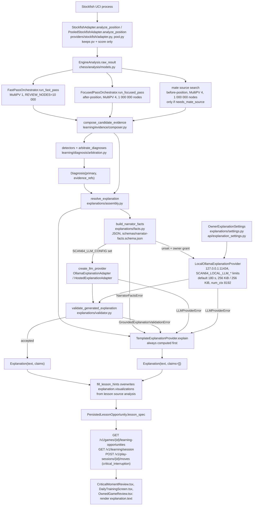
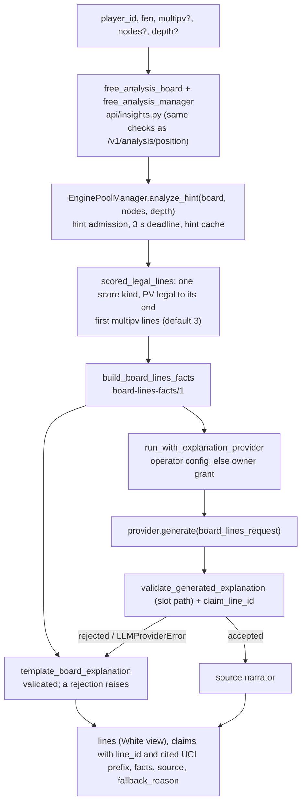

# Narrator pipeline: how engine variations reach the explanation LLM

Status: describes current behaviour only. Written for issue #361 at commit `8f0071168be9d4a31f4573246660c76977a3b94d` (branch `epic/371`); sections 4 to 9 and 11 were updated for #366 (claim-text grounding) and #367 (precomputed narrator facts); sections 5, 8, 9, 11 and the new section 12 were updated for #368 (Analysis Board line explanations); sections 5, 8, 10 and 12 and the new section 13 were updated for #386 (fact slots); sections 6 and 7 and the new section 14 were updated for #387 (narrator voice); sections 5, 8, 12, 13, 14 and 15 and the new section 16 were updated for #408 (factor facts, vocabulary rule, slot-list-only prompt). `file:line` references in sections that were not updated are line numbers at that commit; updated sections name symbols instead.

The narrator is an optional LLM that words a lesson explanation or, since #368, an explanation of the Analysis Board's engine lines (section 12). The engine and the deterministic detectors decide every chess fact. The LLM receives evidence the server has already composed. Since #386 the LLM writes no chess token itself: it names facts by slot (`{played}`, `{capture:best}`) and code fills each slot from the facts (section 13). Its output is shown only if `validate_generated_explanation` accepts it. Otherwise the deterministic template is shown.

Paths are relative to the repository root.

## 1. Flow overview



## 2. Engine analysis (`src/scan64/providers/stockfish/`)

Both adapters run `chess.engine` `analyse(board, limit, multipv=multipv)` and reduce each info dict to two fields:

| Source | Kept | Form |
|---|---|---|
| `StockfishAdapter.analyze_position` (`adapter.py:76-124`) | `pv` | list of UCI strings, full length as Stockfish reports it |
| same | `score` | `score_cp` or `score_mate`, relative to the side to move (`info["score"].pov(board.turn)`) |
| `PooledStockfishAdapter.analyze_position` (`pool.py:127-178`) | same two fields | same |

Dropped by both adapters (not copied into `raw_result`): `depth`, `seldepth`, `nodes`, `nps`, `time`, `hashfull`, `tbhits`, the `multipv` index, `lowerbound`/`upperbound` flags, `currmove`, `refutation`, `string`. WDL is not produced: neither adapter sets `UCI_ShowWDL`.

`EngineAnalysis.config` (`chess/analysis/models.py:21-29`) records the engine identity and the *requested* limits (`nodes`, `depth`, `time_ms`, `multipv`), not the depth reached. The adapter does not cut PV length. Every later cut happens downstream.

`PoolBoundAdapter` (`pool.py:235-260`) and `BatchAnalysisAdapter` (`chess/analysis/reuse.py:34`) produce the same `raw_result` shape. `BatchAnalysisAdapter` reuses saved rows keyed by FEN and config.

## 3. Analysis jobs and the focused pass (`src/scan64/chess/analysis/`)

`resolve_explanation` has three callers. Each one feeds `compose_candidate_evidence` different engine budgets:

| Caller | Fast pass (`fast_analysis`, `reply_analysis`) | `focused_analysis` | Mate source | LLM provider | Time budget around the LLM |
|---|---|---|---|---|---|
| `run_analysis_for_game` (`jobs.py:91`) | `FastPassConfig(nodes=REVIEW_NODES)`; `REVIEW_NODES = 10_000` (`review.py:12`), MultiPV 1 | `FocusedPassConfig(nodes=1_000_000, multipv=4)` on the **after** position (`jobs.py:150-158`) | 1 000 000 nodes, MultiPV 4, before position (`jobs.py:195-198`) | operator config, else `read_local_explanation_provider` (`jobs.py:332-337`) | Local Ollama 4 s; hosted: httpx default 5 s per request (the `httpx.AsyncClient()` that `resolve_explanation` opens at `assembly.py:162`) |
| `analyse_command` (`cli/analyse.py:26`) | `FastPassConfig(nodes=10000)` (`analyse.py:48`), MultiPV 1 | `analyze_position(candidate.fen, nodes=1_000_000, multipv=4)` (`analyse.py:84`) | same as above (`analyse.py:86-90`) | operator config only; no `local_provider` (`analyse.py:153`) | as above |
| `prepare_coach_interruption` (`coach_interruption.py:146`), called from `play_session_service.py:449,686` | `analyze_interactive(nodes=COACH_DIAGNOSTIC_NODES)`, 10 000 nodes, MultiPV 1 (`coach_interruption.py:205-210`) | **`after_analysis` reused**: 10 000 nodes, MultiPV 1 (`coach_interruption.py:250`) | as above (`coach_interruption.py:237-241`) | operator config, else local grant (`_resolve_coach_explanation`, `coach_interruption.py:130-143`) | `COACH_EXPLANATION_TIMEOUT_SECONDS = 0.25` for consent read plus generation; on `TimeoutError`, template |

`FastPassOrchestrator.run_fast_pass` (`orchestration.py:144`) flags a candidate when the mover's swing exceeds `swing_threshold_cp` (150). `FocusedPassOrchestrator.run_focused_pass` (`orchestration.py:224`) searches `candidate.fen`, the position **after** the mistake, with the opponent to move.

The lesson source search `analyze_lesson_source` (`learning/exercises/sound_moves.py:57`) runs 1 000 000 nodes at MultiPV 2, 4, then 8 on the before-position. It builds the accepted-move set and the hints (`fill_lesson_hints`). It is **not** passed to `resolve_explanation`, so it never reaches the LLM.

## 4. Evidence composition (`src/scan64/learning/evidence/composer.py`)

`compose_candidate_evidence` (`composer.py:331-607`) builds a `provenance` dict (`composer.py:355-373`). Every evidence item it emits copies that dict into its payload. Engine-derived provenance fields:

| Payload field | Content | Origin position |
|---|---|---|
| `fast_line` | full `pv` of `fast_analysis.raw_result[0]` (`_pv_line`, `composer.py:56`) | before |
| `proving_line` | full `pv` of `reply_analysis.raw_result[0]` | after |
| `source_score_mate` | `score_mate` of `fast_analysis.raw_result[0]` | before |
| `focused_multipv` | the whole `focused_analysis.raw_result` list: every MultiPV entry with full `pv` and `score_cp`/`score_mate` | after |
| `focused_line` | full `pv` of `focused_analysis.raw_result[0]` only | after |
| `fast_score_cp` / `fast_score_mate` | best-line score of `fast_analysis` (side to move = learner); `None` when not reported | before |
| `reply_score_cp` / `reply_score_mate` | best-line score of `reply_analysis` (side to move = opponent); `None` when not reported | after |
| `swing_cp`, `analysis_depth`, `before_fen`, `after_fen`, `played_move` (SAN) | scalars | — |
| `fast_analysis_id`, `reply_analysis_id`, `focused_analysis_id`, `diagnosis_rule_version`, `diagnosis_capabilities` | identifiers | — |

The fast and reply scores were added for #367. Evidence rows stored earlier lack the four score keys; the narrator facts mark those evaluations `unknown`.

Per-kind additions (all at `composer.py`):

| Evidence | Extra engine fields |
|---|---|
| allowed mate (`composer.py:399-425`) | `mate_source_config` (engine identity and limits), `mate_source_multipv` (four before-position lines with scores), `before_score_mate`, `before_score_cp`, `after_score_mate`, `mate_in`, `mating_line` (= `proving_line`) |
| hanging piece (`composer.py:426-436`) | `hanging_square`, `hanging_piece`, `material_gain`, `exchange_gain` |
| missed check / capture (`composer.py:443-486`) | single move `best_move` = `fast_line[0]` |
| knight fork / pin / overload (`composer.py:487-504`) | `best_move`; pin adds `pinning_move` (= `best_move`) |
| missed direct threat (`composer.py:512-539`) | single move `threat_move` = `proving_line[0]` |
| king safety (`composer.py:540-553`) | single move `incoming_threat` = `proving_line[0]` |
| calculation hypothesis (`composer.py:556-571`) | `sequence_plies` = `len(proving_line)` |
| motifs (`composer.py:588-606`, `motifs.py:66`) | motif squares and pieces; back rank adds `mating_line` |

Only codes in `TRUSTED_CODES` (`learning/diagnosis/trust.py:12-21`) reach an explanation: hanging piece, missed check, missed capture, missed direct threat, allowed mate, knight fork. `arbitrate_diagnoses` (`arbitration.py:79`) always returns an empty secondary tuple.

## 5. Explanation assembly and the prompt (`src/scan64/explanations/assembly.py`)

`resolve_explanation` (`assembly.py:115-168`):

1. Computes `TemplateExplanationProvider().explain(diagnosis, evidence)` first (`assembly.py:135`).
2. If `SCAN64_LLM_CONFIG` is unset: uses `local_provider` if given, else returns the template (`assembly.py:139-148`).
3. If it is set: `LLMProviderConfig.from_toml`. With `provider = "template"`, it returns the template. Otherwise `create_llm_provider` builds an adapter. Operator config overrides the owner grant. Steps 2 and 3 are `run_with_explanation_provider`, shared with the Analysis Board path (section 12).
4. `_attempt_grounded_generation` (`assembly.py:99-112`) builds the grounding context and the request, calls `provider.generate`, and validates the result.

`_attempt_grounded_generation` first calls `build_narrator_facts(diagnosis, evidence, fen)` (`explanations/facts.py`). A `NarratorFactsError` (no referenced evidence, unparsable FEN, payload `before_fen` differing from `fen`, referenced items disagreeing on `played_move` or `before_fen`, an illegal played move or stored line, an untaxonomised code) logs a warning and falls back to the template with reason `invalid_evidence`; no provider is called. `fen` is the **before** position in all three callers (`jobs.py`, `analyse.py`, `coach_interruption.py`). `_grounding_context` keeps the referenced evidence, takes the verified lines from the facts (`verified_lines_by_evidence`) and sets `requested_hint_level = 3`.

`_explanation_request` produces two messages (#408; before, the `NarratorFacts` JSON was a second user message):

- `system`: `NARRATOR_SYSTEM_PROMPT`, then the voice line (section 14). It states that code computed every fact with the board library, the engine and the factor module. Its slot rules (`slot_rules`, shared with the Analysis Board prompt) tell the model to write every chess fact only as a slot from the slot list and to copy slot names exactly; to write no moves, squares, piece names, colours, numbers or evaluations outside slots, and a chess word only when the slot list allows it as a plain word (section 13); and to name a cause only through a `{factor:...}` slot, and no cause without one. It asks for claims with the quoted `evidence_ref` of an evidence item (never a line ID), `line` `[]`, and names the sides "you" and "your opponent".
- `user`: the slot list (`SlotCatalogue.prompt`, section 13): the slots with their code-rendered values, the mistake class (`{mistake}`), the plain chess words each evidence item allows, the factor module version, and an example claim text built from this position's own slots.

The `NarratorFacts` document is not sent. It stays in the pipeline: it builds the slots and the grounding context, and `to_prompt_json` remains its compact serialisation for storage and tests.

`_grounding_context` also sets `slots` to `lesson_slot_catalogue(facts)`, so the validator checks provider output on the slot path (section 8).

### Narrator facts (`schemas/narrator-facts.schema.json`, `narrator-facts/1`)

The schema is generated from the pydantic models in `explanations/facts.py` (`uv run python -m scan64.explanations.facts`); `tests/unit/test_narrator_facts.py` fails when the stored file is stale and parses every prompt built from the fixture corpus with `NarratorFacts.model_validate_json(..., strict=True)`.

| Object | Fields | Computed by |
|---|---|---|
| `factors` (#408) | `source` (factor module version), `points` (`before`, `played`, `best`: moves from the before-position, `quiet`), `engine_swing_cp`, `changes[]` (`key`, `name`, `kind`, `guide_name`, `compared_with`, `change_pawns`) | factor module at quiet positions; section 16 |
| `position` | `fen`, `side_to_move` (the learner), `material`, `played_move` and `best_move` (move facts), `evaluation_before`, `evaluation_after` (after the played move), `best_move_evaluation`, `evaluation_difference_cp` (best minus played, both centipawn scores only), `swing_cp`, `mistake_class` (`code` = `diagnosis.primary`, `name` from the taxonomy seeds) | python-chess; evaluations from stored searches |
| `evidence[]` | `evidence_id`, `kind`, `claim`, `line_ids`, `pieces` (square, piece, colour, payload role), `squares`, `tactic`, `mate_in`, `material_gain` | payload fields |
| `lines[]` | `line_id`, `origins` (payload fields), `begins_with_played_move`, `uci` (citable), `full_plies` (set when cut), `moves[]` | python-chess replay |
| move facts | `ply`, `side`, `mover` (`learner`/`opponent`), `san`, `uci`, `piece`, `captures` (piece, colour, square; en passant names the captured pawn's square), `check`, `checkmate`, `promotion`, `castling`, `material_after` (white, black, learner advantage; pawn 1, knight 3, bishop 3, rook 5, queen 9), `new_threats`, `evaluation_after` | python-chess; evaluation from stored searches |

`new_threats` lists the opponent-of-mover pieces, kings excluded, that are attacked by the mover and not defended after the move and were not attacked-and-undefended before it.

**Line coordinates.** Every line starts at the position before the learner's move. Lines searched from the position after it (`focused_line`, every `focused_multipv` entry, `proving_line`, `threat_move`, `incoming_threat`, and `mating_line` for an allowed mate) are prefixed with the learner's move. `fast_line`, `best_move`, `pinning_move`, every `mate_source_multipv` entry and a back-rank motif's `mating_line` start at the before-position as stored. Identical lines are merged (`origins` lists every source field); a line that is a prefix of another is merged into the longer one. Each line is cut after `MAX_LINE_PLIES = 8` plies and `full_plies` records the engine line's length. The validator accepts the cut lines only.

**Evaluations.** No engine search runs in the explanation path. `StoredEvaluations.from_payload` maps positions to scores already in the payload: the fast score to the position after `fast_line[0]` and to `evaluation_before`; the reply score to the position after the played move (`evaluation_after`); each `focused_multipv` entry to the position after the played move and that entry's first move; each `mate_source_multipv` entry to the position after its first move. The deeper searches (focused, mate source; 1 000 000 nodes) overwrite the fast or reply score (10 000 nodes) for the same position. Every other move's `evaluation_after` is `{"status": "unknown"}`. Scores are converted to the learner's point of view; mates are `mate_in` full moves, negative when the learner is mated. `source` names the search.

Not in the prompt: the diagnosis confidence, `position_id`, `engine_analysis_id` and `producer` of each evidence item, unreferenced evidence, engine identities and configs, analysis IDs, the lesson's accepted moves and the lesson source analysis (MultiPV 2/4/8).

Measured prompt sizes on real Stockfish evidence are in section 6.

### Where variations are cut

| Stage | Cut | Reference |
|---|---|---|
| Adapter | all info fields except `pv` and score | `adapter.py:103-114`, `pool.py:158-168` |
| Fast pass | MultiPV 1, 10 000 nodes | `jobs.py:135-141`, `analyse.py:48`, `coach_interruption.py:205-210` |
| Focused pass | MultiPV 4 (jobs, CLI). Coach: MultiPV 1, 10 000 nodes, the fast reply reused | `jobs.py:152-155`, `analyse.py:84`, `coach_interruption.py:250` |
| Prompt and verified lines | every stored line of the referenced evidence (section 5), each cut after 8 plies with `full_plies` recorded; lesson source analysis excluded | `MAX_LINE_PLIES`, `verified_lines` in `facts.py` |
| Validator replay origin | every verified line is replayed from the **before** FEN; after-position lines carry the played move as their first move | `_validate_line`, `validator.py` |
| Local Ollama request | serialised request body > `SCAN64_LOCAL_LLM_MAX_REQUEST_BYTES` (default 256 KiB) raises `LLMProviderError` | `LocalOllamaLimits`, `local_ollama.py` |
| Local Ollama response | body > `SCAN64_LOCAL_LLM_MAX_RESPONSE_BYTES` (default 256 KiB) raises `LLMProviderError` | `LocalOllamaLimits`, `local_ollama.py` |
| Local Ollama time | `SCAN64_LOCAL_LLM_TIMEOUT_SECONDS` (default 180 s) for model listing plus chat, one `asyncio.timeout`; the evidence-free settings probe keeps 4 s | `LocalOllamaLimits`, `_PROBE_SECONDS`, `local_ollama.py` |
| Coach | 0.25 s for consent read plus generation | `coach_interruption.py:39,139` |
| Ollama context | local provider sends `options.num_ctx` = `SCAN64_LOCAL_LLM_CONTEXT_TOKENS` (default 8192); a response whose `prompt_eval_count` reaches it raises `LLMProviderError` (Ollama drops the start of a longer prompt). The operator-configured Ollama adapter sends no `options`, so the server default (4096 tokens on Ollama 0.17.5) applies | `OllamaExplanationAdapter.generate`, `adapters.py` |

Before #367 the after-position lines (`focused_line`, `threat_move`, `incoming_threat`) were replayed from the before FEN, began with an opponent move and were always rejected as illegal. They are now prefixed with the played move, so every trusted code can cite its continuation, for example `["g1f3", "g5g2"]` (the learner's Nf3, then the reply Qxg2). A line from the after-position without the played move is still rejected (`illegal_line_move`).

## 6. Providers (`src/scan64/providers/llm/`)

| Provider | Transport | Output contract | Reference |
|---|---|---|---|
| `OllamaExplanationAdapter` | `POST {base_url}/api/chat`, `stream: false`, `format` = `GeneratedExplanation` JSON schema; with `context_tokens`, also `options.num_ctx` | `message.content` parsed by `GeneratedExplanation.model_validate_json`; with `context_tokens`, `prompt_eval_count >= context_tokens` raises `LLMProviderError` (truncated prompt) | `adapters.py` |
| `HostedExplanationAdapter` | `POST {base_url}/v1/chat/completions`, bearer key from `llm.api_key_environment`, one forced strict function `submit_grounded_explanation` | `tool_calls[0].function.arguments` parsed the same way; `_strict_schema` marks every property required and removes defaults | `adapters.py:110-172` |
| `LocalOllamaExplanationProvider` | fixed `LOCAL_OLLAMA_BASE_URL = "http://127.0.0.1:11434"`; `_BoundedTransport` (no proxy env, no retries, no redirects, identity encoding only) | lists `/api/tags`, requires the granted model to be installed and not a `*cloud` name or remote entry (`_permitted_name`, `_models`), rechecks consent in a request hook (`_authorize_dispatch`), then delegates to `OllamaExplanationAdapter` with `context_tokens` | `local_ollama.py` |

`GeneratedExplanation` (`contracts.py:18-23`) is `claims: tuple[ExplanationClaim, ...]` with at least one claim. `ExplanationClaim` (`packages/chess-lesson-spec/src/chess_lesson_spec/claims.py:8-17`) has `text`, `evidence_ref`, `line` (UCI tuple, default empty), `certainty` (default `observed`) and `disclosure_level` (≥ 1).

`LLMProviderConfig.from_toml` and `create_llm_provider` (`config.py`) accept `template`, `ollama` (HTTPS, or loopback HTTP) and `openai` (HTTPS only, `_validated_base_url`). The optional `llm.voice` selects the narrator voice (section 14); an unknown name raises `LLMConfigurationError`.

### Local Ollama limits

`LocalOllamaLimits.from_environment` (`local_ollama.py`) reads the bounds of one local explanation when `generate` runs. An invalid value raises `LLMConfigurationError`, which is not converted to a template fallback.

| Variable | Default | Accepted | Bounds |
|---|---|---|---|
| `SCAN64_LOCAL_LLM_TIMEOUT_SECONDS` | `180` | (0, 600] | model listing plus chat, one `asyncio.timeout` and the httpx timeout |
| `SCAN64_LOCAL_LLM_MAX_REQUEST_BYTES` | `262144` (256 KiB) | [1024, 16 MiB] | serialised chat request, checked before any network I/O |
| `SCAN64_LOCAL_LLM_MAX_RESPONSE_BYTES` | `262144` (256 KiB) | [1024, 16 MiB] | each response body, checked while streaming |
| `SCAN64_LOCAL_LLM_CONTEXT_TOKENS` | `8192` | [2048, 131072] | `options.num_ctx`; a prompt that fills it is rejected |

The settings probe (`detect_local_ollama`) sends no evidence and keeps a fixed 4 s deadline. The coach path keeps its 0.25 s budget (`coach_interruption.py`), so local narration of a coach interruption only succeeds with a model that answers within it.

### Measured local run

Measured on 2026-11-26: RTX 4080 Laptop GPU (12 GB), Ollama 0.17.5 (the user's installed app), `qwen3:8b` Q4_K_M (8.2 B parameters), Stockfish 18 evidence (fast and reply 10 000 nodes, focused 1 000 000 nodes MultiPV 4, mate source when the reply is a mate) for four positions: 3.Nf3 missing 3.Bxg5 (missed capture), 3...Nd4 allowing Qxf7# (missed direct threat, allowed mate), and O-O leaving Nb5 and missing Nxc7+ (hanging piece, missed check, missed capture, missed direct threat, knight fork). Eight diagnoses, two runs each. Another client shared the same Ollama server during the run, so wall time includes queueing behind its requests; Ollama's `total_duration` is the server time of one request.

| Quantity | Before (#361 limits, server default context) | After (this change) |
|---|---|---|
| Prompt, serialised request | 19–33 KB (12-ply lines, all fields) | 11.7–18.0 KB (8-ply lines, defaults omitted) |
| Prompt tokens (`prompt_eval_count`) | 4096 in every request: the 4096-token default context truncated every prompt | 3509–7355 with `num_ctx` 8192 |
| Output tokens | 1043–1226 | 161–427 |
| Ollama `total_duration` per request, model loaded | 20 s | 11.5–51.5 s |
| Cold model load (`load_duration`), GPU shared | 97 s | 81 s (first request of an earlier run) |
| Wall time per explanation | 34–92 s | 10.0–57.6 s |
| Outcome | 0/6 accepted (invented evidence IDs; invalid output schema) | 10/16 accepted; rejected: 4 bare colour word (`unparsed_chess_token`), 2 evaluation not in the facts (`9 points` for a nine-point material gain, `3 pawns`) |

A run between these two, with the current prompt before it stated that `line` holds UCI moves, accepted 10/18; five rejections were line IDs (`L1`) placed in `line`. The default deadline of 180 s covers the observed cold load (81 s) plus the slowest request (51.5 s) with margin; the previous 4 s deadline could not complete one request. Accepted claims passed the grammar in section 8; the grammar does not check relations between facts (for example which piece a capture removes), and some accepted sentences in this run state such relations wrongly. Model choice and accuracy rates are measured in #369, not here.

## 7. Owner grant (local Ollama)

- Table `OwnerExplanationSettings(player_id, model, revision, voice)` (`explanations/settings.py`). `voice` (#387, migration `20261127_26`) is nullable; NULL reads as the default voice (`stored_narrator_voice`).
- API router `/v1/players/{player_id}/explanation-settings` (`api/explanation_settings.py:18`):
  - `GET` returns `mode` `disabled` | `local` | `operator` and, in `local` mode, the saved `voice` (`get_explanation_settings`).
  - `POST /probe` calls `detect_local_ollama` and lists local model names. It sends no evidence (`probe_explanation_settings`).
  - `PUT` takes `{model, consent}` and an optional `voice`. `consent` must equal `model is not None`. A `voice` without a model is rejected (422). An absent `voice` keeps the saved voice; a new grant without one gets the default. The model must be in the current local listing (503 if Ollama is unreachable, 422 if the model is not installed). The handler re-authorises under `lock_puzzle_player`, then inserts, updates (new `revision`) or deletes the row (`set_explanation_settings`).
  - Both write endpoints return 409 while `SCAN64_LLM_CONFIG` is set (`_require_settings_control`).
- Job fence: `_execute_analysis_job_async` selects `local_explanation_owner_generation` (deletion-audit count) in the same query as the game (`jobs.py:550`). `read_local_explanation_provider` (`settings.py:81-98`) returns a provider only if the committed grant's generation matches. It wraps the provider in `LocalNarratorProvider`, which carries the voice read with the grant. Its `still_authorized` closure requires the same `(model, revision)` at chat dispatch; a voice change does not revoke the grant.
- Client: `LocalExplanationSettings.tsx` in `SettingsScreen.tsx:91` (model and **Narrator voice** selects), API calls in `apps/scan64-web/src/api/explanationSettings.ts`.

## 8. Validator (`src/scan64/explanations/validator.py`)

`validate_generated_explanation` checks claim text on one of two paths:

| Path | When | Claim text check | Returned claims |
|---|---|---|---|
| Slot (#386) | `context.slots` is set: lesson provider output (`_grounding_context`) and Analysis Board provider output (`board_slot_grounding`) | `render_slot_text`: every slot is listed for the cited evidence item, and the prose outside the slots holds no notation and no chess word outside the item's vocabulary (section 13, #408) | text with every slot filled by code; a claim with an empty `line` gets the line of its slots (`slot_citation`) |
| Grammar (#366) | `context.slots` is unset: the Analysis Board template (`board_lines_grounding`), `attach_validated_explanation` callers, tests | `_validate_claim_text`, the claim grammar below | unchanged |

The slot path does not run the claim grammar. On the slot path an `evidence_ref` wrapped in one pair of quotes that a model copied from the slot list is read without them when the inner ID is known (`_unquoted_evidence_ref`). A claim with an empty `line` cites the longest `Slot.citation` among its slots that is a prefix of a verified line of its evidence item (`slot_citation`); the Analysis Board links a comparison claim to a line this way. Slot-path reason codes:

| Reason | Raised when |
|---|---|
| `unknown_slot` | a `{...}` names no slot of this position, or braces are malformed (`{played`, `{}`, `{Played}`) |
| `slot_not_in_evidence` | the slot exists for another evidence item of this position, not the cited one |
| `chess_token_outside_slot` | the prose outside the slots holds chess content (section 13) |

It raises `GroundedExplanationValidationError` with a `reason` code (`REJECTION_REASONS`) on the first failure:

1. `requested_hint_level < 1`.
2. The context FEN does not parse.
3. Duplicate evidence IDs in the context.
4. Per claim (`_validate_claim`):
   - `evidence_ref` is blank or not among the referenced evidence IDs;
   - `certainty` ranks above `maximum_certainty`. The default is `observed` and `resolve_explanation` does not override it, so `likely` and `certain` are always rejected;
   - `disclosure_level` > `requested_hint_level` (3);
   - `line` non-empty and (`_validate_line`): any move is malformed UCI, or illegal when replayed from the context FEN, or the line is not a prefix of a verified line for that `evidence_ref` (the narrator-facts lines, section 5);
   - `text`, slot path: see the table above;
   - `text`, grammar path (`_validate_claim_text`, #366): a fixed grammar reads SAN and UCI moves, squares, pieces with colour, evaluations in pawns or centipawns, mate-in-N, material won or lost, check, side to move, castling, promotion, en passant and named tactics, and checks each against the cited evidence item, its payload and every board its lines reach. A chess token outside the grammar rejects the claim (`unparsed_chess_token`).

Facts added for #367 and the claims they admit:

| Claim form | Accepted when | Rejection reason |
|---|---|---|
| an evaluation (`8.5 pawns`, `-0.4`, `850 cp`) | within 25 cp (`EVALUATION_TOLERANCE_CP`) of a payload score, a stored evaluation of the narrator facts (`StoredEvaluations.numbers`: before, after the played move, after each scored move) or the best-minus-played difference | `evaluation_not_supported` |
| mate in N | N equals a payload or stored mate distance, or a verified line ends in mate after N moves | `mate_not_supported` |
| material balance: `White is up a knight`, `you are down 2 pawns`, `your opponent is behind in material`, `material is equal` | some board of the cited evidence (before, after, or any position of its lines) has exactly that learner-or-side advantage in pawn units (pawn 1, knight 3, bishop 3, rook 5, queen 9, exchange 2), the sign for `ahead/behind in material`, or zero for `equal` | `material_not_supported` |
| attack or threat on a piece: `Qxg2 attacks the rook on h1`, `threatens the undefended knight` | some board of the cited evidence has a piece of that type (and colour and square, when named) attacked by the other side; with `undefended`, also not defended | `threat_not_supported` |
| `hangs`, `hanging`, `undefended`, `en prise` | a line proves a material gain, or some board has a non-king piece attacked and not defended | `material_not_supported` |

Verified evaluations for a claim come only from its cited evidence item; another item's scores do not admit it.

Added for #368: the payload field `board_multipv` (Analysis Board lines, replayed from the context FEN, scores admitted like `mate_source_multipv`) and the list field `best_differences_cp` (best-line score minus a compared line's score) are read as evidence. A signed evaluation that ends a sentence (`scored +1.50.`) is now read as an evaluation; before, the full stop after it kept the grammar from matching and the number passed unchecked. The reason `missing_line` is raised by the Analysis Board path, not by `validate_generated_explanation` (section 12).

On success the validator returns `Explanation(text=" ".join(claim.text …), claims=…)`; on the slot path both hold the rendered text.

`attach_validated_explanation` is a second entry point with an added FEN-match check. None of the three callers uses it.

## 9. Template fallback

`TemplateExplanationProvider.explain` (`templates/provider.py:236-257`) renders one template per code from the first evidence item in `diagnosis.evidence_refs` (`_matched_payload`). It returns `Explanation(text, visualizations=[])` with `claims` empty. Allowed mate prints the full mating line in SAN (`_allowed_mate_text`). The other trusted codes print `played_move` and one move or square.

Paths that return the template instead of LLM output:

| # | Condition | Reference |
|---|---|---|
| 1 | `SCAN64_LLM_CONFIG` unset and no `local_provider` (no grant, generation mismatch, operator mode, or CLI) | `assembly.py:139-148`, `settings.py:72-73,85-90` |
| 2 | `[llm] provider = "template"` | `assembly.py:151-152` |
| 3 | `create_llm_provider` returns `None` (template config only) | `assembly.py:156-157,164-165` |
| 4 | `NarratorFactsError` from `build_narrator_facts` (section 5); reason `invalid_evidence`, a warning names the cause; no provider is called | `_attempt_grounded_generation`, `assembly.py` |
| 5 | `LLMProviderError` from `generate`: HTTP error or non-2xx, invalid JSON, wrong shape, schema mismatch, no choices or tool call, wrong function name, prompt filled the Ollama context; local: model not installed or not permitted, consent changed before dispatch, request or response over its byte limit, encoded or ambiguous framing, length mismatch, timeout; reason `provider_error` | `assembly.py`, `adapters.py`, `local_ollama.py` |
| 5a | `GroundedExplanationValidationError` (section 8); reason = the validator's code | `assembly.py` |
| 6 | Coach path: 0.25 s timeout. The template is computed again | `coach_interruption.py:142-143` |
| 7 | Consent read raises `SQLAlchemyError`: provider `None`, then path 1 | `settings.py:75-78` |

Failures that do **not** fall back. These propagate to the caller: `ExplanationTemplateError` (raised before any LLM call, because the template is computed first) and `LLMConfigurationError` (bad config file, missing API key env var, non-HTTPS URL, invalid `SCAN64_LOCAL_LLM_*` value).

Paths 4 to 5a are logged by `record_template_fallback` (event `explanation_template_fallback`, the pipeline and the reason code only, never evidence) and counted in-process. Section 15 gives the attempt, accept and fallback counts and the fallback rate. The stored `Explanation` has no field naming its source. The only implicit marker is that template output has an empty `claims` list.

## 10. After resolution: storage, API, client

- `fill_lesson_hints` (`learning/exercises/hints.py:54-62`) runs after `resolve_explanation` in all three callers. It replaces `explanation.visualizations` with level-3 hint drawings plus one `AnimateLineCommand` per lesson-source candidate line. Engine lines shown on the board therefore come from the lesson source analysis, not from the LLM.
- `verify_lesson` checks the lesson, including visualizations (`verification/verifier.py:99-100`). It does not check explanation text.
- The lesson is stored in `PersistedLessonOpportunity.lesson_spec` and served through `GET /v1/games/{game_id}/learning-opportunities` (`api/games.py:266`), `GET /v1/learning/session` (`api/learning.py:331`), game review (`api/game_review.py:47`) and `critical_interruption` on play moves (`api/play.py:130-139,539-546`).
- On the slot path the stored `explanation.text` and `claims[].text` hold the rendered text: the slot names are not stored, and the stored format is unchanged.
- The client renders `explanation.text` only: `CriticalMomentReview.tsx:171-174`, `DailyTrainingScreen.tsx:184`, `OwnedGameReview.tsx:301`. `claims` and `claims[].line` are not rendered. `CriticalMomentReview` also appears in `PlayScreen.tsx:1522`, `PgnImportScreen.tsx:157` and `PuzzlesScreen.tsx:342`.

## 11. Gaps

| Gap | Evidence in code | Issue |
|---|---|---|
| Adapter drops depth, seldepth, nodes, time, WDL, bound flags and the MultiPV index | `adapter.py:103-114`, `pool.py:158-168` | #360 |
| ~~Claim text is not grounded~~ Resolved: claim-text grammar (section 8) | `validator.py` | #366 |
| ~~Prompt is a Python-`repr` dump of raw UCI payloads with no SAN, per-move facts or schema~~ Resolved: narrator facts JSON (section 5) | `facts.py`, `assembly.py` | #367 |
| ~~Narration exists only for diagnosed mistakes (lessons, coach), not for arbitrary positions~~ Resolved: Analysis Board line explanations (section 12) | `board_lines.py`, `api/analysis_explanation.py` | #368 |
| No evaluation of which open model words chess lines with the fewest false statements | — | #369 |
| ~~Verified lines from the after-position always fail replay; most stored lines cannot be cited~~ Resolved: every stored line is a verified line from the before FEN, cut after 8 plies | `facts.py` | #367 |
| The operator-configured Ollama adapter sends no `num_ctx`; the server default context (4096 tokens on Ollama 0.17.5) truncates prompts larger than it without an error | `create_llm_provider`, `config.py` | — |
| Coach focused evidence is a 10 000-node MultiPV 1 search | `coach_interruption.py:250` | #360 |
| The lesson source analysis (1 000 000 nodes, MultiPV up to 8) never reaches the prompt | `jobs.py:306`, `assembly.py:115` | #367 |
| The explanation records no source (fallbacks are logged and counted since #366) | section 9 | — |
| The `calculation.stopped_too_early` template prints `focused_line` (after-position line 1) with `sequence_plies = len(proving_line)`, so the count and the printed line come from different searches. The code is untrusted today | `templates/provider.py:175-183`, `composer.py:566` | #367 |

### Steps to give the narrator full, long variations

1. Engine contract (#360): keep the full `InfoDict` per MultiPV entry in `raw_result` (`pv`, score with bound flags, `depth`, `seldepth`, `nodes`, `time`, `multipv`, and WDL with `UCI_ShowWDL`) in both `StockfishAdapter` and `PooledStockfishAdapter`. Store the reached depth, not only the requested limits.
2. Record each line's start FEN. Store every line as a verified line with the FEN it starts from: before-position fast and source lines, after-position focused and reply lines. Extend `GroundedExplanationContext.verified_lines` to map an evidence ID to `(start_fen, line)` pairs, and make `_validate_line` replay each line from its own start FEN.
3. Widen verified lines: include every `focused_multipv` entry, `fast_line`, `proving_line`, `mating_line` and `mate_source_multipv` in `_verified_lines_for`. Pass the lesson source analysis (MultiPV 2/4/8, 1 000 000 nodes) into `resolve_explanation` as evidence.
4. Raise coach depth or reuse a deeper search: replace `focused_analysis=after_analysis` (`coach_interruption.py:250`) with a MultiPV search inside the coach budget, or keep the 10 000-node line labelled as `interactive` evidence.
5. Precompute per-move facts (#367): for each move of each verified line, give SAN, the piece moved, capture, check, material balance and engine evaluation. Serialise as JSON with a declared schema instead of `repr`.
6. Budget the prompt: measure the serialised request against `_MAX_REQUEST_BYTES` (128 KiB) and the model context. Set `options.num_ctx` in `OllamaExplanationAdapter`. When a line must be shortened, cut it deterministically at a stated ply and mark the cut in the payload. Review the 4 s local limit for background jobs; the coach keeps 0.25 s.
7. Ground the claim text (#366) so long lines cannot carry invented prose facts.
8. Log every fallback with its reason (provider error class, validator message) and record the explanation source on `Explanation`. Nothing measures acceptance rates today.
9. ~~Expose narration of MultiPV lines on the Analysis Board (#368), with the same validator and template floor.~~ Done (section 12).
10. Choose the narrator model through the evaluation in #369 before changing the default.

## 12. Analysis Board line explanations (#368)

`POST /v1/analysis/position/explanation` (`api/analysis_explanation.py`) explains the engine lines of any position. No diagnosis or stored evidence is involved.



**Search.** The endpoint reuses the free-analysis search: the interactive pool, the hint admission (no queue, 250 ms acquisition, 3 s wall deadline, at least two interactive engines) and the hint cache. With no `nodes` or `depth` the call is `analyze_hint(board)` with the default budget, so the explanation covers the lines `POST /v1/analysis/position` returned for that position, from the same cached search. `nodes` may only lower the hint node budget (`[limits.hint]` or 200 000); `depth` adds a depth limit (1 to 245) while the node and time limits still apply; both are part of the cache key. `multipv` (1 up to the hint MultiPV, default 3) selects how many of the ranked lines are explained; it does not change the search. Out-of-range values return 422 before any search; an ended position returns 409; no usable line evicts the cached search and returns 503.

**Lines.** `scored_legal_lines` keeps a MultiPV entry only if it has exactly one of `score_cp`/`score_mate` and its whole PV replays legally; `/v1/analysis/position` uses the same filter. Lines are not cut: the full principal variation the engine reported is in the facts, the verified lines and the response. In 15 positions searched through the real pool (Stockfish 18, 200 000 nodes), line lengths ranged from 1 to 27 plies; the 12 positions recorded in `tests/fixtures/analysis_board_lines.json` produce prompts of 4.8 to 13.7 KB at MultiPV 3.

**Facts** (`explanations/board_lines.py`, `schemas/board-lines-facts.schema.json`, regenerate with `uv run python -m scan64.explanations.board_lines`):

| Object | Fields |
|---|---|
| `position` | `fen`, `side_to_move`, `material`, `evaluation` (line 1's score) |
| `lines[]` | `line_id` (`line-1` ...), `rank`, `evaluation`, `difference_from_best_cp` (line 1 minus this line, both centipawns), `depth`, `seldepth`, `wdl`, `uci` (full line), `moves[]` (the #367 move facts), `outcome` |
| `outcome` | `material_change` (pawn units won over the line, `line_material_gain`), `material_at_end`, `checks_by_side_to_move`, `checks_by_opponent`, `ends_in_checkmate`, `ends_in_stalemate`, `first_move_threats` (the first move's `new_threats`) |

Evaluations are the engine's MultiPV scores from the side to move's point of view (source `analysis_board_pass`, added to the narrator-facts `EvaluationSource`). A line's score is the `evaluation_after` of its first move; every later move is `unknown`: no other position was searched. In move facts, `mover: "learner"` is the side to move.

**Grounding.** `board_lines_grounding` builds one `Evidence` per line (`board_multipv` with that line and its score, `best_differences_cp` with its difference to line 1) whose only verified line is the full line, and, with two or more lines, `comparison` holding every line, every score and every difference. The context FEN is the board position, so "you" in the claim grammar is the side to move. Provider output is validated against `board_slot_grounding(facts)`: the same evidence and verified lines plus `board_slot_catalogue(facts)` (section 13), so it is checked on the slot path. The template keeps the grammar path. After `validate_generated_explanation`, `claim_line_id` links each claim to a line: its `evidence_ref` when that is a line, else the line its cited UCI prefix starts; a claim linked to no line (a `comparison` claim with an empty `line`) is rejected with `missing_line`.

**Template.** `template_board_claims` writes, from the facts only: the side to move and line 1's first move; per line, the line in numbered SAN, its score and depth, the first move's attacks on undefended pieces (up to two), whether it wins or loses material and the material balance at its end, the side to move's checks, and checkmate or stalemate at its end; per line after the first, its difference to line 1, or both scores when a mate is involved. `template_board_explanation` runs these claims through the same validator: the template is grounded by construction, and a rejection is a bug that raises instead of being shown. `tests/unit/test_board_lines.py` validates it for the 12 recorded positions at MultiPV 1 to 4.

**Provider.** `BOARD_NARRATOR_SYSTEM_PROMPT` (with the shared `slot_rules` and the voice line), then the board slot list; since #408 the `BoardLinesFacts` JSON is not sent (it stays in the response as `facts`). Lines 2 and later carry `factors`: factor changes against line 1 (section 16), stated by `{factor:KEY:line-K}` slots. The response carries `source` (`template` or `narrator`) and `fallback_reason` (a `TemplateFallbackReason`, or null when no provider ran or the provider's wording was accepted); fallbacks are counted by `record_template_fallback` like lesson fallbacks. No time limit beyond the provider's own applies (local Ollama: `SCAN64_LOCAL_LLM_TIMEOUT_SECONDS`, default 180 s).

**Measured local run.** 2026-11-26, RTX 4080 Laptop GPU, Ollama with `qwen3:8b`, the recorded `start`, `scholar_mate_in_one`, `italian_black` and `promotion` lines (MultiPV 3), one run before and one after the prompt change below: 0 of 8 explanations accepted, 15 to 38 s per request. Rejection reasons: `check_not_supported` and `move_type_not_supported` (a negated fact such as "no checks" or "does not threaten stalemate" is read as a claim), `evaluation_not_supported` (a line's gap to line 1 cited from that line's evidence, which did not hold it; it does now), `malformed_line_move` (SAN in `line`; the prompt now states UCI), `missing_line` (comparison claims without a line) and `unparsed_chess_token` (a bare colour word). One unsupported claim rejects the whole explanation, so with this model the board shows the template. Model choice is evaluated in #369.

**Client.** `AnalysisScreen.tsx` shows **Explain lines** under the engine lines. On success it replaces the shown lines with the explained lines and lists the claims; hovering or focusing a claim highlights the cited prefix of its line (`data-cited`), and selecting it pins the highlight. A response for a position the user has left is dropped.

## 13. Fact slots (#386)

The narrator writes prose with named slots; code writes every chess token. For example the claim text `You played {played}, but {capture:best}.` renders as `You played Nf3, but Bxg5 captures the black queen on g5.` Module: `src/scan64/explanations/slots.py`.

**Why.** In the #385 benchmark run the claim grammar rejected most answers of the strongest models as `unparsed_chess_token` (granite4.2-8b 42 of 58 fallbacks, qwen3.5-9b 60 of 82). Each grammar gap is a false rejection or an unchecked statement. With slots, the free-prose check is a fixed rule set, and the rendered chess tokens come only from the facts.

### Catalogue

`lesson_slot_catalogue(NarratorFacts)` and `board_slot_catalogue(BoardLinesFacts)` (`board_lines.py`) build a `SlotCatalogue`: per evidence item, a map from slot name to `Slot(name, value, meaning, moves, phrase)`. `value` is rendered by code; `moves` are the UCI moves the value states (the benchmark counts coverage from them); `phrase` marks a value that starts with a word, which is capitalised at a sentence start. Since #408: `source` labels a value from another module (the factor module version on factor slots); `group`, `listed` and `preview` shape the prompt only; `cite` is the line prefix a claim using the slot cites when `moves` is empty.

**Prompt layout (#408).** `SlotCatalogue.prompt` lists each slot once: the position slots, then each line's slots under `Line L:` (the line value cut to `PROMPT_LINE_PLIES = 6` plies with its length, the clause slots of the first `PROMPT_CLAUSE_PLIES = 2` plies with the mover, and one note for every `{move:L:N}`), then each evidence item as `evidence_ref "ID"; lines ...:` with its own slots and `Allowed plain words: ...`. It ends with the factor module version (or `No factor slot: no cause was measured, so name no cause.`) and an example claim text built from the position's own slots. Validation accepts every slot of the catalogue, listed or not.

| Slot | Value (example) | Present when |
|---|---|---|
| `{played}` | SAN of the learner's move (`Nf3`) | always (lessons) |
| `{best}` | SAN of the engine's best move (`Bxg5`) | `position.best_move` is set |
| `{mistake}` | mistake class name (`Missed capture`) | always (lessons) |
| `{eval_before}`, `{eval_after}` | signed pawn units, learner's view (`+8.50 pawns`), or `mate in 2 for the learner` / `for the opponent` | the evaluation is not `unknown` |
| `{eval_diff}` | `8.90 pawns` | `evaluation_difference_cp` is set and positive |
| `{line:L}` | the line in numbered SAN (`3.Bxg5 Nf6 4.Bxf6`) | line `L` is in the evidence item's `line_ids` |
| `{move:L:N}` | SAN of ply N of line L | as above |
| `{capture:K}` | `Bxg5 captures the black queen on g5` | the move captures |
| `{check:K}` / `{mate:K}` | `Bb5+ gives check` / `Qh4# is checkmate` | the move checks / mates |
| `{threat:K}` | `Nd5 attacks the undefended black queen on c7 and black rook on a8` | the move's `new_threats` is not empty |
| `{promotion:K}`, `{castle:K}` | `e8=Q promotes to a queen`, `O-O castles kingside` | the move promotes / castles |
| `{tactic}` | `knight fork`, `pin`, `skewer`, `discovered attack`, `back-rank mate`, `overloaded defender` | the evidence item's `tactic` is one of these |
| `{mate_in}` | `mate in 1` | the evidence item's `mate_in` is positive |
| `{material_gain}` | `a material swing of 9 points` | the evidence item's `material_gain` is not zero |
| `{piece:N}` | `the black queen on g5` | Nth entry of the evidence item's `pieces` |
| `{factor:KEY:played}` | `after your move, king safety fell by 0.65 pawns for you` | a factor change from the position before the move passed (section 16) |
| `{factor:KEY:best}` | `after your move, king safety is 0.60 pawns worse for you than after the best move` | a factor change against the best move's line passed |
| `{square:N}` | `e7` | Nth entry of the evidence item's `squares` |

`K` is `played`, `best` or `L:N` (ply N of line L). Position slots (`played`, `best`, their clause slots, `mistake`, evaluations) are listed for every evidence item; line and evidence slots only for their own item. `{material_gain}` does not say which side gains, because the payload field does not.

Analysis Board slots, per line evidence item `line-K` (the `comparison` item lists the slots of every line):

| Slot | Value (example) |
|---|---|
| `{eval}` | the position's score (line 1), side to move's view (`+0.41 pawns`, `mate in 2 for the side to move`) |
| `{label:line-K}` | `line K` |
| `{first:line-K}` | the first move in numbered SAN (`1.e4`) |
| `{eval:line-K}` | the line's score |
| `{diff:line-K}` | `0.06 pawns less than line 1` (difference set and not zero) |
| `{outcome:line-K}` | `over line K the side to move wins 3 points of material` / `loses` / `the material balance does not change` |
| `{balance:line-K}` | `at the end of line K the side to move is up 3 points of material` / `material is equal` |
| `{checks:line-K}` | `the side to move gives check twice in line K` (only with checks) |
| `{end:line-K}` | `line K ends in checkmate` / `stalemate` |
| `{factor:KEY:line-K}` | `in line 2, king safety is 0.62 pawns worse for the side to move than in line 1` (lines 2 and later, up to 2 per line) |
| `{line:line-K}`, `{move:line-K:N}` and the clause slots | as for lessons |

### Prose rule set and vocabulary rule

The prose outside the slots (each slot replaced by a placeholder) is checked by `chess_words_outside_slots` against two fixed, case-insensitive patterns. `CHESS_PROSE` is their union (the #386 blanket rule) and stays exported.

| Pattern | Rule | Covers |
|---|---|---|
| `NOTATION` | always rejected | a digit (squares, SAN, UCI, move numbers, evaluations, mate counts, `+150 cp`); `#`, `O-O`/`0-0`, figurines |
| `CHESS_WORDS` | rejected unless the facts contain the word | piece names; `white`, `black`; check and mate forms; capture, take, exchange and trade forms; tactic and move-type words (fork, pin, skewer, discovered, back rank, overload, deflect, decoy, sacrifice, zwischenzug, en passant, promote, castle); threat, attack, hang, undefended, defend, en prise; material, centipawn, win, lose, gain, ahead, behind, advantage, equal; `a-file`, `a-pawn`, kingside, queenside, file, rank, diagonal |

**Vocabulary rule (#408).** A `CHESS_WORDS` match passes when each of its words is in the cited evidence item's vocabulary (`SlotCatalogue.vocabulary`). The vocabulary is the words of four kinds of fact names, nothing else:

| Source | Example | Words |
|---|---|---|
| slot names listed for the item | `{capture:best}`, `{threat:L1:2}`, `{mate_in}`, `{factor:king_safety:best}` | capture, best, threat, mate, king, safety ... |
| the mistake class name | `Missed direct threat` | missed, direct, threat |
| the evidence tactic | `knight_fork` | knight, fork |
| names of passed factor changes | `king safety`, `pawn shelter` | king, safety, pawn, shelter |

Words compare in lower case with a plural `s` removed (`threats` = `threat`); other forms do not match (`threatened` is not `threat`). The rule is one mechanism over the facts; it has no phrase list. Squares, moves, numbers and evaluations stay rejected because they contain a digit; colour words, `advantage` and `equal` stay rejected because no fact name contains them; a piece-on-square phrase needs a square.

| Text | Position | Result |
|---|---|---|
| `Your move, {played}, missed a direct threat, as seen in line {line:L2}.` | missed direct threat | passes |
| `After {played}, your piece on d2 became a {mistake}.` | any | `chess_token_outside_slot` (`2`) |
| `{played} missed a threat.` | missed capture, no threat slot or factor (`a301qp92:21`) | `chess_token_outside_slot` |
| `After {played}, your king safety suffered.` | no king-safety factor | `chess_token_outside_slot` |

Every adversarial text of the claim-grounding suite (#366, #384) is still rejected as free prose on three benchmark positions (`tests/unit/test_narrator_vocabulary.py`). A correct grammar-suite text without notation may now pass when the facts name its words, for example `Check the opponent's captures before moving.` where check and capture slots exist.

**Looseness.** A clause slot of any ply admits its word for the whole item: `threat` is in the vocabulary of 48 of the 50 benchmark positions, because most lines have a `{threat:L:N}` slot. The word then carries no square, move or number, so it cannot state which piece is threatened.

**Limits.** A slot value is true by construction, but the prose may still relate two true slots wrongly (for example "after `{best}`, `{threat:L2:2}`" when line L2 does not start with the best move). Clause slots (`{capture:K}`, `{threat:K}`) state the move inside the value to keep such relations local. The mover words in the slot list (`your move`, `your opponent's move`) help the model attach a move to the right side.

### Contract decision

The output contract is unchanged: `GeneratedExplanation` claims with `text`, `evidence_ref`, `line`, `certainty`, `disclosure_level`. A smaller contract (text only) would drop the evidence scope that keeps a claim to one item's slots and the cited line the Analysis Board links claims with, and would change the provider JSON schema. Since #408 the slot list is the only user message; `line` stays in the contract, the prompt asks for `[]`, and code fills it from the claim's slots (section 8).

### Benchmark

`benchmarks/narrator/run_benchmark.py` records, per claim, `slots`: each slot name the text uses, its rendered value (`null` when not listed) and its UCI moves; per run of the slot pipeline, `slots_used` (all claims' slots in order). Coverage (played move, key move, result) of a record with `slots_used` is counted from the listed slots only (`slot_coverage`): a move counts when a used slot's moves or rendered SAN hold it; the result counts when a used slot's value names it. Records without `slots_used` (all runs before #386) keep the claim-text count, so their summaries recompute unchanged. `chess_token_outside_slot` counts as a false chess statement.

## 14. Narrator voice (#387)

A voice sets the tone and sentence style of the plain words around the slots. It adds no chess fact and asks for no reasoning. Module: `src/scan64/explanations/voice.py`.

| Voice | Prompt fragment (start) |
|---|---|
| `coach` (default) | a calm, friendly coach; short, encouraging sentences |
| `terse` | as few plain words as possible; no greetings, praise or filler |
| `playful` | lively, everyday words; a warm, cheerful tone; short sentences |

**Prompt.** `with_voice` appends one line to the system prompt: the voice fragment, then a fixed sentence that every slot rule applies unchanged and that the voice never adds a chess fact. `narrator_system_prompt(voice)` (lessons) and `board_narrator_system_prompt(voice)` (Analysis Board) build it. `NARRATOR_SYSTEM_PROMPT` and `BOARD_NARRATOR_SYSTEM_PROMPT` are unchanged; the voice line comes after them. The facts JSON and the slot list do not depend on the voice. Because the default voice also adds its line, the default prompt differs from the #386 prompt by that line.

**Checks.** The voice does not reach the validator. Every voice uses the same slot path, the same prose rules (`NOTATION`, `CHESS_WORDS` and the vocabulary rule) and the same reason codes (sections 8 and 13). Tests (`tests/unit/test_narrator_voice.py`) check, for each voice, that the prompt builds, that a raw chess claim outside a slot falls back as `chess_token_outside_slot` for lessons and the Analysis Board, and that no fragment matches `CHESS_PROSE` or names reasoning.

**Selection.** `run_with_explanation_provider` picks the voice in this order:

| Source | Where | Absent |
|---|---|---|
| `voice=` argument | `resolve_explanation`, `resolve_board_lines_explanation` (benchmark, tests) | next source |
| operator | `voice` in the `[llm]` table of `SCAN64_LLM_CONFIG` | `coach` |
| local grant | `OwnerExplanationSettings.voice`, set in **Settings → Local explanation wording** | `coach` |

Example operator file:

```toml
[llm]
provider = "ollama"
model = "gemma4:12b"
base_url = "http://127.0.0.1:11434"
voice = "terse"
```

**Benchmark.** `voice` in the `[run]` table of `benchmarks/narrator/narrator.toml` (default `"coach"`) is passed to `pipeline_entry` as `voice=` and recorded in the run header and the summary. One runs file holds one voice; resume refuses a different voice. To compare voices, run once per voice and compare the summaries (grounding pass and coverage).

## 15. Factor module (#407)

The factor module computes the evaluation of a position as named factors, so the narrator can say why a move changed the score (section 16, #408). It is a Python port of the Stockfish Evaluation Guide (hxim, GPL-3.0, commit `63ff375`), which documents the Stockfish 12-era classical evaluation. Module: `src/scan64/explanations/factors/`. Since #408 the narrator reads it through factor facts (section 16).

**API.** `evaluate_factors(board)` takes a python-chess board or a FEN and returns a `FactorReport` (White's point of view, internal units; `FactorReport.to_pawns` divides by 206):

| Field | Content |
|---|---|
| `terms` | all 125 guide functions under their guide names and groups; `white` = value on the position, `black` = value on the colour-flipped position |
| `contributions` | 48 named parts (for example `Hanging`, `King danger`, `Passed block`) with White and Black middle-game and end-game values, net values and the tapered total |
| `groups` | Material, Imbalance, Pawns, Pieces, Mobility, Threats, Passed pawns, Space, King, Winnable: the sums of their contributions |
| `phase`, `scale_factor`, `middle_game`, `end_game`, `tempo`, `rule50`, `evaluation` | the guide's taper inputs and its `Main evaluation` |

A side value belongs to the side that earns it, as in the guide: White's `King danger` measures White's attack on the black king. `Imbalance total` and `Winnable` are net only.

**Parity.** `tests/unit/test_factors_parity.py` compares every term, for both sides, with the guide's own JavaScript on 324 positions (curated cases, the 50 narrator-benchmark positions before and after the played move, FENs from `tests/fixtures`, and openings, middle games and endgames from the recorded real games). All values match exactly. The reference values are a committed fixture (`tests/fixtures/factors/seg_reference.json.gz`), so CI needs no Node. To regenerate: build the position set with `tests/helpers/factors/build_positions.py`, then run `tests/helpers/factors/regenerate_reference.py <guide index.html>` on a guide checkout outside the repository.

**Stockfish 11 comparison.** `tests/helpers/factors/sf11_compare.py` records the Stockfish 11 `eval` trace (development machine only) and compares the net middle-game and end-game group totals in internal units. Tolerance: 50 units (about 0.25 pawn) per group and phase. Of 324 positions, 232 are compared; Stockfish 11 prints no trace for 34 positions in check, 51 lazy evaluations and 7 specialized endgames. 50 group values exceed the tolerance, in King (30), Winnable (10), Pieces (4), Threats (4) and Space (2). Each one has a cause code checked against the Stockfish 11 source, for example safe checks that the guide multiplies by their count, the guide's king-pawn distance of 6 for a side without pawns, and the guide's space weight. The table of every difference is `tests/fixtures/factors/sf11_comparison.md`; a unit test rebuilds it and checks that every row has a cause.

**Speed.** On linux-5090 (AMD Ryzen Threadripper 9960X, Python 3.12.13), `evaluate_factors` takes 2.87 ms mean, 3.7 ms p95 and 7.2 ms maximum over the 324 positions (3 passes). The port uses a padded board with precomputed attack tables and per-position caches. A unit test fails above 50 ms mean.

**Limits.**

- The guide is the classical Stockfish evaluation, not the engine that judges moves (Caissa, or Stockfish with NNUE). Its factors explain a score; they do not replace the engine's judgement.
- The guide skips Stockfish's specialized endgames (KPK, KRK and others) and has no search, so factor values in those endgames and in tactical positions describe the static position only.
- The module needs exactly one king per side and no pawn on the first or last rank (`ValueError` otherwise).
- Pure Python on python-chess: no engine binary and no network access at runtime.

## 16. Factor facts (#408)

Factor changes across each mistake are narrator facts, so the narrator can name why the engine's score changed. The engine judges; a factor change is stated only when the engine's verdict agrees with it. Module: `src/scan64/explanations/factor_facts.py`.

**Three points.** `narrator_factor_facts` measures the factor module (section 15) at:

| Point | Position | Line followed |
|---|---|---|
| `before` | before the learner's move | none |
| `played` | after the learner's move and the engine's reply line | the verified line from `focused_line`, else `focused_multipv[1]`, else the played move alone |
| `best` | after the engine's best move and its line | the verified line from `fast_line`, else the best move alone |

**Quiet positions.** `quiet_ply` follows a line from its first move to the first quiet position, within `quiet_ply_limit = 8` plies. Quiet: the side to move is not in check, and the line's next move is neither a capture nor a check. At the end of a line the engine names no next move, so quiet also needs no pending capture: no legal capture of an undefended piece, of a more valuable piece, or en passant. A point with no quiet position is `quiet: false` and is not measured. On the 50 benchmark positions, `played` is not quiet in 11 (mostly allowed mates, whose lines are checks to the end) and `best` in 6.

**Rule.** A change is `played` minus a reference point (`before` or `best`), in pawns (internal units / 206), from the learner's point of view. It becomes a fact only when both hold:

1. its size reaches the threshold of its kind;
2. its sign agrees with the engine swing: the score after the learner's move minus the score before it (learner's view; a mate counts as ±(100 000 − distance); `-swing_cp` when a score is unknown). A zero or unknown swing gives no fact.

**Config table** (`FACTOR_CONFIG`; calibrated in #410):

| Field | Value | Meaning |
|---|---|---|
| `thresholds["group"]` | 0.30 pawns | smallest change of an evaluation group |
| `thresholds["term"]` | 0.15 pawns | smallest change of one named part of a group |
| `quiet_ply_limit` | 8 plies | longest walk to a quiet position |
| `excluded_groups` | Material, Imbalance, Winnable | never stated: capture and material slots state material; Imbalance and Winnable are scaling terms |
| `max_changes` | 3 | facts per comparison, largest first |
| `max_board_changes` | 2 | facts per Analysis Board line |

**Names.** Groups: pawn structure, piece placement, mobility, threats, passed pawns, space, king safety. Parts have plain names (`GROUP_NAMES`, `TERM_NAMES`), for example `King danger` is `king attack` and `Shelter strength` is `pawn shelter`. A part that is the only part of its group (Mobility, Space) is stated as the group. Each name gives the slot key (`king safety` → `king_safety`) and the words the vocabulary rule admits (section 13).

**Facts and slots.** `NarratorFacts.factors` (`FactorFacts`, schema `narrator-facts/1`, optional, so earlier documents stay valid) holds `source` (`FACTOR_SOURCE`, `scan64-factors/1, Stockfish Evaluation Guide 63ff375`), the points, the swing and the passed changes. Each change is a slot: `{factor:KEY:played}` (against `before`) and `{factor:KEY:best}` (against `best`), shared by every evidence item and labelled with the source (`Slot.source`). Analysis Board: `BoardLineFacts.factors` for lines 2 and later compares the line's quiet position with line 1's, with the swing this line's score minus line 1's; its slots are `{factor:KEY:line-K}`. Values are rendered by code and name their position, so they stay true wherever the model places them.

**Measured on the 50 benchmark positions.** 37 have at least one passed change (the Stockfish 11 measurement in #406 found 37 with a non-material term moving at least 0.3 pawns). Most frequent: king safety (13 against `before`, 13 against `best`), king attack (12, 10), threats (9, 7), hanging pieces (8, 8). 13 positions have none: in 11 the `played` point is not quiet, in 1 no change passes both rules, and in 1 (`ui2g2idg:59`) the stored best move equals the played move, so nothing is measured (`factors` absent). Facts for all 50 take 0.72 s (linux-5090).

**Prompt size.** The model gets the system prompt and the slot list only (section 5). Largest prompt, `prompt_eval_count` from Ollama with think=false (`tests/helpers/narrator/prompt_tokens.py --ollama`), RTX 5090:

| Prompt set | Before (#386 prompt with facts JSON) | After |
|---|---|---|
| Lessons, 50 benchmark positions (gemma4-12b) | 9869 | 1410 |
| Analysis Board, 12 recorded positions, MultiPV 3 (gemma4-12b) | 10047 | 1302 |
| Analysis Board, MultiPV 4 (gemma4-12b) | — | 1608 |

The lowest ratio measured was 2.58 characters per token (gemma4-12b, qwen3.5-9b, granite4.2-8b). `estimated_prompt_tokens` divides characters by 2.4, and `tests/unit/test_narrator_prompt_size.py` fails when any lesson or board prompt (MultiPV 1 to 4, every voice) reaches `PROMPT_TOKEN_TARGET = 2000` estimated tokens.

**Grounding check.** An ad-hoc run (not the benchmark harness), 2026-11-27, RTX 5090, 50 benchmark positions, one run per model, think=false, `num_ctx` 4096. Accepted explanations: gemma4-e4b 49, gemma4-12b 45, qwen3.5-4b 24 (24 rejected as `chess_token_outside_slot`). The interim #386 run had gemma4-e4b at 45%. These are grounding pass counts, not a measure of chess teaching quality.

**Limits.**

- The factors are the classical Stockfish evaluation (section 15), not the engine that judges. A factor fact names a part of the classical evaluation whose change agrees in sign with the engine; it does not prove that part caused the engine's score.
- The sign rule does not compare sizes: a 0.3-pawn factor change can accompany a 9-pawn swing.
- A group and one of its parts can both pass (king safety and king attack).
- Lines are the stored verified lines, cut at 8 plies (section 5); a line that is still forcing at its end gives no measurement.

## 17. Observability (#366)

The process counts narrator outcomes per pipeline: `lesson` (`resolve_explanation`) and `board` (`resolve_board_lines_explanation`). The counts start at zero when the server starts. They hold counts and reason codes only: no evidence, prompt, model output or player data.

| Counter | Incremented when | Function |
|---|---|---|
| attempts | A configured provider is about to be used (after paths 1 to 3 of section 9) | `record_narrator_attempt` |
| accepted | The provider's wording passed validation and replaced the template | `record_narrator_accepted` |
| fallbacks by reason | Paths 4 to 5a of section 9 (`invalid_evidence`, `provider_error`, a validator code) | `record_template_fallback` |

- One lock guards all counters, so concurrent requests count correctly.
- Each finished attempt adds one to `accepted` or to one fallback reason. A request in flight, or one ended by an unexpected exception, has an attempt only.
- Template-only resolution (no provider) counts nothing. The fallback rate therefore measures the narrator, not the share of template output.
- `narrator_counts()` returns a snapshot per pipeline. `template_fallback_counts()` returns the fallbacks by reason summed over both pipelines.

**Endpoint.** `GET /v1/diagnostics/narrator` (`api/diagnostics.py`) is read-only and needs no player token. It answers only a loopback client (`127.0.0.1`, `::1`); other clients get 403. The desktop shell token applies as for every other route. The response has `Cache-Control: no-store`.

```json
{
  "lesson": {
    "attempts": 12,
    "accepted": 9,
    "fallbacks": 3,
    "fallback_rate": 0.25,
    "fallbacks_by_reason": {"provider_error": 1, "unparsed_chess_token": 2}
  },
  "board": {
    "attempts": 0,
    "accepted": 0,
    "fallbacks": 0,
    "fallback_rate": null,
    "fallbacks_by_reason": {}
  }
}
```

`fallback_rate` is `fallbacks / attempts`, or `null` before the first attempt.

```bash
curl -s http://127.0.0.1:8001/v1/diagnostics/narrator  # scan64 serve default port
```
