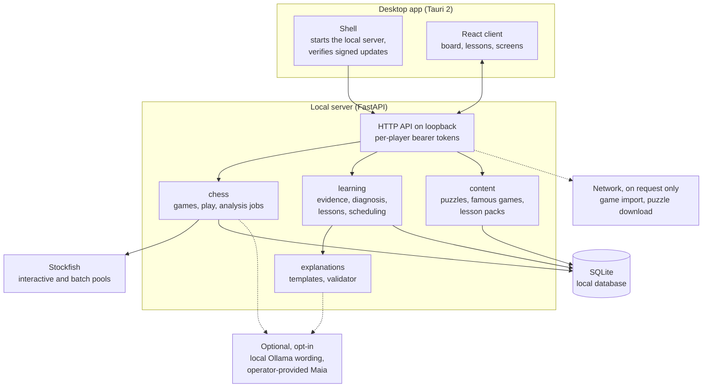
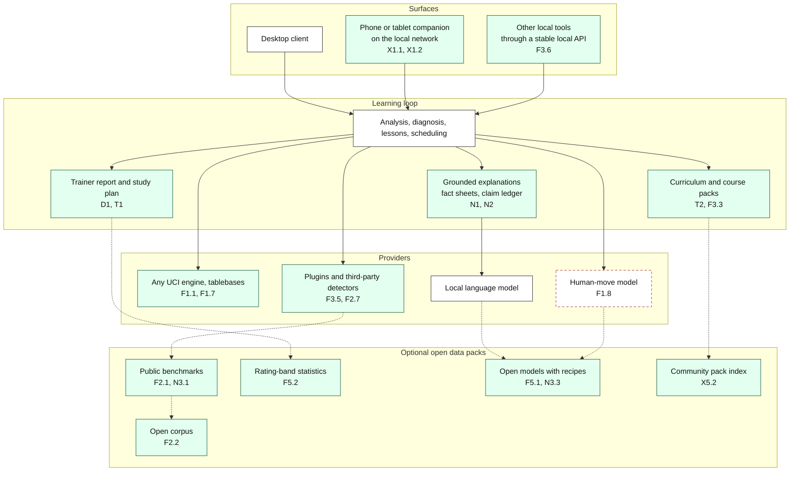
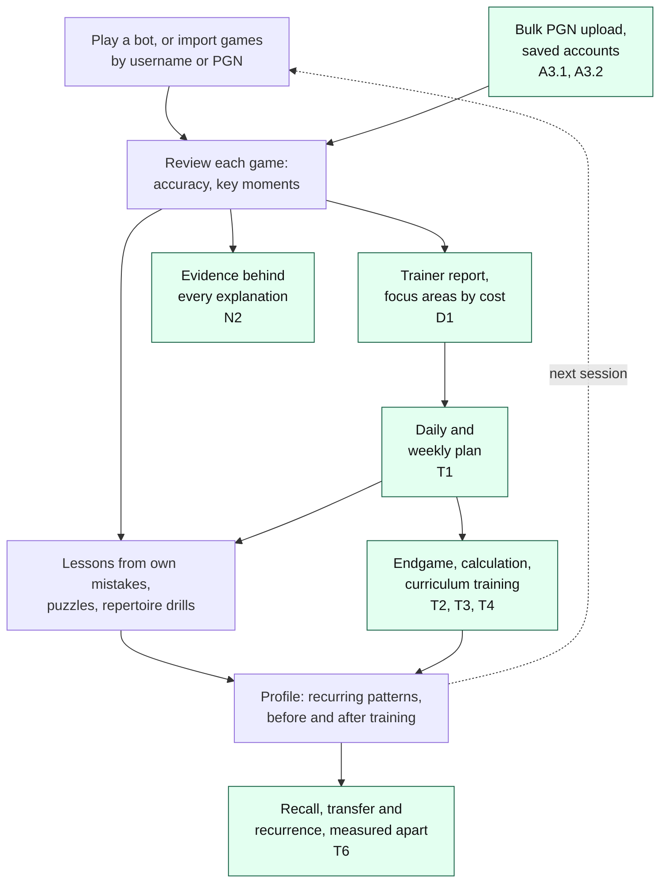
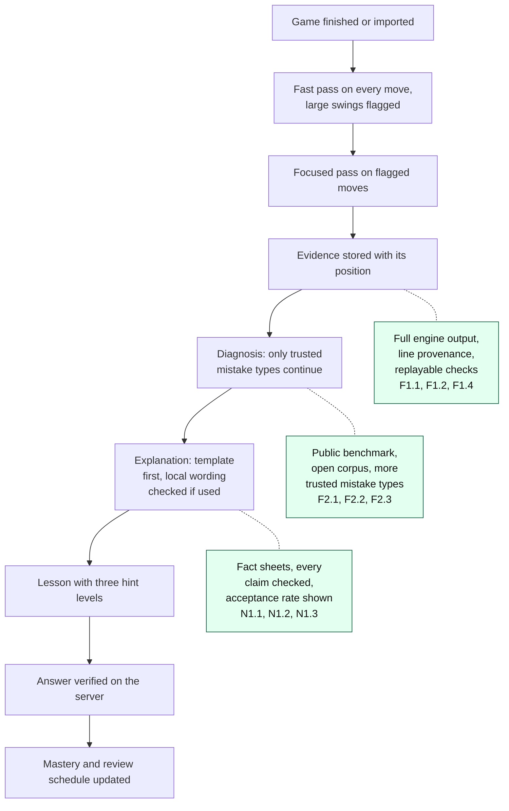
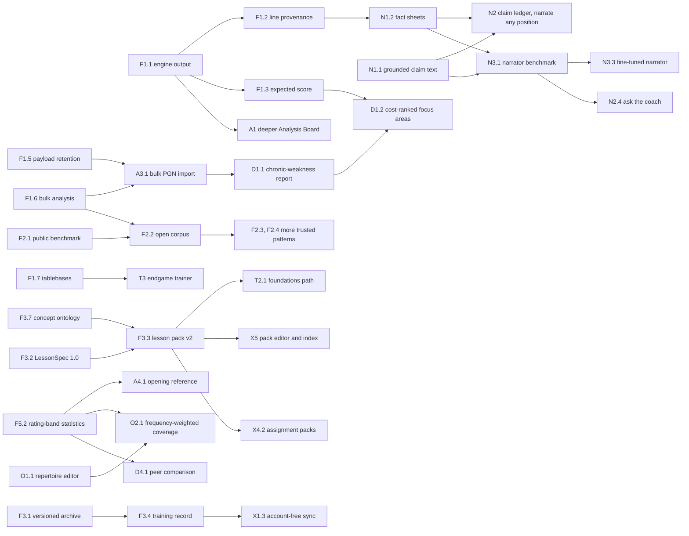

# Scan64 roadmap

Roadmap version 1 · 2026-11-26 · written against Scan64 1.1.0

This roadmap describes how Scan64 is expected to grow: the features we would like it to have, grouped by area and ordered in waves. It is a growth plan, not a release schedule or a promise of dates. Each item is written so that one person can pick it up, study the code involved, plan the work and take it to completion.

- To see what Scan64 does now, read [Scan64 today](#1-scan64-today) or the [system overview](system-overview.md).
- To choose something to build, go to the [feature checklist](#6-feature-checklist) and look for items marked **Ready**, then follow [how to pick up an item](#7-how-to-pick-up-an-item).

## Contents

1. [Scan64 today](#1-scan64-today)
2. [Direction and principles](#2-direction-and-principles)
3. [Architecture](#3-architecture)
4. [Workflows](#4-workflows)
5. [Waves](#5-waves)
6. [Feature checklist](#6-feature-checklist)
7. [How to pick up an item](#7-how-to-pick-up-an-item)
8. [Not planned](#8-not-planned)
9. [Roadmap changes](#9-roadmap-changes)

## 1. Scan64 today

Scan64 is a free, open-source chess coach that runs on the player's own computer. Its core is one owned path from a game to a verified training result:

```text
play or import -> analyse -> persist evidence -> diagnose -> serve lesson -> verify answer -> update mastery and review
```

At version 1.1.0 a player can:

- play Stockfish at eight relative levels, untimed or with clocks, with hints, candidate-move grading and an opt-in blunder guard;
- import games by Lichess or Chess.com username, or paste a PGN, and review every move with key moments;
- practise lessons built from their own mistakes, Safe or blunder, Convert the win, Lichess puzzles and a repertoire imported as PGN, all on FSRS review schedules;
- see recurring patterns with their source positions, and recurrence before and after training with sample sizes and intervals;
- install community lesson packs, which the local engine re-verifies, and export a coach packet;
- opt in to wording from a local language model, which can reword explanations but never changes the engine's verdict.

Six mistake types currently pass the measurement that lets them become lessons: hanging piece, missed check, missed capture, missed direct threat, allowed mate and knight fork. Widening that set is one of the main threads of this roadmap.

The [system overview](system-overview.md), [system design](system-design.md) and [user guide](user-guide.md) describe the current release in full.

## 2. Direction and principles

Scan64 grows along its learning loop. Every item in this roadmap does at least one of these:

- brings more games and positions into the loop;
- makes the engine evidence richer, or easier for anyone to check;
- widens what the coach can diagnose, through measurement;
- explains positions with claims that trace back to evidence;
- adds ways to practise, each of which records its attempts;
- measures learning honestly;
- carries a player's work into documented formats, other devices and other tools.

### Principles every item keeps

A pull request that breaks one of these is not merged, however useful the feature.

1. **The engine and the board decide chess facts.** Language models only word them, and a deterministic explanation always exists.
2. **Nothing leaves the player's machine without an explicit action,** and declining never reduces function.
3. **A new diagnosis reaches players only after it passes a measurement planned in advance.** Today that gate is precision of at least 0.80 with at least 10 supporting cases.
4. **Statistics show sample sizes, intervals and "not enough data" states.** No claim that training raises a rating without a study designed to show it.
5. **Everything a player or author creates exports to a documented, versioned format.**
6. **The code, data, content and model weights the project produces are open.**

## 3. Architecture

### 3.1 Today

Scan64 is one desktop application. A Tauri shell starts a local Python server bound to the loopback interface; the React client talks to it over HTTP. All player data lives in one SQLite database on the player's machine.



Solid arrows are always present. Dashed arrows are optional components or network calls the player starts.

### 3.2 Where it is going

The planned architecture keeps the same local core and adds three things around it. Item IDs refer to the [feature checklist](#6-feature-checklist).



White boxes exist today, green boxes are planned, and the dashed red box waits on a decision. Dashed arrows are optional downloads.

- **A provider layer.** The analysis engine, tablebases, a human-move model and the language model sit behind provider contracts, so each can be replaced by configuration.
- **Open data packs beside the app.** Benchmarks, a corpus, rating-band statistics and models are built in public from Lichess public-domain data and installed as optional packs. The app stays fully usable without them.
- **More than one surface.** A companion on the local network and a stable local API let other devices and tools use the same local data, with no hosted account.

## 4. Workflows

### 4.1 Player workflow

The loop a player follows today, with the main planned additions in green.



### 4.2 System workflow: from a game to a lesson

What the server does between a finished game and a lesson, with the planned upgrades to each stage beside it.



## 5. Waves

Waves order the work by dependency: a wave holds the items whose prerequisites are complete by the time it starts. They are not release dates. An item marked **Ready** can start in any wave, so contributors do not need to wait for earlier waves to finish.

| Wave | Theme | When the wave is complete, a player can … | Items | Ready now |
|---:|---|---|---:|---:|
| 0 | Engine output and project foundations | … choose the analysis engine in a configuration file, export PGN with full engine lines and see where each explanation came from. The repository documents its trademark, licence per asset type and contribution workflow. | 12 | 6 |
| 1 | Grounded explanations and open analysis | … ask for an explanation of any Analysis Board position and open the evidence behind each sentence. Anyone can rerun the diagnosis and explanation benchmarks. | 21 | 13 |
| 2 | Trainer-style diagnosis | … upload a PGN of thousands of games and get a trainer-style report with focus areas ranked by cost, context breakdowns and a time-boxed daily plan. | 22 | 9 |
| 3 | Practice breadth and lesson formats | … train endgames against perfect tablebase defence, drill calculation and visualisation, edit a repertoire on the board and hear explanations read aloud. Lesson authors write to LessonSpec 1.0 and pack format v2. | 32 | 19 |
| 4 | Open data and rating-band context | … see how often players at their rating find a move, how their numbers compare with their rating band and which repertoire gaps opponents reach most. More tactical patterns become lessons, each only after passing its measurement. | 18 | 2 |
| 5 | Curriculum, coaching and extensions | … follow a foundations path as a beginner, receive assignment packs from a coach, run the daily queue on a phone on the same network, and use detectors, packs and translations published by others. | 27 | 4 |
| 6 | Research tracks and new devices | … use each longer-term track once it passes its own measurement: a personal mistake model, a fine-tuned narrator, conversational and voice coaching, shared analysis computing, native mobile and physical boards. | 24 | 4 |

### Items that unblock the most work

These items have the most other items waiting on them. Finishing one of them opens the largest amount of follow-on work.

| Item | Unblocks directly | Unblocks in total | Status |
|---|---:|---:|---|
| F1.1 Swappable engine with full engine output | 9 | 31 | In progress on the epic [#371](https://github.com/Mathews-Tom/Scan64/issues/371) branch |
| F1.6 Bulk analysis capacity | 2 | 17 | **Ready** |
| F1.2 Line provenance | 3 | 16 | Needs F1.1 |
| F3.7 Concept ontology | 4 | 16 | **Ready** |
| N1.2 Fact sheets | 7 | 12 | Needs F1.1, F1.2 |
| F3.2 LessonSpec 1.0 | 1 | 11 | **Ready** |
| F1.5 Engine-payload retention | 1 | 10 | **Ready** |
| F3.3 Lesson pack v2 (course format) | 5 | 10 | Needs F3.2, F3.7 |
| N1.1 Grounded claim text | 4 | 9 | In progress on the epic [#371](https://github.com/Mathews-Tom/Scan64/issues/371) branch |
| A3.1 Bulk PGN import | 1 | 9 | Needs F1.5, F1.6 |



## 6. Feature checklist

The checklist has 156 items in 8 areas. Each area is split into features, which are good units to pick up as a group.

**How to read an item.** The bold line is the item's ID and name; the sentence after it says what a player or contributor can do once it ships. Then:

- **Wave** is the earliest wave the item fits, given its dependencies.
- **Size**: S is a small change, M one feature, L several connected features, XL a programme of work best split into its own plan.
- **Status**: **Ready** has no unfinished dependency and can start now. **Needs** lists the items that must land first. **In progress** has a branch or pull request. **Waiting on a decision** needs a maintainer decision first, with the reason given.
- **Careful review** marks changes to saved data, releases, installers or network boundaries. They need the full check suite, a security review and maintainer sign-off on the evidence before merge.

A ticked box means the item is merged to `main` and released.

### F — Foundations

Engine output, diagnosis measurement, file formats, project governance and open data. Most other areas build on these items.

#### F1 — Engine and evidence contract

- [ ] **F1.1 Swappable engine with full engine output.** Any UCI engine is selected by a TOML profile; every stored line keeps its full PV, cp or mate score, WDL, depth, seldepth, nodes and MultiPV index. *Wave 0 · Size M · In progress on the epic [#371](https://github.com/Mathews-Tom/Scan64/issues/371) branch · issue [#360](https://github.com/Mathews-Tom/Scan64/issues/360)*
- [ ] **F1.2 Line provenance.** Every stored line records its start FEN and search identity; the validator replays each line from its own start, so after-position lines become citable. *Wave 0 · Size M · Needs F1.1*
- [ ] **F1.3 Expected score as the common unit.** Review, hints, accuracy and reports express loss as expected score from engine WDL, not centipawns. *Wave 1 · Size M · Needs F1.1*
- [ ] **F1.4 Replayable evidence manifest.** `scan64-cli verify` re-runs any stored diagnosis from its recorded engine hash, options and limits, and reports agreement. *Wave 2 · Size M · Needs F1.1*
- [ ] **F1.5 Engine-payload retention.** Stored engine payloads follow a configurable retention and compaction policy; the database stays bounded on large imports. *Wave 2 · Size M · Ready · careful review*
- [ ] **F1.6 Bulk analysis capacity.** A resumable bulk queue with priorities, progress and pause analyses thousands of games in the background without starving play. *Wave 2 · Size M · Ready · issue [#365](https://github.com/Mathews-Tom/Scan64/issues/365)*
- [ ] **F1.7 Tablebase provider.** Optional Syzygy 3-5-piece download and opt-in remote lookup for 6-7 pieces give review, drills and detectors exact results. *Wave 2 · Size M · Ready*
- [ ] **F1.8 Human-move model provider.** A separate-process provider returns move probabilities by rating band (Maia family), installed as an optional pack. *Wave 4 · Size L · Waiting on a decision: a licence for the model weights*

#### F2 — Diagnosis measurement and taxonomy

- [ ] **F2.1 Public diagnosis benchmark v1.** A published, versioned benchmark (corpus hashes, protocols, per-code precision and support) with `scan64-cli benchmark diagnosis`; anyone can reproduce the trust table. *Wave 1 · Size M · Ready*
- [ ] **F2.2 Open Corpus pipeline.** A reproducible pipeline samples Lichess CC0 games by rating band, deep-analyses them and publishes verified labelled positions with proofs and a data card. *Wave 4 · Size L · Needs F2.1, F1.6*
- [ ] **F2.3 Trust promotion wave 1.** Pin, skewer, discovered attack, back rank and overloaded defender become lessons once each passes precision >= 0.80 and support >= 10 on a preregistered sample. *Wave 4 · Size L · Needs F2.2*
- [ ] **F2.4 Detector wave 2.** New detectors: double attack, removal of the defender, deflection, trapped piece, intermezzo, missed defensive resource, promotion tactics. *Wave 5 · Size L · Needs F2.2*
- [ ] **F2.5 Non-tactical diagnosis families.** Operational definitions and gates for conversion failure, tablebase-proved endgame errors, time-pressure collapse and premature simplification. *Wave 5 · Size L · Needs F1.3, F1.7*
- [ ] **F2.6 Missed-punishment diagnosis.** Opponent mistakes the player failed to punish become lessons, reported separately from the player's own blunders. *Wave 2 · Size M · Needs F1.3 · issue [#365](https://github.com/Mathews-Tom/Scan64/issues/365)*
- [ ] **F2.7 Out-of-tree detectors.** Third-party detector packages load through entry points and reach trusted status only by passing the public benchmark. *Wave 5 · Size M · Needs F2.1, F3.5*
- [ ] **F2.8 Distributed verification.** Volunteers donate CPU to analyse corpus shards; results are signed and spot-re-verified deterministically. *Wave 6 · Size XL · Needs F2.2, F1.4*

#### F3 — Open formats and interfaces

- [ ] **F3.1 Versioned player archive.** The export archive carries a format name and schema version with a published schema; 1.x archives keep importing. *Wave 0 · Size M · Ready · careful review*
- [ ] **F3.2 LessonSpec 1.0.** A public spec, JSON Schema, conformance fixtures and semver policy let other boards and tools render Scan64 lessons. *Wave 3 · Size M · Ready*
- [ ] **F3.3 Lesson pack v2 (course format).** Packs carry chapters, prose pages, branching solutions with accepted alternatives, concept IDs, prerequisites, per-asset licence and an optional author signature. *Wave 3 · Size L · Needs F3.2, F3.7*
- [ ] **F3.4 Portable training record.** Review logs, attempts and schedules export and import in a documented schema with an Anki revlog mapping. *Wave 5 · Size M · Needs F3.1*
- [ ] **F3.5 External plugin loading.** The six existing registry kinds load from installed packages, off by default and capability-limited. *Wave 5 · Size M · Ready · careful review*
- [ ] **F3.6 Stable local API v1.** A versioned, contract-tested local HTTP API with scoped tokens for third-party local tools. *Wave 5 · Size M · Ready · careful review*
- [ ] **F3.7 Concept ontology.** A public, versioned concept graph: IDs, definitions, prerequisites and mappings to diagnosis codes and Lichess themes. *Wave 3 · Size M · Ready*

#### F4 — Project identity, licensing and releases

- [ ] **F4.1 Trademark policy.** `TRADEMARKS.md` describes official builds, unmodified mirrors and how forks name themselves. *Wave 0 · Size S · Ready*
- [ ] **F4.2 Licence architecture and DCO.** A licence manifest per asset type (code, content, data, models, marks) and DCO sign-off on contributions. *Wave 0 · Size S · Ready*
- [ ] **F4.3 Release provenance.** Every release publishes build attestations and an SBOM, with a documented reproducible build. *Wave 1 · Size M · Ready · careful review*
- [ ] **F4.4 OS code signing.** Installers are Developer ID signed and notarised on macOS and Authenticode signed on Windows. *Wave 5 · Size M · Waiting on a decision: funding for signing certificates · careful review*
- [ ] **F4.5 Sustainability channel.** Donations with a public budget; compute sponsorship for corpus runs. *Wave 0 · Size S · Ready*
- [ ] **F4.6 Contribution governance.** An epic-per-area workflow (as in epic [#371](https://github.com/Mathews-Tom/Scan64/issues/371)), an RFC template for spec changes and a maintainers file. *Wave 0 · Size S · Ready*

#### F5 — Open data and models

- [ ] **F5.1 Difficulty model.** Own-game lessons get a calibrated difficulty rating with uncertainty from a model trained on Lichess CC0 puzzle ratings. *Wave 4 · Size L · Ready*
- [ ] **F5.2 Population stats pack.** A downloadable aggregate of opening move frequencies, results and error rates by rating band and time control, built from Lichess CC0 games. *Wave 4 · Size L · Ready*
- [ ] **F5.3 Opt-in aggregate contributions.** A player may opt in to share anonymous outcome counts for public item IDs; aggregates are published; refusing changes nothing. *Wave 6 · Size L · Waiting on a decision: a privacy review of opt-in sharing; needs F3.4 · careful review*
- [ ] **F5.4 Model zoo with recipes.** Every shipped model has open weights, a model card, a training script and a score on the public benchmarks. *Wave 6 · Size M · Needs N3.1, F2.1*

### A — Analysis and review

Deeper engine analysis, better game review, and more ways to bring games in.

#### A1 — Analysis Board

- [ ] **A1.1 Deep variations and engine detail.** Lines show at full length, with more than three MultiPV lines and depth, nodes and WDL per line. *Wave 0 · Size M · Needs F1.1 · issue [#362](https://github.com/Mathews-Tom/Scan64/issues/362)*
- [ ] **A1.2 PGN export with engine variations.** A saved PGN includes engine lines and evaluation annotations. *Wave 0 · Size S · Needs F1.1 · issue [#362](https://github.com/Mathews-Tom/Scan64/issues/362)*
- [ ] **A1.3 Continuous analysis.** Analysis keeps deepening until paused, inside a visible engine budget. *Wave 1 · Size M · Needs F1.1*
- [ ] **A1.4 Threat view.** A toggle shows what the opponent threatens if the side to move passes. *Wave 1 · Size S · Ready*
- [ ] **A1.5 Tablebase verdicts.** Positions with five or fewer pieces show the exact result and DTZ. *Wave 2 · Size S · Needs F1.7*

#### A2 — Game review

- [ ] **A2.1 Move classification v2.** Every move label has a published definition, including evidence-defined positive labels such as only-move. *Wave 1 · Size M · Ready*
- [ ] **A2.2 Review takeaways.** Each reviewed game ends with a deterministic summary: what decided it, the top lesson and one-click practice. *Wave 1 · Size M · Ready*
- [ ] **A2.3 Practical difficulty overlay.** Review shows how often players at the player's rating find each missed move, with a blunder-risk meter. *Wave 4 · Size M · Needs F1.8*
- [ ] **A2.4 Guided walk-through.** Step through a game stopping only on chosen move classes, retrying in place. *Wave 1 · Size S · Ready*
- [ ] **A2.5 Annotate-first review.** The player marks critical moments and an assessment before the engine is revealed; the review compares both. *Wave 3 · Size M · Ready*

#### A3 — Import and library

- [ ] **A3.1 Bulk PGN import.** One multi-game file (hundreds to thousands of games) imports with dedupe and background analysis progress. *Wave 2 · Size M · Needs F1.5, F1.6 · issue [#365](https://github.com/Mathews-Tom/Scan64/issues/365)*
- [ ] **A3.2 Saved accounts and incremental sync.** Saved Lichess and Chess.com usernames; Sync now fetches only new games, past today's 50-game cap. *Wave 1 · Size M · Ready*
- [ ] **A3.3 Game library.** Games filter and search by opening, result, date, opponent, source and lesson status, with collections and notes. *Wave 2 · Size M · Ready*
- [ ] **A3.4 Position search.** Find every own game that reached a position or structure. *Wave 3 · Size M · Needs A3.3*
- [ ] **A3.5 Open in Scan64.** A `scan64://` link and a browser extension send a completed online game to the desktop app. *Wave 3 · Size M · Ready*
- [ ] **A3.6 Lichess study import.** A study's chapters import as games, a repertoire or a pack. *Wave 3 · Size S · Ready*
- [ ] **A3.7 OTB capture.** A photographed scoresheet or diagram becomes a human-confirmed PGN or FEN in the same review loop. *Wave 6 · Size XL · Ready*
- [ ] **A3.8 Chess960.** Chess960 games import, play and review. *Wave 6 · Size L · Ready*

#### A4 — Reference

- [ ] **A4.1 Opening reference explorer.** Any position shows move popularity and results at the player's rating band next to the player's own record. *Wave 4 · Size M · Needs F5.2*
- [ ] **A4.2 Model-game library.** Curated public-domain master games indexed by opening and structure. *Wave 3 · Size M · Ready*

### N — Explanations

Explanations whose every claim is checked against engine and board evidence. Conversation and voice come last because each adds more claims to check.

#### N1 — Grounded explanations

- [ ] **N1.1 Grounded claim text.** Every piece, square, move, evaluation and material statement in generated prose is checked against evidence or the board. *Wave 0 · Size M · In progress on the epic [#371](https://github.com/Mathews-Tom/Scan64/issues/371) branch · issue [#366](https://github.com/Mathews-Tom/Scan64/issues/366)*
- [ ] **N1.2 Fact sheets.** The narrator receives a schema'd JSON fact sheet per move (SAN, piece, capture, check, threats, material, evaluation) instead of a Python `repr` of UCI payloads. *Wave 1 · Size M · Needs F1.1, F1.2 · issue [#367](https://github.com/Mathews-Tom/Scan64/issues/367)*
- [ ] **N1.3 Fallback accounting.** Each explanation records its source, every fallback logs its reason, and the acceptance rate shows in Settings and the CLI. *Wave 0 · Size S · Ready*
- [ ] **N1.4 Prompt budgeting.** Context size is set explicitly, truncation is deterministic and marked, and background and coach paths have separate time budgets. *Wave 1 · Size S · Needs N1.2*

#### N2 — Explanation surfaces

- [ ] **N2.1 Claim ledger.** Each sentence of an explanation links to its evidence; cited lines play on the board. *Wave 1 · Size M · Needs N1.1*
- [ ] **N2.2 Narrate any position.** On the Analysis Board the player asks for an explanation comparing the top engine lines. *Wave 1 · Size M · Needs N1.1, N1.2 · issue [#368](https://github.com/Mathews-Tom/Scan64/issues/368)*
- [ ] **N2.3 Game narrative.** A reviewed game gets a narrated summary built from its takeaways. *Wave 2 · Size M · Needs A2.2, N1.2*
- [ ] **N2.4 Ask the coach.** Free-form questions such as "why not Nf5?" are answered only through engine and board tool calls, validated, with refusal when ungrounded. *Wave 6 · Size L · Needs N1.1, N1.2, N3.2*
- [ ] **N2.5 Report narration.** The trainer report gets a narrated summary; the deterministic report stands without it. *Wave 2 · Size S · Needs D1.1, N1.2 · issue [#365](https://github.com/Mathews-Tom/Scan64/issues/365)*

#### N3 — Models and evaluation

- [ ] **N3.1 Narrator benchmark.** A public fixed benchmark reports grounding pass rate, false statements per explanation, SAN correctness and latency. *Wave 1 · Size M · Needs N1.1, N1.2 · issue [#369](https://github.com/Mathews-Tom/Scan64/issues/369)*
- [ ] **N3.2 Recommended models by hardware tier.** Settings recommends a tested model for the machine class. *Wave 1 · Size S · Needs N3.1 · issue [#369](https://github.com/Mathews-Tom/Scan64/issues/369)*
- [ ] **N3.3 Fine-tuned open narrator.** An open-weights narrator trained on evidence-to-explanation pairs, with the validator as filter, is published with its recipe. *Wave 6 · Size XL · Waiting on a decision: results of the narrator benchmark; needs N3.1 · issue [#370](https://github.com/Mathews-Tom/Scan64/issues/370)*
- [ ] **N3.4 Built-in model runtime.** Scan64 downloads and runs a recommended model itself; no separate Ollama install. *Wave 6 · Size L · Needs N3.2 · careful review*

#### N4 — Concept explanations

- [ ] **N4.1 Verified concept extractor.** Deterministic, engine-verified facts about piece roles, threat persistence, pawn structure and king safety. *Wave 6 · Size L · Needs F3.7, F1.2*
- [ ] **N4.2 Why not my move.** Every lesson shows the refutation of the played move next to the best line. *Wave 3 · Size M · Needs F1.2*
- [ ] **N4.3 Contrast positions.** Paired near-identical positions where one feature flips the right decision. *Wave 6 · Size XL · Needs N4.1, F2.2*

#### N5 — Voice and language

- [ ] **N5.1 Read-aloud.** Verified explanations and lines are spoken (OS speech first, local TTS optional). *Wave 3 · Size M · Ready*
- [ ] **N5.2 Spoken move input.** Moves and variations are dictated through local speech recognition with legal-move disambiguation. *Wave 6 · Size L · Ready*
- [ ] **N5.3 Voice Socratic coach.** Hands-free question-and-answer coaching, fully offline. *Wave 6 · Size XL · Needs N2.4, N5.1, N5.2*
- [ ] **N5.4 Localised explanations.** Templates and narrator output follow the UI language. *Wave 5 · Size M · Needs X2.1*

### D — Diagnosis and player model

From single mistakes to a picture of the player across many games. Reports are computed first; generated wording only describes them.

#### D1 — Trainer report

- [ ] **D1.1 Chronic-weakness report.** Recurring errors across all imported games show counts, rates per 100 moves, intervals and insufficient-data states. *Wave 2 · Size M · Needs A3.1 · issue [#365](https://github.com/Mathews-Tom/Scan64/issues/365)*
- [ ] **D1.2 Cost-ranked focus areas.** Focus areas are ranked by expected score lost. *Wave 2 · Size S · Needs F1.3, D1.1 · issue [#365](https://github.com/Mathews-Tom/Scan64/issues/365)*
- [ ] **D1.3 Context breakdowns.** Performance splits by material imbalance, position type, attack or defence, advantage state and time pressure. *Wave 2 · Size M · Needs D1.1 · issue [#365](https://github.com/Mathews-Tom/Scan64/issues/365)*
- [ ] **D1.4 Blind-spot classes.** Miss classes by geometry (long diagonal, backward move, knight distance) for own and opponent threats. *Wave 5 · Size L · Needs F2.4, F2.6 · issue [#365](https://github.com/Mathews-Tom/Scan64/issues/365)*
- [ ] **D1.5 Report over time.** Each new upload shows the change against the previous report. *Wave 2 · Size M · Needs D1.1 · issue [#365](https://github.com/Mathews-Tom/Scan64/issues/365)*
- [ ] **D1.6 Practice links.** Every finding links to a lesson, a puzzle theme or its source positions. *Wave 2 · Size S · Needs D1.1 · issue [#365](https://github.com/Mathews-Tom/Scan64/issues/365)*

#### D2 — Skill model

- [ ] **D2.1 Mastery map with uncertainty.** Per-concept mastery shows intervals, split by evidence source (lesson, fresh position, game). *Wave 4 · Size M · Needs F3.7*
- [ ] **D2.2 Knowledge tracing.** Mastery estimates use slip- and guess-aware tracing and handle multi-concept items. *Wave 5 · Size M · Needs D2.1*
- [ ] **D2.3 Calibrated priors.** Rating-band priors replace today's provisional ones. *Wave 5 · Size M · Needs F5.2, F2.2*

#### D3 — Time and decision behaviour

- [ ] **D3.1 Time-allocation diagnostics.** Time spent is compared with position criticality; time-trouble segments are flagged. *Wave 2 · Size M · Ready*
- [ ] **D3.2 Criticality signal.** Each position gets a worth-calculating score from shallow and deep search disagreement. *Wave 3 · Size M · Needs F1.1*

#### D4 — Cohort context

- [ ] **D4.1 Peer benchmarks from open data.** Accuracy by phase and error rates compare against the rating band from the stats pack, with no telemetry. *Wave 4 · Size M · Needs F5.2*
- [ ] **D4.2 Game-derived rating estimate.** Players without a rating get an estimate with a wide interval. *Wave 6 · Size L · Ready*

#### D5 — Personal model

- [ ] **D5.1 Personal mistake predictor.** A local model fitted to the player's own games predicts their likely errors and is shown only after passing held-out calibration. *Wave 6 · Size XL · Waiting on a decision: the design of a calibration study; needs F1.8*
- [ ] **D5.2 Future-error radar.** Lesson selection weights positions the player is predicted to misplay. *Wave 6 · Size L · Needs D5.1*

#### D6 — Opponent preparation

- [ ] **D6.1 Opponent dossier.** Openings, frequent lines and error patterns of a named opponent come from their public games and stay local. *Wave 3 · Size M · Needs A3.2, D1.1*
- [ ] **D6.2 Prep sparring.** A bot plays the opponent's repertoire. *Wave 4 · Size M · Needs D6.1, O3.1*

### T — Training and practice

More ways to practise. Every mode records its attempts, so each drill also feeds the player's profile.

#### T1 — Study plan

- [ ] **T1.1 Daily plan v2.** A time-boxed session mixes due reviews, weakness drills, new material and play, gives a reason for each item and carries no backlog penalty. *Wave 2 · Size M · Ready*
- [ ] **T1.2 Weekly plan and review.** Weekly targets and an end-of-week evidence summary. *Wave 2 · Size M · Needs T1.1*
- [ ] **T1.3 Plan from report and curriculum.** The plan draws from cost-ranked focus areas and curriculum units. *Wave 5 · Size M · Needs T1.1, T2.1, D1.2*

#### T2 — Curriculum

- [ ] **T2.1 Foundations path (600-1600).** Concept units (introduction, guided examples, mixed test) ship as CC BY-SA packs. *Wave 5 · Size XL · Needs F3.3, F3.7*
- [ ] **T2.2 Checkpoint tests.** Theme-hidden tests on unseen positions gate progression. *Wave 5 · Size M · Needs T2.1, T5.1*
- [ ] **T2.3 Remediation links.** A diagnosed weakness opens the matching curriculum unit. *Wave 5 · Size S · Needs T2.1*

#### T3 — Endgames

- [ ] **T3.1 Fundamental endgame trainer.** Basic mates, king-and-pawn and rook endings are graded by tablebase and played out against perfect defence. *Wave 3 · Size L · Needs F1.7*
- [ ] **T3.2 Own-game endgame lessons.** Tablebase-proved thrown wins and draws become lessons. *Wave 5 · Size M · Needs F1.7, F2.5*
- [ ] **T3.3 Endgame rating.** A separate endgame rating. *Wave 3 · Size S · Needs T3.1*

#### T4 — Calculation and visualisation

- [ ] **T4.1 Coordinate and board-vision trainer.** Timed square, colour and route drills. *Wave 1 · Size S · Ready*
- [ ] **T4.2 Blind tactics.** Solve from a position shown N plies earlier, or with pieces hidden. *Wave 3 · Size M · Ready*
- [ ] **T4.3 Checks-captures-threats scan.** List every forcing move before choosing one. *Wave 3 · Size M · Ready*
- [ ] **T4.4 Commit-your-line trainer.** The player enters the full variation before feedback; the app names the failure: missed reply, wrong evaluation or visualisation slip. *Wave 3 · Size L · Ready*
- [ ] **T4.5 Guess the move.** Play through master games and own wins, scored by expected-score tolerance. *Wave 3 · Size M · Ready*

#### T5 — Puzzle depth

- [ ] **T5.1 Custom puzzle sets.** Sets by rating range, themes, missed and unseen, with a theme-hidden mixed mode. *Wave 1 · Size M · Ready*
- [ ] **T5.2 Timed puzzle mode.** A clocked run with its own score, never mixed into the puzzle rating. *Wave 1 · Size S · Ready*
- [ ] **T5.3 Woodpecker cycles.** Frozen sets repeat in cycles with per-cycle accuracy and time. *Wave 2 · Size M · Ready*
- [ ] **T5.4 Calibrated own-game difficulty.** Own-game lessons are sequenced by calibrated difficulty. *Wave 4 · Size M · Needs F5.1*

#### T6 — Measuring learning

- [ ] **T6.1 Blind transfer probes.** Unprompted fresh positions for each trained concept, mixed with safe positions. *Wave 2 · Size M · Ready*
- [ ] **T6.2 N-of-1 method trials.** An opt-in comparison of practice methods with preregistered endpoints. *Wave 6 · Size L · Needs T5.3, T6.1*
- [ ] **T6.3 Personal FSRS optimisation.** Scheduler parameters fit the player's own reviews, with a desired-retention setting and a workload forecast. *Wave 2 · Size M · Ready*
- [ ] **T6.4 Efficacy dashboard.** Trained recall, fresh transfer, game recurrence and rating show as separate endpoints. *Wave 3 · Size M · Needs T6.1*

#### T7 — Motivation

- [ ] **T7.1 Strengths page.** Strong decisions are recognised alongside mistakes. *Wave 1 · Size S · Ready*
- [ ] **T7.2 Competency achievements.** Achievements follow demonstrated mastery, not activity. *Wave 4 · Size S · Needs D2.1*

### O — Openings and repertoire

Building a repertoire on the board and prioritising the lines opponents actually play.

#### O1 — Repertoire authoring

- [ ] **O1.1 Repertoire editor.** Moves are added, edited and annotated on the board across several repertoires, with source merging and PGN export. *Wave 3 · Size L · Ready*
- [ ] **O1.2 Transposition-aware reviews.** One review state per position across move orders. *Wave 3 · Size M · Needs O1.1*
- [ ] **O1.3 Study-backed repertoire.** A Lichess study acts as a repertoire source. *Wave 3 · Size S · Needs A3.6, O1.1*
- [ ] **O1.4 Polyglot import and export.** Repertoires convert to and from Polyglot books. *Wave 4 · Size S · Needs O1.1*

#### O2 — Coverage and priority

- [ ] **O2.1 Frequency-weighted coverage.** Gaps rank by how often opponents at the player's level reach them (1 in N games). *Wave 4 · Size M · Needs F5.2, O1.1*
- [ ] **O2.2 Cost-ranked deviations.** Deviations in own games rank by expected score lost. *Wave 2 · Size S · Needs F1.3*
- [ ] **O2.3 Real games count as reviews.** A correct repertoire move in a real game credits its review. *Wave 3 · Size M · Ready*
- [ ] **O2.4 Gap-fill suggestions.** A gap gets candidate moves with engine, population and simplicity scores; the player chooses. *Wave 5 · Size L · Needs O2.1*

#### O3 — Opening practice

- [ ] **O3.1 Repertoire sparring.** Play from repertoire positions against population-weighted replies into the middlegame. *Wave 4 · Size M · Needs O1.1*
- [ ] **O3.2 Plans and model games.** Each line carries plans and model games. *Wave 5 · Size L · Needs F3.3, A4.2*

### P — Play and opponents

More varied and more human opponents, structured practice games, and physical boards.

#### P1 — Human-like opponents

- [ ] **P1.1 Human-model bots.** Elo-labelled human-like opponents come from an optional pack. *Wave 4 · Size M · Needs F1.8*
- [ ] **P1.2 Calibrated ladder.** Every bot level has a published measured strength. *Wave 4 · Size M · Needs F1.8*
- [ ] **P1.3 Human pacing.** Human-like move times and resignation. *Wave 4 · Size S · Needs P1.1*

#### P2 — Opponent variety

- [ ] **P2.1 Opponent styles.** Selectable styles with documented behaviour. *Wave 3 · Size M · Ready*
- [ ] **P2.2 Adaptive session difficulty.** Opt-in difficulty adapts within a session, outside the rated cohorts. *Wave 3 · Size M · Ready*
- [ ] **P2.3 Play your past self.** A bot built from the personal model. *Wave 6 · Size L · Needs D5.1*

#### P3 — Structured play

- [ ] **P3.1 Play from any position.** A game starts from the Analysis Board or a pasted FEN. *Wave 1 · Size S · Ready*
- [ ] **P3.2 Sparring library.** Themed starting positions: endgames, structures and the player's own lost positions. *Wave 3 · Size M · Needs P3.1*
- [ ] **P3.3 In-game coach v2.** Proactive coaching at critical moments uses deeper evidence than today's 10,000-node single line. *Wave 3 · Size M · Needs F1.1, N1.2*
- [ ] **P3.4 Custom time controls.** Any base time and increment. *Wave 3 · Size S · Ready*

#### P4 — Physical board

- [ ] **P4.1 E-board adapters.** Play and drill on a Chessnut or DGT board. *Wave 6 · Size L · Waiting on a decision: test hardware*
- [ ] **P4.2 OTB game capture.** Games played on the board enter review. *Wave 6 · Size M · Needs P4.1*

### X — Platform and community

Other devices, languages, accessibility, tools for coaches, community content, board presentation and distribution.

#### X1 — Devices

- [ ] **X1.1 LAN companion.** A phone or tablet on the same network pairs with the desktop install. *Wave 5 · Size L · Ready · careful review*
- [ ] **X1.2 Companion PWA.** The companion installs to the home screen and keeps an offline due queue. *Wave 5 · Size M · Needs X1.1*
- [ ] **X1.3 Account-free sync.** Two installs sync through a user-chosen folder, end-to-end encrypted. *Wave 6 · Size L · Needs F3.1, F3.4 · careful review*
- [ ] **X1.4 Native mobile.** A mobile app with an on-device engine. *Wave 6 · Size XL · Waiting on a decision: the device strategy, after the local-network companion*

#### X2 — Language

- [ ] **X2.1 Internationalisation.** Strings are externalised and notation is localised. *Wave 5 · Size L · Ready*
- [ ] **X2.2 Translation workflow.** Community translations flow through an open translation tool. *Wave 5 · Size S · Needs X2.1*

#### X3 — Accessibility

- [ ] **X3.1 WCAG 2.2 AA acceptance.** Routes are audited, VoiceOver and NVDA acceptance is recorded, forced-colours mode works. *Wave 3 · Size M · Ready*
- [ ] **X3.2 Spoken board.** Positions and moves are read aloud. *Wave 3 · Size S · Needs N5.1*

#### X4 — Coaches, clubs and families

- [ ] **X4.1 Local learner switcher.** Several learners share one install through a profile switcher. *Wave 3 · Size M · Ready*
- [ ] **X4.2 Assignment packs.** A coach builds a pack from a student's coach packet; the student's results return as a result packet; no server. *Wave 5 · Size M · Needs F3.3, F3.4*
- [ ] **X4.3 Coach workspace.** A coach tracks many students from imported packets. *Wave 5 · Size M · Needs X4.2*
- [ ] **X4.4 LAN classroom.** A shared board for a room. *Wave 6 · Size L · Needs X1.1*

#### X5 — Community content

- [ ] **X5.1 Pack and course editor.** Packs are authored in the app with live engine verification. *Wave 5 · Size L · Needs F3.3*
- [ ] **X5.2 Community pack index.** A signed, reviewed, git-hosted index is browsable in the app behind an explicit network boundary. *Wave 5 · Size M · Needs F3.3, F4.2 · careful review*
- [ ] **X5.3 Reviewer reputation.** Packs show engine-verified and coach-reviewed badges with reviewer history. *Wave 6 · Size M · Needs X5.2*

#### X6 — Board presentation

- [ ] **X6.1 FIDE boards and Staunton sets.** Tournament-standard boards and Staunton-pattern piece sets are selectable. Scan64 1.1.0 shipped the Staunton (cburnett) and Merida sets and four traditional board palettes; two more Staunton-pattern sets are on the epic branch. *Wave 0 · Size M · In progress on the epic [#371](https://github.com/Mathews-Tom/Scan64/issues/371) branch*
- [ ] **X6.2 Material boards.** Wood, marble and granite boards with a matte finish. *Wave 1 · Size S · Ready · issue [#363](https://github.com/Mathews-Tom/Scan64/issues/363)*
- [ ] **X6.3 3D board.** An opt-in 3D view with every board feature. *Wave 6 · Size L · Needs X6.2 · issue [#364](https://github.com/Mathews-Tom/Scan64/issues/364)*

#### X7 — Distribution

- [ ] **X7.1 More build targets.** Intel macOS, Windows ARM and Flatpak builds. *Wave 3 · Size M · Ready*
- [ ] **X7.2 Package managers.** winget, Homebrew and Flathub entries. *Wave 5 · Size S · Needs F4.4*

## 7. How to pick up an item

1. **Choose an item.** Start with one marked **Ready**, or one whose dependencies are ticked. A feature (for example F2) or a whole wave can be taken as a group.
2. **Say you are on it.** Comment on the item's linked issue or open one titled with its ID, for example `[F2.1] Public diagnosis benchmark v1`, so work is not duplicated. Larger efforts run as an epic issue with child issues and a working branch, as epic [#371](https://github.com/Mathews-Tom/Scan64/issues/371) does.
3. **Study before you build.** Trace the code path the item touches at a pinned commit, with file and line references, and list what exists and what is missing. Issue [#361](https://github.com/Mathews-Tom/Scan64/issues/361) and its narrator pipeline trace are an example.
4. **Write the plan in the issue.** State the outcome, the scope and what is out of scope, acceptance criteria phrased as "Done when …", how you will verify it, and the risks. Check it against the [principles](#principles-every-item-keeps).
5. **Build and verify.** Follow [CONTRIBUTING.md](../CONTRIBUTING.md): DCO sign-off, disposable data while developing, the [engineering guardrails](../CONTRIBUTING.md#engineering-guardrails), `scripts/check.sh`, and updated user and architecture documentation. Items marked **careful review** also need the extra review described above.
6. **Close the loop.** Link the pull request to the issue. When it is merged and released, the item's box in this roadmap is ticked.

Questions about scope or design belong in the item's issue before code, not in review.

## 8. Not planned

These are outside the plan. Each would require a hosted service, a content or licensing budget, or a change to the principles above.

- Online play between people, tournaments, clubs, leaderboards and puzzle racing.
- A cloud engine service, or hosted accounts as a requirement. Sync between devices is planned without accounts (X1.1, X1.3).
- A video course library, celebrity coaches and personas.
- A browser overlay that analyses games while they are being played. Importing finished games is in scope (A3.5).
- Engagement mechanics such as XP, lives or paid streak repair. Achievements follow demonstrated skill (T7.2).
- Paid tiers that gate features, or any closed component.
- A language model that judges chess positions on its own.
- A multi-million-game reference database bundled by default. Rating-band statistics (F5.2) and a curated model-game library (A4.2) cover the coaching need.
- Identifying players or making fair-play judgements.

## 9. Roadmap changes

The roadmap version changes when an item is added, dropped or moved to another wave, when a wave completes, or when the principles change. Item IDs are permanent: a dropped item stays in the checklist marked "Dropped", and IDs are never reused.

| Version | Date | Change |
|---|---|---|
| 1 | 2026-11-26 | First public roadmap: 156 items in 8 areas, 41 features and 7 waves, baseline Scan64 1.1.0. |
