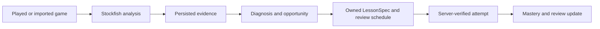

# Scan64 — System Design

This document describes the implementation delivered in Scan64 `0.4.0`, not a future architecture proposal. Product behavior and operating instructions are in the [user guide](user-guide.md).

## Runtime

The normal source entry point, `uv run scan64-cli serve`, serves the built React client and FastAPI on `http://127.0.0.1:8001`. Build the client first; `--host`, `--port` and `--no-browser` control binding and browser launch. `SCAN64_WEB_DIST` can select another built-client directory. API namespaces remain reserved, missing assets return 404, and extensionless client routes fall back to the application's HTML.

The Dockerfile builds the client and pinned Stockfish 18, runs as a non-root user, and starts the same command on `0.0.0.0:8001` with `--no-browser`. Its database is `/data/scan64.db`; preserve the `/data` volume. The unsigned Apple silicon macOS app bundles Python, the client and Stockfish, chooses the first free loopback port from 8001, and stores data and logs in `~/Library/Application Support/Scan64`. Its status window owns server shutdown, and a second launch reuses the running instance. `scripts/build-macos-app.sh` and `Scan64.spec` build that app; neither signing with a distribution identity nor notarization is delivered.

For development, `scripts/run.sh` starts two local processes. Only the Vite client hot-reloads; the API runs without `--reload`, so restart the script after Python changes:

```text
FastAPI API:  http://127.0.0.1:8001
React client: http://127.0.0.1:5173
```

The FastAPI lifespan migrates the local schema, initializes learning plugins, idempotently seeds the transfer catalog, creates Stockfish engine pools when pooling is enabled, and recovers pending/running analysis jobs. Shutdown stops admission work, closes the pools and clears the plugin registry.

The API exposes `GET /health`, generated interactive documentation at `/docs`, and its machine-readable contract at `/openapi.json`.

## Components

| Component | Implemented responsibility |
| --- | --- |
| `apps/scan64-web` | React client for Today, onboarding, play, PGN import, game history, per-move review, Daily Training, puzzles, profile, opening explorer, famous-game study, and coach dashboard. |
| `src/scan64/api` | FastAPI routers, bearer-token ownership boundaries, idempotency middleware, lifecycle endpoints, reports, and application orchestration. |
| `src/scan64/chess` | Game/play-session state, Stockfish opponents, analysis jobs, diagnosis candidates, and admission control. |
| `src/scan64/learning` | Evidence, diagnostics, profile updates, spaced review, lesson attempts, transfer measurement, verification, and plugins. |
| `packages/chess-lesson-spec` | Versioned, renderer-independent Pydantic models for `LessonSpec`. |
| SQLite | Default local persistence for players, games, analysis artifacts, evidence, lessons, schedules, study sessions, attempts, transfer measurements, puzzle runs/ratings/daily sets, onboarding, habit evidence, and lifecycle records. |

## Owned learning loop



### Analysis and persistence

A completed or resigned play session can enqueue analysis automatically. Imported games can be analysed through the owned game path. Analysis persists positions, engine analyses, and evidence for every flagged move. Only learning opportunities, lessons, and profile observations are limited to moves by the owner's side; the read paths do not depend on synthetic ownership.

The analysis board renders every ply with persisted fast-pass scores, owner-move bands, accuracy and coverage, a White-perspective probability graph, and up to three trusted key moments. Review-only backfill is an explicit write for older games; ordinary reads do not search an engine. Retry lessons share their lifetime attempt budget with Daily Training. Analysis keeps at most five lessons at distinct source positions; retained lessons and coarse per-move scores are separate.

### Lessons, review, and transfer

The service creates a durable opportunity, review schedule, and study session before serving an owned persisted lesson. Lesson moves are checked on the server; a verified attempt updates only the matching active skill and review schedule.

Daily Training derives ordering from active mastery, due review, verified attempt history, fatigue, and an exploration floor. Opening Explorer missions remain a separate, ungraded path.

Transfer positions are seeded at application startup. When the existing mastery threshold is reached, the service can assign a separate transfer measurement; later training sessions serve it as a required exercise and its result is reported separately.

### Coach-mode interruption

Coach mode is explicitly enabled on a play session. During eligible practice moves, the server can run a capacity-bounded diagnosis path. It returns a `CriticalInterruptionRead` only after persisting the owned opportunity, review schedule, and study session. Normal play, independent calculation, and ordinary post-game analysis do not claim this interruption behavior.

### Position hints

`POST /v1/insights/position` requires the player's bearer token, `player_id`, and `step` (1–3), plus exactly one of `play_session_id` (an owned active game, on the player's turn) or `fen` (a valid, non-terminal position). Missing tokens return 401; a different player's identity or session is not disclosed (404); invalid FENs or missing/out-of-range steps return 422 and finished positions/sessions return 409. Session positions are reconstructed on the server, including repetition history.

Only automatic game-over states are terminal here, matching Play: checkmate, stalemate, insufficient material, fivefold repetition, or the 75-move rule. A claimable threefold repetition or 50-move draw does not disable hints while the game remains active.

Each response contains only the requested step's data:

- **Step 1 — nudge:** `step`, a question in `text`, and `visualizations` highlighting one safe cue square. The square is never the origin or destination of any candidate (or any accepted lesson move). Without a safe reason square, the cue is the most valuable legally attacked opponent piece, otherwise the opponent's last-moved piece when history is available, otherwise the opponent king. The question matches the cue; only when none of these squares is available is it text-only with empty `visualizations`.
- **Step 2 — idea:** `step`, `text`, `motif`, `piece`, its origin `square`, filtered `targets`, and square-highlight `visualizations`. Targets exclude every candidate destination; lessons also exclude every accepted move's origin and destination from targets.
- **Step 3 — moves:** `step`, the source `fen`, up to three engine `candidates` within the shared win-probability-loss tolerance of 0.08, and `visualizations`. Candidates include their UCI move, SAN, engine line, numbered drawings, and board-validated reasons or an explicit engine-preference fallback.

Steps 1 and 2 never include candidate SAN/UCI moves, engine lines, or destination drawings. FEN is omitted from those hint-only payloads; the client already has the source board. Lessons use the same three projections in `LessonSpec.hints`. Every step-3 reason carries a legal prefix of its own candidate's line. A mate threat means a new mate-in-one opportunity created by the candidate if the opponent did not respond; a mating move already available before the candidate is not credited. It does not claim the engine's actual reply allows mate. Previewing a line never changes the stored game or submits a move.

Hydrating legacy lesson hints permits at most one fallback analysis per read. Invalid engine results consume that budget and mark the lesson invalid rather than temporarily unavailable; subsequent reads do not search that invalid lesson again.

Hints use only the interactive pool: one hint is admitted at a time, leaving at least one engine available for opponent moves in the default two-engine configuration. Hints have no admission queue, wait at most 250 ms for a checkout, and search with MultiPV 4, 200,000 nodes and a 1.5-second search limit inside a three-second wall deadline (including lazy startup). Busy capacity returns retryable 503 with a visible panel message; hints are explicitly unavailable (503) when pooling is disabled or the interactive pool has fewer than two engines. Background batch work is never used for hints.

Live-session hints persist server-side assistance before disclosure; that canonical source remains ineligible for positive good-move credit after reload or takeback. Candidate reasons separate tactical line proofs from local positional principles; neither engine preference nor a principle is a proof that a move wins. Bounded engine results can be reused without reusing player-specific disclosure or assistance records.

### Puzzles, orientation and habit evidence

Puzzle catalogs are imported explicitly through `scan64-cli puzzles import`; startup never downloads them. Source-verified continuations, not Stockfish diagnoses, grade these multi-move runs. The server persists the active cursor, wrong-attempt budget and revealed hints, with revision checks for conflicting tabs. Daily sets are stable for a UTC day; first-exposure rating events use a separate 1200/K32 puzzle scale. Theme and solve-streak modes are unrated, and Your mistakes reuses owned lesson retries.

Onboarding maps declared experience to an overridable bot suggestion, not measured strength. Puzzle rating and Stockfish level/policy result cohorts remain separate. Recurring patterns project retained trusted evidence, while habit outcome writers record qualifying solves and bounded pattern-target awards. Reads do not mint habit rewards. Puzzle hints are server-tracked; lesson zero-hint status is app-reported. Goals, calendar streaks and targets grant no rating or mastery bonus. See the [user guide](user-guide.md#daily-goals-and-tracked-pattern-evidence) for qualification and coverage limits.

## Authorization and privacy

Player identities receive bearer tokens. Player-reachable game, play-session, position, analysis-job, and lesson-attempt routes resolve the authenticated player before returning or changing owned data. Missing, malformed, ownerless, and non-owned resources intentionally share an undisclosing not-found response.

Player-derived records participate in export, import, and deletion. Deletion is destructive; use a disposable local player and database while testing the lifecycle.

## Engine capacity

Stockfish work uses separate interactive and batch pools by default. Interactive opponent work is isolated from background analysis. Admission control applies a per-player daily quota to immediately admitted analysis games; work beyond the quota remains queued fairly rather than rejected.

Runtime controls:

| Variable | Default | Effect |
| --- | --- | --- |
| `SCAN64_DATABASE_URL` | `sqlite:///database.db` | SQLite database URL. |
| `SCAN64_DATA_DIR` | SQLite database directory for puzzle downloads | Overrides the puzzle download directory; does not relocate the database. The macOS app sets it to its application-support directory. |
| `SCAN64_WEB_DIST` | `apps/scan64-web/dist` in a source checkout | Built web-client directory; Docker and the macOS app set their bundled paths. |
| `SCAN64_ANALYSIS_DAILY_QUOTA` | `50` | Immediately admitted analysis games per player per day; `0` queues every job. |
| `SCAN64_ENGINE_POOL_INTERACTIVE_CONCURRENCY` | `2` | Interactive Stockfish pool size. |
| `SCAN64_ENGINE_POOL_BATCH_CONCURRENCY` | `2` | Batch Stockfish pool size. |
| `SCAN64_ENGINE_POOL_ENABLED` | enabled | Set `0`, `false`, `no`, or `off` to construct engines per call. |
| `SCAN64_MAIA_CONFIG` | unset | Operator-owned Maia configuration file. |
| `SCAN64_LLM_CONFIG` | unset | Optional explanation-provider configuration file. |

## Optional providers

Stockfish is required for the local application. Maia is optional and requires operator-provided assets; follow [Maia operator provisioning](maia.md). Optional LLM explanations never replace the deterministic chess-analysis path: generated claims are validated against evidence before use.

## Deliberate limits

- SQLite is the implemented local storage target; PostgreSQL production verification is not delivered.
- No hosted deployment is documented or supported here.
- Behavioural-habit and context-conditioned profiling are not implemented as calibrated production capabilities.
- The shared board exposes readable coordinates/pieces/side/check/result, legal choices and strict UCI/canonical English SAN entry through the same authoritative chess state and move callback as pointer input. Replay and Famous Game study remain read-only; Famous Game prediction resolves locally and submits canonical SAN to unchanged server grading. Navigation, hints, retries, promotion and responsive controls target WCAG 2.2 AA across shipped routes. Conformance is not certified: human Safari/VoiceOver acceptance is pending owner observation, and no universal AT support is claimed. See [keyboard coverage and limits](user-guide.md#keyboard-touch-and-screen-readers).
- Persisted engine payload retention and compaction are not configurable.
